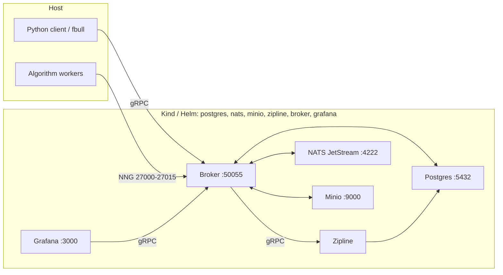
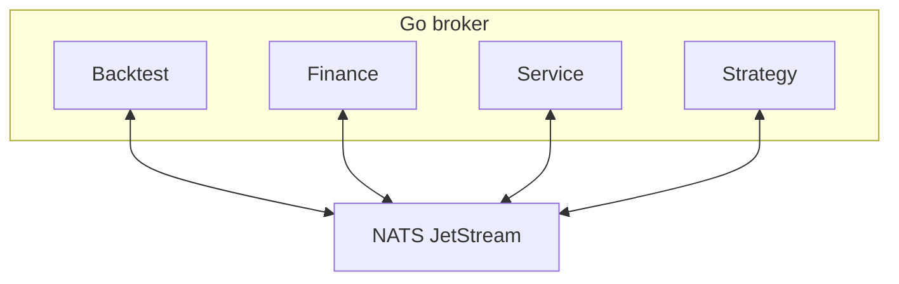

# Foreverbull

Foreverbull is a Go broker with a Python client for developing and backtesting trading algorithms. A backtest's `provider` chooses its bars: `yahoo` (default when omitted), `stooq` (daily GetOHLC only; Yahoo stays for asset, search, and index metadata), or `alpaca`. Bars are stored per provider. ETF universes are point-in-time membership from iShares as-of holdings (ISIN identity, not a static ticker list). Paper trading is off unless `TRADING_ENABLED` is true. That flag is a kill switch, not a broker. A deployment's backend is a trading profile name. 🔒️ Credentials live only in the profiles file, which the cluster mounts from Kubernetes Secret `foreverbull-trading`. Live trading is not supported.

The install path is Kubernetes: Kind locally via `fbenv`, Helm on a remote cluster. One chart deploys Postgres, NATS JetStream, Minio, Zipline, the broker, and Grafana.

## Requirements

- [Docker](https://docs.docker.com/get-docker/) (Kind node runtime; Testcontainers for tests)
- [Kind](https://kind.sigs.k8s.io/docs/user/quick-start/)
- [Helm](https://helm.sh/docs/intro/install/)
- [kubectl](https://kubernetes.io/docs/tasks/tools/)
- Python 3.12+ and [uv](https://docs.astral.sh/uv/)
- [Task](https://taskfile.dev/) (`go-task`)
- Go 1.27.3 (contributors; see `go.mod`)

This is not a Docker Compose / Docker-network stack. Tests still use Testcontainers on Docker; they do not run on Kind.

### Host resources

Give Docker at least 2 CPUs, 4 GB of memory and 30 GB of disk. On macOS and Windows that is the Docker Desktop VM allocation, not the machine's total.

- CPU and memory: the chart requests 275m CPU and 544Mi memory in total across the six workloads (`resources.*` in `deploy/helm/foreverbull/values.yaml`). Those are requests with no limits, so they are the floor for the pods to schedule. A backtest uses more, and Zipline and the strategy workers grow with the universe size and the date range.
- Disk: the chart's volumes request 17Gi (Postgres `8Gi`, Minio `8Gi`, NATS `1Gi`). Leave that free in Docker's storage, plus room for the images that `task build` creates and Kind loads into the node.
- Ports: `5432`, `4222`, `9000`, `50055`, `3000`, and `27000`–`27015` must be free on the host before `fbenv create`. See [Troubleshooting](#troubleshooting) when one is taken.

## Your first backtest

One copy-paste path from a fresh clone to printed execution results. Prerequisites are listed under [Requirements](#requirements) (Docker, Kind, Helm, uv, Task). Check [Host resources](#host-resources) before `task build` so Docker has enough CPU, memory, and disk. Commands after `task build` run from `client/`. Accept the cookiecutter defaults so the strategy lands at `simple_foreverbull/crossover.py`. Deeper options (remote clusters, strategy lifecycle) stay in [Quickstart](#quickstart) below. Stooq and Alpaca bars are opt-in via `--provider`; see [client/cli/README.md](client/cli/README.md). If a step fails, see [Troubleshooting](#troubleshooting).

```bash
# build :local images (and sync the Python workspace from the repo root)
task build

cd client
# sync the client workspace so fbull and fbenv are available
uv sync

# create the Kind cluster and Helm release with workloads stopped
VERSION=local uv run fbenv create
# start the six workloads
uv run fbenv start

# ingest the demo universe (Yahoo default)
uv run fbull backtest create --file ../examples/demo.yaml

# generate the simple crossover strategy (defaults → simple_foreverbull/)
uv run cookiecutter templates/simple

# run the strategy against the backtest; it ends with a results summary
uv run fbull backtest run demo simple_foreverbull/crossover.py
```

For charts, open the Grafana `Charts:` link the run prints (local Kind: port `3000`), or visit [http://localhost:3000](http://localhost:3000). Anonymous access is enabled (no login).

### Example: `backtest create` output

Progress lines use a spinner, then a checkmark when each step finishes. Symbols is the comma-separated enabled list (truncated here).

Example output:

```text
✔ Creating
✔ Downloading
✔ Ingesting
✔ Storing
                             Created Backtest
┏━━━━━━━━┳━━━━━━━━━━━━┳━━━━━━━━━━━━┳━━━━━━━━━━━━━━━━━━━━┳━━━━━━━━━━━┳━━━━━━━━━━┓
┃ Name   ┃ Start      ┃ End        ┃ Symbols            ┃ Benchmark ┃ Provider ┃
┡━━━━━━━━╇━━━━━━━━━━━━╇━━━━━━━━━━━━╇━━━━━━━━━━━━━━━━━━━━╇━━━━━━━━━━━╇━━━━━━━━━━┩
│ demo   │ 2023-01-01 │ 2023-12-31 │ AAPL,MSFT,AMZN,…   │ SPY       │ yahoo    │
└────────┴────────────┴────────────┴────────────────────┴───────────┴──────────┘
```

### Example: `backtest run` output

After the session and execution progress bars, the CLI prints a results summary for the whole run: total return next to the benchmark's return, Sharpe, Sortino, and max drawdown. When the backtest has no benchmark, or the run has no benchmark return, the Benchmark row says `not set` or `not available`. A ratio that is not defined yet (for example on a run of one day) prints as `-`. The `Details:` line is a paste-ready command with a short execution ID; the `Charts:` line is the Grafana dashboard. Numbers and IDs are example data:

```text
✔ Backtest finished: demo · 2023-01-01 → 2023-12-31 · provider: yahoo

  Return        +4.2%  Benchmark (SPY)  +3.1%
  Sharpe         1.35  Sortino           1.10
  Max drawdown  -6.8%

  Details: uv run fbull backtest execution 01234567
  Charts:  http://localhost:3000/d/ee9ep4jxtwkcgf?var-execution=01234567-89ab-cdef-0123-456789abcdef
```

### Example: `backtest execution` output

`fbull backtest execution <id>` takes the full execution ID or a unique prefix of it, such as the short ID from `Details:`. It prints an Execution summary (with Session), the Grafana link, then a `periods` table with Date, Portfolio, Alpha, Beta, Sharpe, and Sortino. Optional floats that are unset print as `-`. IDs and period rows are illustrative; a real run prints one row per period (truncated here):

```text
                                                      Execution
┏━━━━━━━━━━━━━━━━━━━━━━━━━━━━━━━━━━━━━━┳━━━━━━━━━━━┳━━━━━━━━━━━━━━━━━━━━━━━━━━━━━━━━━━━━━━┳━━━━━━━━━━━━┳━━━━━━━━━━━━┓
┃ ID                                   ┃ Backtest  ┃ Session                              ┃ Start      ┃ End        ┃
┡━━━━━━━━━━━━━━━━━━━━━━━━━━━━━━━━━━━━━━╇━━━━━━━━━━━╇━━━━━━━━━━━━━━━━━━━━━━━━━━━━━━━━━━━━━━╇━━━━━━━━━━━━╇━━━━━━━━━━━━┩
│ 01234567-89ab-cdef-0123-456789abcdef │ demo      │ fedcba98-7654-3210-fedc-ba9876543210 │ 2023-01-01 │ 2023-12-31 │
└──────────────────────────────────────┴───────────┴──────────────────────────────────────┴────────────┴────────────┘
Link: http://localhost:3000/d/ee9ep4jxtwkcgf?var-execution=01234567-89ab-cdef-0123-456789abcdef
                               periods
┏━━━━━━━━━━━━┳━━━━━━━━━━━━━━┳━━━━━━━━━┳━━━━━━━━━┳━━━━━━━━━┳━━━━━━━━━┓
┃ Date       ┃ Portfolio    ┃ Alpha   ┃ Beta    ┃ Sharpe  ┃ Sortino ┃
┡━━━━━━━━━━━━╇━━━━━━━━━━━━━━╇━━━━━━━━━╇━━━━━━━━━╇━━━━━━━━━╇━━━━━━━━━┩
│ 2023-01-03 │ 100000.00000 │ -       │ -       │ -       │ -       │
│ 2023-01-04 │ 100125.50000 │ 0.00120 │ 0.98000 │ 1.50000 │ 1.20000 │
│ 2023-12-29 │ 102450.25000 │ 0.04500 │ 0.95000 │ 1.25000 │ 1.10000 │
└────────────┴──────────────┴─────────┴─────────┴─────────┴─────────┘
```

Next: edit your strategy. Open `simple_foreverbull/crossover.py`, change a parameter (for example the short or long window lengths `10` and `30`), and run the same `fbull backtest run` command again.

For a real index universe, run `fbull backtest create` without `--file` and pick an iShares ETF; membership is point-in-time from historical holdings, not today's list.

## Quickstart

From a clone of this repository, build the `:local` images and sync the Python workspace (this installs the Kind/Helm `fbenv` in that workspace):

```bash
# repository root
task build
```

`task build` builds `lhjnilsson/foreverbull`, `lhjnilsson/zipline`, and `lhjnilsson/fb-grafana` at tag `local`, then runs `uv sync` in `client/`. It does not start the cluster.

Install the chart into a Kind cluster named `foreverbull` (namespace `foreverbull`):

```bash
cd client
VERSION=local uv run fbenv create
uv run fbenv start
uv run fbenv status
```

`fbenv create` installs the Kind cluster and the Helm release with the workloads stopped. `fbenv start` scales them to 1.

Without `VERSION`, `fbenv create` pulls `lhjnilsson/foreverbull`, `lhjnilsson/zipline`, and `lhjnilsson/fb-grafana` tagged with the version of the installed `foreverbull` Python client, never `latest`, so the client and the broker come from the same release. `VERSION=local` uses the `:local` images that `task build` made instead, and it is the only other value `fbenv` accepts. A checkout's client version is `0.0.0`, which has no published images, so the commands in this README use `VERSION=local`. On a local Kind cluster, when the images for your client version can't be pulled, `fbenv create` stops before it installs anything, names the image and tag, and tells you to build them locally. On a remote cluster there is no such promise: this host does not pull the images, the cluster's nodes do, so Helm can create the release first and the pods can then sit in `ImagePullBackOff` if a node cannot pull. Run `fbenv` through `uv run`. A `fbenv` already on `PATH` can be an older installer that starts Postgres, NATS, Minio, and Grafana as separate Docker containers. The workspace command is Kind and Helm.

`fbenv create` (cluster `local`, the default) creates the Kind cluster if needed, loads images, and `helm upgrade --install`s `deploy/helm/foreverbull` at `replicaCount=0`. Workloads: Postgres, NATS JetStream, Minio, Zipline, the Foreverbull broker, and Grafana.

Host ports (Kind `extraPortMappings`): Postgres `5432`, NATS `4222`, Minio `9000`, broker gRPC `50055`, broker HTTP `8080`, backtest NNG `27000`–`27015`, Grafana `3000`. Python `fbull` talks to `localhost:50055`. Override with `FOREVERBULL_BROKER_ADDRESS`.

Remote cluster (writes `.foreverbull/config.yaml`, then installs the same chart):

```bash
uv run fbenv use remote \
  --kubeconfig /path/to/kubeconfig \
  --context my-context \
  --namespace my-namespace \
  --broker-address host:50055
uv run fbenv create
uv run fbenv start
```

You can also `helm upgrade --install` against a kubeconfig directly. See [deploy/README.md](deploy/README.md).

Useful `fbenv` commands (from `client/` after `uv sync`):

```bash
uv run fbenv status
uv run fbenv start                 # scale deployments to 1
uv run fbenv stop                  # scale to 0
uv run fbenv stop --remove         # helm uninstall
uv run fbenv stop --remove --purge # uninstall; local also deletes the Kind cluster
```

### Ingest data and create a backtest

`fbull backtest create` is the ingest. It stores the universe, downloads daily bars for every symbol and the benchmark, and loads those bars into Zipline. The command prints progress for Creating, Downloading, Ingesting, and Storing, then prints the backtest. A symbol whose download fails is stored with `enabled: false` and left out of the Zipline bundle.

`fbull backtest create` reads optional `provider` and `profile` from the YAML file. `--provider` overrides the file. Omitting `provider` sends `yahoo`, which is what the server stores. Create prints `Using provider: <name> (<source>)`, where the source is `default`, `from --provider`, or `from <YAML file name>`, for example `Using provider: yahoo (default)` or `Using provider: stooq (from --provider)`. The printed backtest includes the provider. An unknown name exits non-zero and lists the valid providers (`yahoo`, `stooq`, `alpaca`). `profile` is a name in the trading profiles file, used only when `provider` is `alpaca`. It is ignored for `yahoo` and `stooq`. Do not put API keys, tokens, or passwords in the YAML, in `.foreverbull/config.yaml`, or in Helm values.

Bars for one symbol and day can exist once per provider. A Yahoo create does not replace Stooq rows, and the reverse is also true. The demo file is [examples/demo.yaml](examples/demo.yaml): name `demo`, benchmark `SPY`, and ten liquid US symbols (AAPL, MSFT, AMZN, GOOGL, JPM, JNJ, XOM, PG, KO, WMT). The sample window is 2023-01-01 through 2023-12-31. Edit those dates in the file before you create. The broker pod needs outbound HTTPS to the price host.

Commands below are from `client/` after `uv sync`, with the platform already running. Yahoo is the default path here. Stooq and Alpaca bars are opt-in with `--provider` (or `provider` in the YAML); see [client/cli/README.md](client/cli/README.md) for those recipes and for Stooq's bot-check note.

#### Yahoo (default)

Yahoo is the default. Leave `provider` out of the file, or pass `--provider yahoo`. No API key is required. Yahoo serves both asset lookup and daily bars.

```bash
cd client
uv run fbull backtest create --file ../examples/demo.yaml
uv run fbull backtest get demo
```

Creating the same name twice fails. `uv run fbull backtest delete demo` removes the backtest record. Stored bars stay in Postgres under the provider they were downloaded with.

Without `--file`, `fbull backtest create` prompts for a name, an iShares ETF, and dates. `fbull backtest etfs` prints the funds that prompt can use (name, benchmark, inception). The known fund is `iShares S&P 100` (benchmark `OEF`, inception 2000-10-23). An unknown name stops before any download. That path builds point-in-time membership from iShares month-end holdings. A month-end with no holdings file keeps the latest published listing on or before that date, or the earliest published listing after it when nothing earlier exists. You do not have to pick a range that includes a published date; the create fails only when the whole range has no holdings file. See [pkg/backtest/universe.md](pkg/backtest/universe.md).

The next step generates a strategy file to run against this backtest.

### Strategy projects

Once the platform is running, generate a starter algorithm. Cookiecutter is a client workspace dev dependency.

From this clone:

```bash
cd client
uv run cookiecutter templates/simple      # no TA-Lib
# or
uv run cookiecutter templates/advanced    # requires TA-Lib
```

From GitHub (picks the same two templates via the root `cookiecutter.json`):

```bash
cookiecutter https://github.com/lhjnilsson/foreverbull.git
```

Cookiecutter writes the project into the current directory. The generated directory is the project slug. From `client/`, if you kept the default project name, the simple strategy file is `simple_foreverbull/crossover.py`.

Run that strategy against the `demo` backtest from the ingest step, still from `client/` (path assumes the default project name):

```bash
uv run fbull backtest run demo simple_foreverbull/crossover.py
```

On success it prints a results summary (return, benchmark return, Sharpe, Sortino, max drawdown), a `Details:` command with a short execution ID, and a Grafana `Charts:` link for that execution. For the advanced template (needs TA-Lib), use `advanced_foreverbull/macd.py` the same way if you kept its default project name.

The generated project README shows `fbull backtest create` and `fbull backtest run` for local-file hacking. When the algorithm is a READY service image, use `fbull strategy` instead of a one-shot live run.

### Strategy lifecycle

A strategy is a lifecycle: register it, pin a READY service image as a version, experiment that version on any number of existing backtests, then paper deploy. The `--backtest` value is the name from `fbull backtest create` (the demo quickstart above stores `demo`). The same version is runnable against different universes via separate `--backtest` experiments. Live is off. Contracts: [pkg/strategy/implementation.md](pkg/strategy/implementation.md), [pkg/strategy/research-to-paper.md](pkg/strategy/research-to-paper.md).

```bash
uv run fbull strategy create mean-rev
uv run fbull strategy version add mean-rev --image lhjnilsson/my-algo:local
uv run fbull strategy experiment mean-rev --backtest spy
uv run fbull strategy experiment mean-rev --backtest eu-small
uv run fbull strategy experiments mean-rev
uv run fbull strategy deploy mean-rev --mode paper --dry-run
uv run fbull strategy deploy mean-rev --mode paper --no-dry-run --backend alpaca-paper --yes
uv run fbull strategy status mean-rev
uv run fbull strategy stop mean-rev
```

Default `deploy` is paper + `--dry-run` (Process, no PlaceOrder). Dry-run may omit `--backend`. Paper PlaceOrder needs `--mode paper --no-dry-run --backend <profile> --yes` (or `--confirm`) and `TRADING_ENABLED=true`. `--backend` is a profile name, not a key. `--mode live` is refused.

### Trading profiles

Paper orders use a profile name. The broker reads `TRADING_PROFILES_FILE`. In the cluster that path is `/etc/foreverbull/profiles.yaml`, mounted from Secret `foreverbull-trading`, key `profiles.yaml`. The Secret is optional. When the file is absent and `TRADING_ENABLED` is false, the process starts with an empty registry. When `TRADING_ENABLED` is true, a missing or invalid file is a startup error.

On local Kind, if `.foreverbull/trading-profiles.yaml` exists, `fbenv` applies it as that Secret before `helm upgrade` and does not print the file. `.foreverbull` is gitignored. The committed example is [deploy/trading-profiles.example.yaml](deploy/trading-profiles.example.yaml). Its credential fields are empty. Do not commit keys. The file has no `baseUrl` field and no live URL switch. Two deployments that name the same profile share that account. Contract: [pkg/finance/profiles.md](pkg/finance/profiles.md).

## Troubleshooting

Commands below are from `client/` after `uv sync`. The local Kind context is `kind-foreverbull` and the namespace is `foreverbull`.

### A host port is already in use

The Kind node publishes `5432`, `4222`, `9000`, `50055`, `3000`, and `27000`–`27015` on the host. `fbenv create` and `fbenv start` check those ports before they change anything. When another process holds one, they stop, name the port and the service it is for, and leave the cluster untouched:

```
✖ Port 5432 (Postgres) is already in use.
A local Postgres is probably running. Stop it (for example `brew services stop postgresql`) and run this again.
Nothing was changed.
```

Find the process that holds the port and stop it, then run the same command again:

```bash
lsof -i :5432                        # macOS and Linux
docker ps --filter publish=5432      # another container
VERSION=local uv run fbenv create
```

`fbenv` does not move a busy port. The ports are fixed when the cluster is created (`extraPortMappings` in `deploy/kind/cluster.yaml`), and the Python client dials `localhost:50055`. Once the `foreverbull` cluster exists, `uv run fbenv status` reports the ports as held by the cluster rather than as a conflict. To change the published ports, see [Recreate the Kind cluster](#recreate-the-kind-cluster).

### Another host check fails

Before they change anything, `fbenv create` and `fbenv start` also check that `kind`, `helm`, `kubectl`, and `docker` are installed, that Docker is running, and that Docker has at least the 4 GB of memory listed under [Host resources](#host-resources). A remote cluster needs only `helm` and `kubectl`. The first failed check stops the command with a fix hint. `uv run fbenv status` lists every check with pass or fail, with or without a cluster.

When an image download fails, `fbenv create` and `fbenv update` stop with one line that names the image and the likely cause (no network, Docker is not running, the registry refused, the repository does not exist, the tag does not exist, or the image has no build for this machine), then a fix hint. Add `--verbose` to see Docker's own error:

```
✖ Couldn't download the Foreverbull image lhjnilsson/foreverbull:0.1.0: Docker could not reach the registry.
Check your internet connection and run `fbenv create` again.
Nothing was changed.
Run `fbenv create --verbose` to see Docker's error.
```

When no images are published for your client version, the hint says so and tells you to build them with `task build` and run `VERSION=local uv run fbenv create`. When the repository itself does not exist on the registry (for example `lhjnilsson/fb-grafana` before it is first published), the line reads `The Foreverbull image lhjnilsson/fb-grafana:<version> isn't published yet, so this install can't start.` and the checkout build with `task build` / `VERSION=local` follows only as a contributor alternative; only a transient or rate-limited registry failure says to wait a few minutes and retry. A `0.0.0` client is named as a development install and pointed straight at `VERSION=local`. When the image has no build for your machine's architecture, the hint names the architecture and gives the same local-build fix, or asks you to report it at https://github.com/lhjnilsson/foreverbull/issues. Any `VERSION` other than `local` stops `fbenv create` and `fbenv update` before they change anything. The stops-before-anything-changes promise for image pulls is local-Kind only: on a remote cluster, Helm can create or update the release first and the pods can then fail to pull (`ImagePullBackOff`), because the remote nodes pull the images, not this host.

### `fbull backtest create` can't load data

When the data service fails to load prices into a new backtest, `fbull backtest create` removes the half-created backtest and stops with one line. A missing database driver in the Zipline image reads:

```
✖ Couldn't load data for backtest 'demo': the data service is missing its database driver (psycopg). This is a bug in the Foreverbull install, not in your strategy or settings. Nothing was saved, so run `fbull backtest create` again once it's fixed.
```

When the broker can't reach the data service, or the data service can't reach Postgres, the line reads:

```
✖ Couldn't load data for backtest 'demo': Foreverbull's data service isn't reachable. Run `fbenv status` to check it's running. Nothing was saved, so run `fbull backtest create` again after that.
```

Any other failure reads `the data service failed while ingesting prices.` The default line never includes the exception text. Add `--verbose` (`fbull --verbose backtest create …`) to print the underlying exception on a `Details:` line. For the "isn't reachable" line, it also names the hop that failed: the broker to the Zipline pod, or the Zipline pod to Postgres. The database password is shown as `***` there, in the broker log and in the Zipline log. If the backtest couldn't be removed, the line says so and asks you to run `fbull backtest delete <name>` before you create it again.

### Pods do not start

`fbenv start` waits up to 120 seconds for the six deployments. `FBENV_READY_TIMEOUT` sets that wait in whole seconds. When that times out it prints `Timed out waiting for healthy` followed by the deployment and pod table. Check which pod is not ready with `uv run fbenv status`, then apply the matching fix:

- `ErrImagePull` or `ImagePullBackOff` on `foreverbull`, `zipline`, or `grafana`: the `:local` image is not in the Kind node. Build it with `task build` from the repository root, then load it and upgrade with `VERSION=local uv run fbenv update`.
- `Pending` with `Insufficient cpu` or `Insufficient memory` in the `describe` events (see More detail below): Docker does not have the resources listed under [Host resources](#host-resources). Raise the Docker allocation, then run `uv run fbenv start` again.
- `CrashLoopBackOff`: the container starts and exits. Its log says why. Add `--previous` to see the run before the restart. When the broker is the one restarting, `fbenv start` and `uv run fbenv status` start with a sentence that says what to do (for example `The broker can't reach its database.`), then print the broker's log line.

More detail:

```bash
kubectl --context kind-foreverbull -n foreverbull get pods
kubectl --context kind-foreverbull -n foreverbull describe pod <pod-name>
kubectl --context kind-foreverbull -n foreverbull logs deploy/<workload>
```

`<workload>` is one of `postgres`, `nats`, `minio`, `zipline`, `foreverbull`, or `grafana`.

### Price downloads fail

`fbull backtest create` downloads bars from inside the broker pod, so the pod needs outbound HTTPS to the price host. A symbol whose download fails is stored with `enabled: false` and left out of the Zipline bundle. The create itself still finishes, so check the printed backtest for disabled symbols.

- Read the reason in the broker log: `kubectl --context kind-foreverbull -n foreverbull logs deploy/foreverbull`.
- When many symbols fail at once, the price host is usually throttling the requests. Wait, delete the backtest with `uv run fbull backtest delete <name>`, and create it again.
- When the connection to the price service or the broker breaks during create, the command stops with one line that says nothing was changed and to run the same create again. The backtest is removed, so the same name works again. Bars that were already downloaded stay. If the backtest couldn't be removed, the line says so; delete it with `uv run fbull backtest delete <name>` before you retry.

### Recreate the Kind cluster

Recreate the cluster when it is in a state that `fbenv update` does not fix, or to change the published ports. It also deletes the `.foreverbull` directory except `config.yaml`.

> **Warning:** Purging deletes the Kind cluster and its volumes, so every stored backtest, bar, and result is gone.

```bash
uv run fbenv stop --remove --purge
VERSION=local uv run fbenv create
uv run fbenv start
uv run fbenv status
```

Then create your backtests again with `fbull backtest create`.

## Architecture

The Python client and `fbull` call the broker over gRPC. Inside the broker process, Backtest, Finance, Service, and Strategy domains publish and subscribe on NATS JetStream. During a backtest, Python workers (host processes or extra Kubernetes pods) attach to the broker over NNG on ports `27000`–`27015`. Zipline is a separate gRPC engine pod. Grafana reads the broker through a custom datasource. Persistence is cluster PVCs, not host binds under `.foreverbull`. The broker does not mount `/var/run/docker.sock`; extra worker pods use the in-cluster Kubernetes API.



### Domains

Go domains live under `pkg/`. The server in `cmd/server` registers Backtest, Finance, Service, and Strategy.



- **Backtest**: Creates backtests and sessions, ingests data, and runs Zipline simulations. ETF create is point-in-time membership from iShares as-of holdings (ISIN identity, not a static ticker list). See [pkg/backtest/universe.md](pkg/backtest/universe.md).
- **Finance**: Market data is chosen per backtest (`provider` `yahoo`, `stooq`, or `alpaca`). Stooq is daily GetOHLC only; Yahoo stays for search, `GetAsset`, and `GetIndex`. Alpaca bars use a profile from the profiles file. `TRADING_ENABLED` defaults to `false` and is the kill switch, not a provider. Credentials live only in that file, mounted from Secret `foreverbull-trading`. Live trading is not supported. Four paper adapters (`alpaca`, `saxo`, `ibkr`, and `ig`) sit behind `supplier.Trading`. Two deployments that name the same profile share that account. Live deploy is off.
- **Service**: Starts and stops algorithm-worker pods through the Kubernetes container runtime (`internal/container`).
- **Strategy**: Lifecycle for a registered algorithm: versions, experiments on existing backtests (period stats on list/get), paper dry-run or confirmed paper PlaceOrder. One version can run on many universes (`--backtest spy` vs `--backtest eu-small`). Live is off. See [pkg/strategy/implementation.md](pkg/strategy/implementation.md) and [pkg/strategy/research-to-paper.md](pkg/strategy/research-to-paper.md).

## Development

The broker is Go (`cmd/server`, `pkg/`, `internal/`). The Python workspace is `client/` (`foreverbull`, `foreverbull-cli`, `foreverbull-zipline`, `foreverbull-testing`). See [client/README.md](client/README.md) and [AGENTS.md](AGENTS.md). CLI details: [client/cli/README.md](client/cli/README.md).

Install Task to run the root `taskfile.yaml` (it includes `client/taskfile.yaml` and `grafana/taskfile.yaml`).

```bash
task build                    # local images + uv sync (client/)
task kind:create              # Kind cluster only
task kind:load                # load :local images into Kind
task helm:install             # helm upgrade --install into Kind

task test:unit                # Go unit tests (Backtest, Finance, Service, Strategy)
task backtest:test:unit
task finance:test:unit
task service:test:unit
task strategy:test:unit
task backtest:test:integration  # needs the local Zipline image

task client:test              # Python unit tests (uv run pytest from client/)
task test:integration         # client end-to-end; builds images first

task build:docker             # lhjnilsson/foreverbull:local
task client:docker:zipline    # lhjnilsson/zipline:local
task grafana:build:docker     # lhjnilsson/fb-grafana:local

task proto                    # regenerate Go + Python protobuf from proto/ (Buf)
task mock:generate            # mockery
task client:lint              # uvx ruff@0.17.0 check
task client:format            # uvx ruff@0.17.0 format
```

Go and Python unit tests start Postgres/NATS/Minio with Testcontainers. Have Docker running. They are not live-trading tests.
