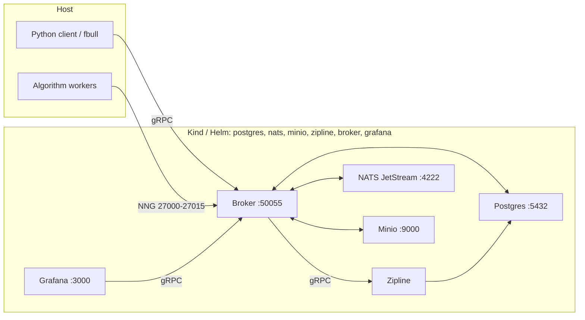
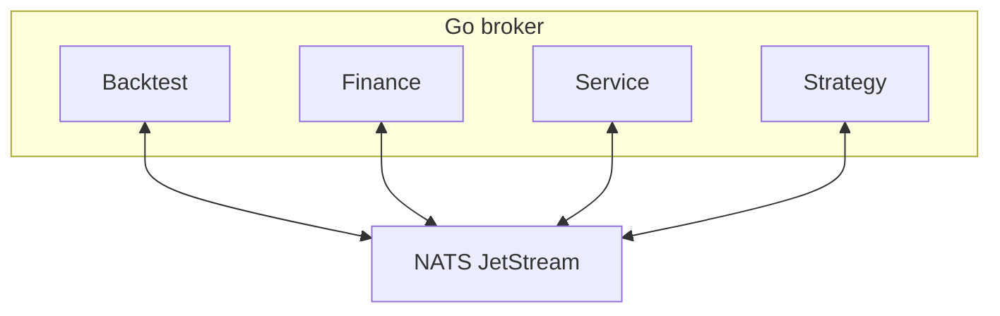

# Foreverbull

Foreverbull is a Go broker with a Python client for developing and backtesting trading algorithms. Market data defaults to Yahoo Finance. `MARKET_DATA_PROVIDER=stooq` is daily GetOHLC only; Yahoo remains for asset/search/index metadata. ETF universes are point-in-time membership from iShares as-of holdings (ISIN identity, not a static ticker list). Alpaca paper trading exists in the Finance domain but is off unless you set `TRADING_ENABLED` (live trading is not supported; do not enable it from this README).

The install path is Kubernetes: Kind locally via `fbenv`, Helm on a remote cluster. One chart deploys Postgres, NATS JetStream, Minio, Zipline, the broker, and Grafana.

## Requirements

- [Docker](https://docs.docker.com/get-docker/) (Kind node runtime; Testcontainers for tests)
- [Kind](https://kind.sigs.k8s.io/docs/user/quick-start/)
- [Helm](https://helm.sh/docs/intro/install/)
- [kubectl](https://kubernetes.io/docs/tasks/tools/)
- Python 3.12+ and [uv](https://docs.astral.sh/uv/)
- [Task](https://taskfile.dev/) (`go-task`)
- Go 1.24 (contributors; see `go.mod`)

This is not a Docker Compose / Docker-network stack. Tests still use Testcontainers on Docker; they do not run on Kind.

## Quickstart

From a clone of this repository, build the `:local` images and sync the Python workspace (this installs the Kind/Helm `fbenv` in that workspace):

```bash
# repository root
task build
```

`task build` builds `lhjnilsson/foreverbull`, `lhjnilsson/zipline`, and `lhjnilsson/fb-grafana` at tag `local`, then runs `uv sync` in `client/`. It does not start the cluster.

Install the chart into a Kind cluster named `foreverbull` (namespace `foreverbull`):

```bash
cd client
VERSION=local uv run fbenv create
uv run fbenv start
uv run fbenv status
```

`fbenv create` installs the Kind cluster and the Helm release with the workloads stopped. `fbenv start` scales them to 1. Run `fbenv` through `uv run`. A `fbenv` already on `PATH` can be an older installer that starts Postgres, NATS, Minio, and Grafana as separate Docker containers. The workspace command is Kind and Helm.

`fbenv create` (cluster `local`, the default) creates the Kind cluster if needed, loads images, and `helm upgrade --install`s `deploy/helm/foreverbull` at `replicaCount=0`. Workloads: Postgres, NATS JetStream, Minio, Zipline, the Foreverbull broker, and Grafana.

Host ports (Kind `extraPortMappings`): Postgres `5432`, NATS `4222`, Minio `9000`, broker gRPC `50055`, backtest NNG `27000`–`27015`, Grafana `3000`. Python `fbull` talks to `localhost:50055`. Override with `FOREVERBULL_BROKER_ADDRESS`.

Remote cluster (writes `.foreverbull/config.yaml`, then installs the same chart):

```bash
uv run fbenv use remote \
  --kubeconfig /path/to/kubeconfig \
  --context my-context \
  --namespace my-namespace \
  --broker-address host:50055
uv run fbenv create
uv run fbenv start
```

You can also `helm upgrade --install` against a kubeconfig directly. See [deploy/README.md](deploy/README.md).

Useful `fbenv` commands (from `client/` after `uv sync`):

```bash
uv run fbenv status
uv run fbenv start                 # scale deployments to 1
uv run fbenv stop                  # scale to 0
uv run fbenv stop --remove         # helm uninstall
uv run fbenv stop --remove --purge # uninstall; local also deletes the Kind cluster
```

### Ingest data and create a backtest

`fbull backtest create` is the ingest. It stores the universe, downloads daily bars for every symbol and the benchmark, and loads those bars into Zipline. The command prints progress for Creating, Downloading, Ingesting, and Storing, then prints the backtest. A symbol whose download fails is stored with `enabled: false` and left out of the Zipline bundle.

The broker reads `MARKET_DATA_PROVIDER` when it starts. Set that variable before create. Bars already stored for a symbol and day are kept, so pick one price source for a database. Both recipes below use the same Nasdaq-100 file, [examples/nasdaq100.yaml](examples/nasdaq100.yaml): name `nasdaq100`, benchmark `QQQ`, and a fixed list of 101 constituents (both `GOOG` and `GOOGL`). The sample window is 2023-01-01 through 2023-03-31. Edit those dates in the file before you create. The broker pod needs outbound HTTPS to the price host. Downloading the full list takes a few minutes.

Commands below are from `client/` after `uv sync`, with the platform already running.

#### Yahoo

Yahoo is the default. With `MARKET_DATA_PROVIDER` unset, or set to `yahoo`, asset lookup and daily bars both come from Yahoo.

```bash
cd client
uv run fbull backtest create --file ../examples/nasdaq100.yaml
uv run fbull backtest get nasdaq100
```

#### Stooq

`MARKET_DATA_PROVIDER=stooq` loads daily bars from Stooq. Asset lookup still uses Yahoo, and that lookup is what marks a symbol enabled. On the local Kind cluster the kubectl context is `kind-foreverbull`. On a remote cluster, use that cluster's context and namespace.

Set Stooq before the first create for these symbols:

```bash
kubectl --context kind-foreverbull -n foreverbull set env deployment/foreverbull MARKET_DATA_PROVIDER=stooq
kubectl --context kind-foreverbull -n foreverbull rollout status deployment/foreverbull

cd client
uv run fbull backtest create --file ../examples/nasdaq100.yaml
uv run fbull backtest get nasdaq100
```

If this database already has bars for these symbols, replace the local cluster first. `fbenv stop --remove --purge` deletes the Kind cluster. Then install again, set Stooq, and create:

```bash
cd client
uv run fbenv stop --remove --purge
VERSION=local uv run fbenv create
kubectl --context kind-foreverbull -n foreverbull set env deployment/foreverbull MARKET_DATA_PROVIDER=stooq
uv run fbenv start
uv run fbull backtest create --file ../examples/nasdaq100.yaml
```

`fbenv create` and `fbenv update` reinstall the chart. The chart leaves `MARKET_DATA_PROVIDER` unset, so the broker comes back on Yahoo. Run the `kubectl set env` command again after either of those when you still want Stooq.

To put the broker back on Yahoo:

```bash
kubectl --context kind-foreverbull -n foreverbull set env deployment/foreverbull MARKET_DATA_PROVIDER=yahoo
kubectl --context kind-foreverbull -n foreverbull rollout status deployment/foreverbull
```

Creating the same name twice fails. `uv run fbull backtest delete nasdaq100` removes the backtest record. Stored bars stay in Postgres until you replace the database.

Without `--file`, `fbull backtest create` prompts for a name, an iShares ETF, and dates. `fbull backtest etfs` prints the funds that prompt can use (name, benchmark, inception). The known fund is `iShares S&P 100` (benchmark `OEF`, inception 2000-10-23). An unknown name stops before any download. That path builds point-in-time membership from iShares month-end holdings. A month-end with no holdings file keeps the latest published listing on or before that date, or the earliest published listing after it when nothing earlier exists. You do not have to pick a range that includes a published date; the create fails only when the whole range has no holdings file. See [pkg/backtest/universe.md](pkg/backtest/universe.md).

After create, run a strategy file against the ingested backtest:

```bash
uv run fbull backtest run nasdaq100 path/to/strategy.py
```

### Strategy projects

Once the platform is running, generate a starter algorithm. Cookiecutter is a client workspace dev dependency.

From this clone:

```bash
cd client
uv run cookiecutter templates/simple      # no TA-Lib
# or
uv run cookiecutter templates/advanced    # requires TA-Lib
```

The generated directory is the project slug (`simple_foreverbull` or `advanced_foreverbull` with the defaults). From that directory, run `fbull backtest run demo <slug>/crossover.py` (simple) or `<slug>/macd.py` (advanced).

From GitHub (picks the same two templates via the root `cookiecutter.json`):

```bash
cookiecutter https://github.com/lhjnilsson/foreverbull.git
```

The generated project README shows `fbull backtest create` and `fbull backtest run` for local-file hacking. When the algorithm is a READY service image, use `fbull strategy` instead of a one-shot live run.

### Strategy lifecycle

A strategy is a lifecycle: register it, pin a READY service image as a version, experiment that version on any number of existing backtests, then paper deploy. The `--backtest` value is the name from `fbull backtest create` (the Nasdaq-100 quickstart above stores `nasdaq100`). The same version is runnable against different universes via separate `--backtest` experiments. Live is off. Contracts: [pkg/strategy/implementation.md](pkg/strategy/implementation.md), [pkg/strategy/research-to-paper.md](pkg/strategy/research-to-paper.md).

```bash
uv run fbull strategy create mean-rev
uv run fbull strategy version add mean-rev --image lhjnilsson/my-algo:local
uv run fbull strategy experiment mean-rev --backtest spy
uv run fbull strategy experiment mean-rev --backtest eu-small
uv run fbull strategy experiments mean-rev
uv run fbull strategy deploy mean-rev --mode paper --dry-run
uv run fbull strategy deploy mean-rev --mode paper --no-dry-run --yes
uv run fbull strategy status mean-rev
uv run fbull strategy stop mean-rev
```

Default `deploy` is paper + `--dry-run` (Process, no PlaceOrder). Paper PlaceOrder: `--mode paper --no-dry-run --yes` (or `--confirm`) with `TRADING_ENABLED`. `--mode live` is refused.

## Architecture

The Python client and `fbull` call the broker over gRPC. Inside the broker process, Backtest, Finance, Service, and Strategy domains publish and subscribe on NATS JetStream. During a backtest, Python workers (host processes or extra Kubernetes pods) attach to the broker over NNG on ports `27000`–`27015`. Zipline is a separate gRPC engine pod. Grafana reads the broker through a custom datasource. Persistence is cluster PVCs, not host binds under `.foreverbull`. The broker does not mount `/var/run/docker.sock`; extra worker pods use the in-cluster Kubernetes API.



### Domains

Go domains live under `pkg/`. The server in `cmd/server` registers Backtest, Finance, Service, and Strategy.



- **Backtest**: Creates backtests and sessions, ingests data, and runs Zipline simulations. ETF create is point-in-time membership from iShares as-of holdings (ISIN identity, not a static ticker list). See [pkg/backtest/universe.md](pkg/backtest/universe.md).
- **Finance**: Market data (Yahoo by default; `stooq` is daily GetOHLC only with Yahoo metadata; `alpaca` is an alternate provider) and a trading API. Alpaca paper trading is compiled in but `TRADING_ENABLED` defaults to `false`. Live trading is not supported.
- **Service**: Starts and stops algorithm-worker pods through the Kubernetes container runtime (`internal/container`).
- **Strategy**: Lifecycle for a registered algorithm: versions, experiments on existing backtests (period stats on list/get), paper dry-run or confirmed paper PlaceOrder. One version can run on many universes (`--backtest spy` vs `--backtest eu-small`). Live is off. See [pkg/strategy/implementation.md](pkg/strategy/implementation.md) and [pkg/strategy/research-to-paper.md](pkg/strategy/research-to-paper.md).

## Development

The broker is Go (`cmd/server`, `pkg/`, `internal/`). The Python workspace is `client/` (`foreverbull`, `foreverbull-cli`, `foreverbull-zipline`, `foreverbull-testing`). See [client/README.md](client/README.md) and [AGENTS.md](AGENTS.md). CLI details: [client/cli/README.md](client/cli/README.md).

Install Task to run the root `taskfile.yaml` (it includes `client/taskfile.yaml` and `grafana/taskfile.yaml`).

```bash
task build                    # local images + uv sync (client/)
task kind:create              # Kind cluster only
task kind:load                # load :local images into Kind
task helm:install             # helm upgrade --install into Kind

task test:unit                # Go unit tests (Backtest, Finance, Service, Strategy)
task backtest:test:unit
task finance:test:unit
task service:test:unit
task strategy:test:unit
task backtest:test:integration  # needs the local Zipline image

task client:test              # Python unit tests (uv run pytest from client/)
task test:integration         # client end-to-end; builds images first

task build:docker             # lhjnilsson/foreverbull:local
task client:docker:zipline    # lhjnilsson/zipline:local
task grafana:build:docker     # lhjnilsson/fb-grafana:local

task proto                    # regenerate Go + Python protobuf from proto/ (Buf)
task mock:generate            # mockery
task client:lint              # ruff check
task client:format            # ruff format
```

Go and Python unit tests start Postgres/NATS/Minio with Testcontainers. Have Docker running. They are not live-trading tests.
