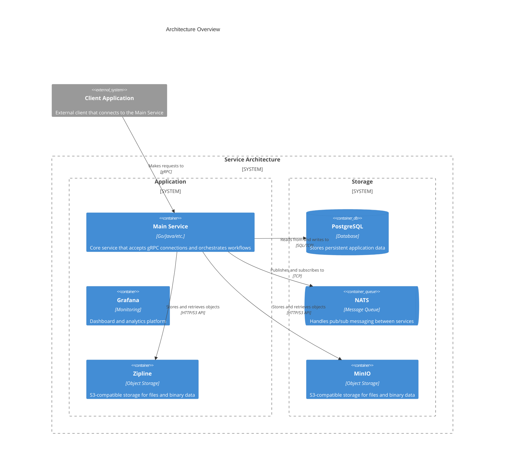

foreverbull
===================

Event driven backtesting and trading platform designed for continuous integration and delivery of algorithmic trading strategies.

Enabled by the [Zipline](https://github.com/stefan-jansen/zipline-reloaded) open source framework.

Currently support [Alpaca](https://alpaca.markets/) for market data and live trading.

# Getting Started

## Requirements

- Docker
- Python 3.10+
- Cookiecutter

## Quickstart

```bash
cookiecutter https://github.com/lhjnilsson/foreverbull.git
```

```bash
fbenv create
```

```bash
fbull backtest run DEMO
```

# Architecture



# Development Setup
