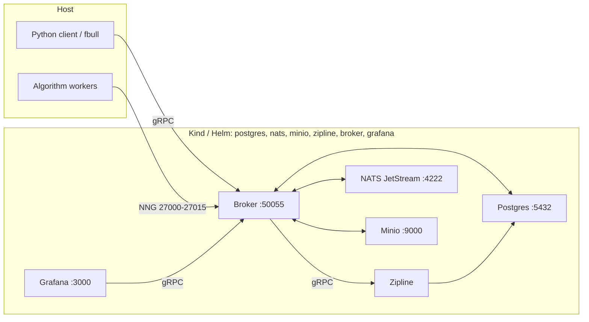
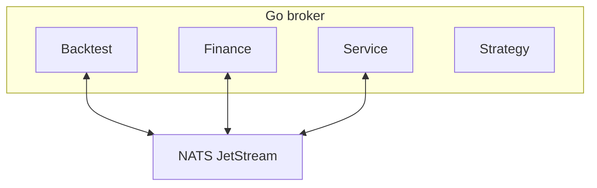

# Foreverbull

Foreverbull is a Go broker with a Python client for developing and backtesting trading algorithms. Market data defaults to Yahoo Finance. ETF universes can be built from the iShares API. Alpaca trading exists in the Finance domain but is off unless you set `TRADING_ENABLED` (do not enable live trading from this README).

The install path is Kubernetes: Kind locally via `fbenv`, Helm on a remote cluster. One chart deploys Postgres, NATS JetStream, Minio, Zipline, the broker, and Grafana.

## Requirements

- [Docker](https://docs.docker.com/get-docker/) (Kind node runtime; Testcontainers for tests)
- [Kind](https://kind.sigs.k8s.io/docs/user/quick-start/)
- [Helm](https://helm.sh/docs/intro/install/)
- [kubectl](https://kubernetes.io/docs/tasks/tools/)
- Python 3.12+ and [uv](https://docs.astral.sh/uv/)
- [Task](https://taskfile.dev/) (`go-task`)
- Go 1.24 (contributors; see `go.mod`)

This is not a Docker Compose / Docker-network stack. Tests still use Testcontainers on Docker; they do not run on Kind.

## Quickstart

From a clone of this repository:

```bash
cd client
uv sync
```

Build `:local` images and install the chart into a Kind cluster named `foreverbull` (namespace `foreverbull`):

```bash
# from the repository root
task env
```

`task env` builds `lhjnilsson/foreverbull`, `lhjnilsson/zipline`, and `lhjnilsson/fb-grafana` at tag `local`, then from `client/` runs `fbenv stop --remove` and `VERSION=local uv run fbenv create`.

If those images already exist on the Docker host:

```bash
cd client
VERSION=local uv run fbenv create
uv run fbenv status
```

`fbenv create` (cluster `local`, the default) creates the Kind cluster if needed, loads images, and `helm upgrade --install`s `deploy/helm/foreverbull`. Workloads: Postgres, NATS JetStream, Minio, Zipline, the Foreverbull broker, and Grafana.

Host ports (Kind `extraPortMappings`): Postgres `5432`, NATS `4222`, Minio `9000`, broker gRPC `50055`, backtest NNG `27000`–`27015`, Grafana `3000`. Python `fbull` talks to `localhost:50055`. Override with `FOREVERBULL_BROKER_ADDRESS`.

Remote cluster (writes `.foreverbull/config.yaml`, then installs the same chart):

```bash
uv run fbenv use remote \
  --kubeconfig /path/to/kubeconfig \
  --context my-context \
  --namespace my-namespace \
  --broker-address host:50055
uv run fbenv create
```

You can also `helm upgrade --install` against a kubeconfig directly. See [deploy/README.md](deploy/README.md).

Useful `fbenv` commands (from `client/` after `uv sync`):

```bash
uv run fbenv status
uv run fbenv start                 # scale deployments to 1
uv run fbenv stop                  # scale to 0
uv run fbenv stop --remove         # helm uninstall
uv run fbenv stop --remove --purge # uninstall; local also deletes the Kind cluster
```

### Strategy projects

Once the platform is running, generate a starter algorithm. Cookiecutter is a client workspace dev dependency.

From this clone:

```bash
cd client
uv run cookiecutter templates/simple      # no TA-Lib
# or
uv run cookiecutter templates/advanced    # requires TA-Lib
```

From GitHub (picks the same two templates via the root `cookiecutter.json`):

```bash
cookiecutter https://github.com/lhjnilsson/foreverbull.git
```

The generated project README shows `fbull backtest create` and `fbull backtest run`. `fbull` is the Python CLI against a running broker (`uv run fbull --help`).

## Architecture

The Python client and `fbull` call the broker over gRPC. Inside the broker process, Backtest, Finance, and Service domains publish and subscribe on NATS JetStream. During a backtest, Python workers (host processes or extra Kubernetes pods) attach to the broker over NNG on ports `27000`–`27015`. Zipline is a separate gRPC engine pod. Grafana reads the broker through a custom datasource. Persistence is cluster PVCs, not host binds under `.foreverbull`. The broker does not mount `/var/run/docker.sock`; extra worker pods use the in-cluster Kubernetes API.



### Domains

Go domains live under `pkg/`. The server in `cmd/server` registers Backtest, Finance, and Service. Strategy is not wired.



- **Backtest**: Creates backtests and sessions, ingests data, and runs Zipline simulations. Can seed a universe from iShares ETF holdings.
- **Finance**: Market data (Yahoo by default; Alpaca is an alternate provider) and a trading API. Alpaca live/paper trading is compiled in but `TRADING_ENABLED` defaults to `false`.
- **Service**: Starts and stops algorithm-worker pods through the Kubernetes container runtime (`internal/container`).
- **Strategy**: Quarantined stub. `pkg/strategy.Module` is empty; `RunStrategy` returns unimplemented and is not registered on the gRPC server.

## Development

The broker is Go (`cmd/server`, `pkg/`, `internal/`). The Python workspace is `client/` (`foreverbull`, `foreverbull-cli`, `foreverbull-zipline`, `foreverbull-testing`). See [client/README.md](client/README.md) and [AGENTS.md](AGENTS.md). CLI details: [client/cli/README.md](client/cli/README.md).

Install Task to run the root `taskfile.yaml` (it includes `client/taskfile.yaml` and `grafana/taskfile.yaml`).

```bash
task env                      # local images + Kind + Helm
task kind:create              # Kind cluster only
task kind:load                # load :local images into Kind
task helm:install             # helm upgrade --install into Kind

task test:unit                # Go unit tests (Backtest, Finance, Service, Strategy)
task backtest:test:unit
task finance:test:unit
task service:test:unit
task strategy:test:unit
task backtest:test:integration  # needs the local Zipline image

task client:test              # Python unit tests (uv run pytest from client/)
task test:integration         # client end-to-end; builds images first

task build:docker             # lhjnilsson/foreverbull:local
task client:docker:zipline    # lhjnilsson/zipline:local
task grafana:build:docker     # lhjnilsson/fb-grafana:local

task proto                    # regenerate Go + Python protobuf from proto/
task mock:generate            # mockery
task client:lint              # ruff check
task client:format            # ruff format
```

Go and Python unit tests start Postgres/NATS/Minio with Testcontainers. Have Docker running. They are not live-trading tests.
