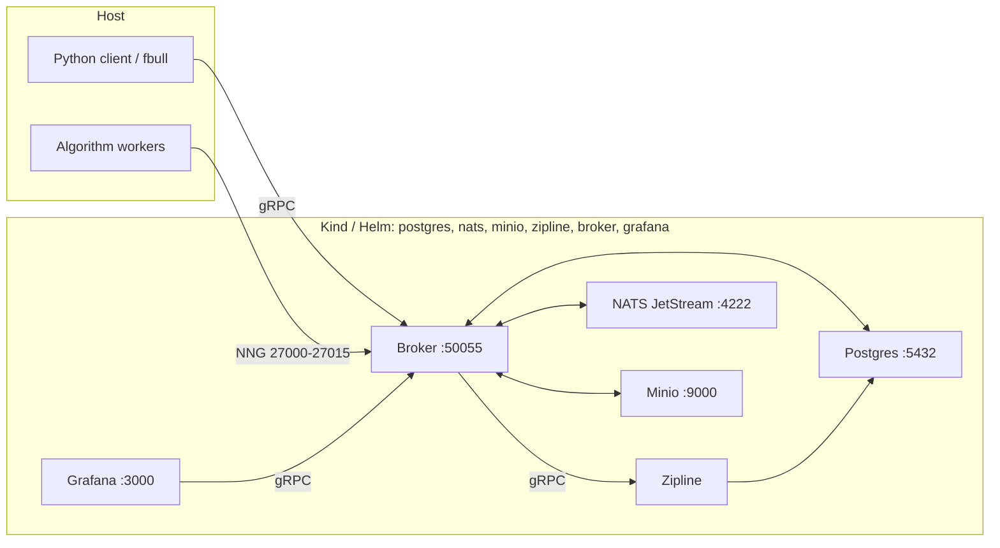
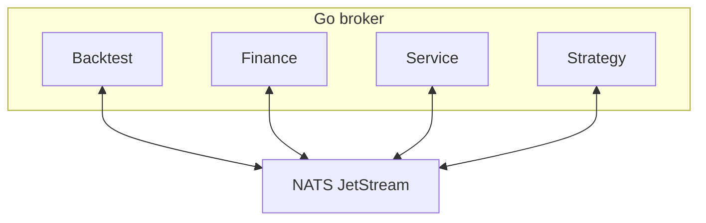

# Foreverbull

Foreverbull is a Go broker with a Python client for developing and backtesting trading algorithms. A backtest's `provider` chooses its bars: `yahoo` (stored when the field is omitted), `stooq` (daily GetOHLC only; Yahoo stays for asset, search, and index metadata), or `alpaca`. Bars are stored per provider. ETF universes are point-in-time membership from iShares as-of holdings (ISIN identity, not a static ticker list). Paper trading is off unless `TRADING_ENABLED` is true. That flag is a kill switch, not a broker. A deployment's backend is a trading profile name. 🔒️ Credentials live only in the profiles file, which the cluster mounts from Kubernetes Secret `foreverbull-trading`. Live trading is not supported.

The install path is Kubernetes: Kind locally via `fbenv`, Helm on a remote cluster. One chart deploys Postgres, NATS JetStream, Minio, Zipline, the broker, and Grafana.

## Requirements

- [Docker](https://docs.docker.com/get-docker/) (Kind node runtime; Testcontainers for tests)
- [Kind](https://kind.sigs.k8s.io/docs/user/quick-start/)
- [Helm](https://helm.sh/docs/intro/install/)
- [kubectl](https://kubernetes.io/docs/tasks/tools/)
- Python 3.12+ and [uv](https://docs.astral.sh/uv/)
- [Task](https://taskfile.dev/) (`go-task`)
- Go 1.24 (contributors; see `go.mod`)

This is not a Docker Compose / Docker-network stack. Tests still use Testcontainers on Docker; they do not run on Kind.

### Host resources

Give Docker at least 2 CPUs, 4 GB of memory and 30 GB of disk. On macOS and Windows that is the Docker Desktop VM allocation, not the machine's total.

- CPU and memory: the chart requests 275m CPU and 544Mi memory in total across the six workloads (`resources.*` in `deploy/helm/foreverbull/values.yaml`). Those are requests with no limits, so they are the floor for the pods to schedule. A backtest uses more, and Zipline and the strategy workers grow with the universe size and the date range.
- Disk: the chart's volumes request 17Gi (Postgres `8Gi`, Minio `8Gi`, NATS `1Gi`). Leave that free in Docker's storage, plus room for the images that `task build` creates and Kind loads into the node.
- Ports: `5432`, `4222`, `9000`, `50055`, `3000`, and `27000`–`27015` must be free on the host before `fbenv create`. See [Troubleshooting](#troubleshooting) when one is taken.

## First backtest in 15 minutes

One copy-paste path from a fresh clone to a Grafana result. Commands after `task build` run from `client/`. Accept the cookiecutter defaults so the strategy lands at `simple_foreverbull/crossover.py`. Deeper options (Stooq, remote clusters, strategy lifecycle) stay in [Quickstart](#quickstart) below.

```bash
# repository root
task build

cd client
VERSION=local uv run fbenv create
uv run fbenv start

# ingest Nasdaq-100 sample (Yahoo default; a few minutes for ~101 symbols)
uv run fbull backtest create --file ../examples/nasdaq100.yaml

# generate the simple crossover strategy (defaults → simple_foreverbull/)
uv run cookiecutter templates/simple

uv run fbull backtest run nasdaq100 simple_foreverbull/crossover.py
```

Open the Grafana `Link:` the run prints (local Kind: port `3000`), or visit [http://localhost:3000](http://localhost:3000).

### Example: `backtest create` output

Progress lines use a spinner, then a checkmark when each step finishes. Symbols is the comma-separated enabled list (truncated here):

```text
✔ Creating
✔ Downloading
✔ Ingesting
✔ Storing
                             Created Backtest
┏━━━━━━━━━━━┳━━━━━━━━━━━━┳━━━━━━━━━━━━┳━━━━━━━━━━━━━━━━━━━━┳━━━━━━━━━━━┳━━━━━━━━━━┓
┃ Name      ┃ Start      ┃ End        ┃ Symbols            ┃ Benchmark ┃ Provider ┃
┡━━━━━━━━━━━╇━━━━━━━━━━━━╇━━━━━━━━━━━━╇━━━━━━━━━━━━━━━━━━━━╇━━━━━━━━━━━╇━━━━━━━━━━┩
│ nasdaq100 │ 2023-01-01 │ 2023-03-31 │ AAPL,NVDA,MSFT,…   │ QQQ       │ yahoo    │
└───────────┴────────────┴────────────┴────────────────────┴───────────┴──────────┘
```

Creating the same name twice fails. A symbol whose download fails is stored with `enabled: false` and left out of the Zipline bundle.

### Example: `backtest run` output

After the session and execution progress bars, the CLI prints an Execution table and a Grafana link. IDs are illustrative:

```text
                          Execution
┏━━━━━━━━━━━━━━━━━━━━━━━━━━━━━━━━━━━━━━┳━━━━━━━━━━━┳━━━━━━━━━━━━┳━━━━━━━━━━━━┓
┃ ID                                   ┃ Backtest  ┃ Start      ┃ End        ┃
┡━━━━━━━━━━━━━━━━━━━━━━━━━━━━━━━━━━━━━━╇━━━━━━━━━━━╇━━━━━━━━━━━━╇━━━━━━━━━━━━┩
│ 01234567-89ab-cdef-0123-456789abcdef │ nasdaq100 │ 2023-01-01 │ 2023-03-31 │
└──────────────────────────────────────┴───────────┴────────────┴────────────┘
Link: http://localhost:3000/d/ee9ep4jxtwkcgf?var-execution=01234567-89ab-cdef-0123-456789abcdef
```

The run command does not print return, Sharpe, or max drawdown in the terminal; those charts and period stats are in Grafana (and on `fbull backtest execution <id>`).

## Quickstart

From a clone of this repository, build the `:local` images and sync the Python workspace (this installs the Kind/Helm `fbenv` in that workspace):

```bash
# repository root
task build
```

`task build` builds `lhjnilsson/foreverbull`, `lhjnilsson/zipline`, and `lhjnilsson/fb-grafana` at tag `local`, then runs `uv sync` in `client/`. It does not start the cluster.

Install the chart into a Kind cluster named `foreverbull` (namespace `foreverbull`):

```bash
cd client
VERSION=local uv run fbenv create
uv run fbenv start
uv run fbenv status
```

`fbenv create` installs the Kind cluster and the Helm release with the workloads stopped. `fbenv start` scales them to 1. Run `fbenv` through `uv run`. A `fbenv` already on `PATH` can be an older installer that starts Postgres, NATS, Minio, and Grafana as separate Docker containers. The workspace command is Kind and Helm.

`fbenv create` (cluster `local`, the default) creates the Kind cluster if needed, loads images, and `helm upgrade --install`s `deploy/helm/foreverbull` at `replicaCount=0`. Workloads: Postgres, NATS JetStream, Minio, Zipline, the Foreverbull broker, and Grafana.

Host ports (Kind `extraPortMappings`): Postgres `5432`, NATS `4222`, Minio `9000`, broker gRPC `50055`, backtest NNG `27000`–`27015`, Grafana `3000`. Python `fbull` talks to `localhost:50055`. Override with `FOREVERBULL_BROKER_ADDRESS`.

Remote cluster (writes `.foreverbull/config.yaml`, then installs the same chart):

```bash
uv run fbenv use remote \
  --kubeconfig /path/to/kubeconfig \
  --context my-context \
  --namespace my-namespace \
  --broker-address host:50055
uv run fbenv create
uv run fbenv start
```

You can also `helm upgrade --install` against a kubeconfig directly. See [deploy/README.md](deploy/README.md).

Useful `fbenv` commands (from `client/` after `uv sync`):

```bash
uv run fbenv status
uv run fbenv start                 # scale deployments to 1
uv run fbenv stop                  # scale to 0
uv run fbenv stop --remove         # helm uninstall
uv run fbenv stop --remove --purge # uninstall; local also deletes the Kind cluster
```

### Ingest data and create a backtest

`fbull backtest create` is the ingest. It stores the universe, downloads daily bars for every symbol and the benchmark, and loads those bars into Zipline. The command prints progress for Creating, Downloading, Ingesting, and Storing, then prints the backtest. A symbol whose download fails is stored with `enabled: false` and left out of the Zipline bundle.

`fbull backtest create` reads optional `provider` and `profile` from the YAML file. `--provider` overrides the file. Omitting `provider` sends `yahoo`, which is what the server stores. The printed backtest includes the provider. `profile` is a name in the trading profiles file, used only when `provider` is `alpaca`. It is ignored for `yahoo` and `stooq`. Do not put API keys, tokens, or passwords in the YAML, in `.foreverbull/config.yaml`, or in Helm values.

Bars for one symbol and day can exist once per provider. A Yahoo create does not replace Stooq rows, and the reverse is also true. Both recipes below use the same Nasdaq-100 file, [examples/nasdaq100.yaml](examples/nasdaq100.yaml): name `nasdaq100`, benchmark `QQQ`, and a fixed list of 101 constituents (both `GOOG` and `GOOGL`). The sample window is 2023-01-01 through 2023-03-31. Edit those dates in the file before you create. The broker pod needs outbound HTTPS to the price host. Downloading the full list takes a few minutes.

Commands below are from `client/` after `uv sync`, with the platform already running.

#### Yahoo

Yahoo is the default. Leave `provider` out of the file, or pass `--provider yahoo`.

```bash
cd client
uv run fbull backtest create --file ../examples/nasdaq100.yaml
uv run fbull backtest get nasdaq100
```

#### Stooq

`--provider stooq`, or `provider: stooq` in the file, loads daily bars from Stooq. Asset lookup still uses Yahoo, and that lookup is what marks a symbol enabled. Give the backtest another name when `nasdaq100` is already stored; the Yahoo rows stay.

```bash
cd client
uv run fbull backtest create --file ../examples/nasdaq100.yaml --provider stooq
uv run fbull backtest get nasdaq100
```

Alpaca bars use `provider: alpaca`. Set `profile` to an Alpaca profile name when more than one Alpaca profile is configured. The key is read from the profiles file, not from this YAML.

Creating the same name twice fails. `uv run fbull backtest delete nasdaq100` removes the backtest record. Stored bars stay in Postgres under the provider they were downloaded with.

Without `--file`, `fbull backtest create` prompts for a name, an iShares ETF, and dates. `fbull backtest etfs` prints the funds that prompt can use (name, benchmark, inception). The known fund is `iShares S&P 100` (benchmark `OEF`, inception 2000-10-23). An unknown name stops before any download. That path builds point-in-time membership from iShares month-end holdings. A month-end with no holdings file keeps the latest published listing on or before that date, or the earliest published listing after it when nothing earlier exists. You do not have to pick a range that includes a published date; the create fails only when the whole range has no holdings file. See [pkg/backtest/universe.md](pkg/backtest/universe.md).

The next step generates a strategy file to run against this backtest.

### Strategy projects

Once the platform is running, generate a starter algorithm. Cookiecutter is a client workspace dev dependency.

From this clone:

```bash
cd client
uv run cookiecutter templates/simple      # no TA-Lib
# or
uv run cookiecutter templates/advanced    # requires TA-Lib
```

From GitHub (picks the same two templates via the root `cookiecutter.json`):

```bash
cookiecutter https://github.com/lhjnilsson/foreverbull.git
```

Cookiecutter writes the project into the current directory. The generated directory is the project slug. From `client/`, if you kept the default project name, the simple strategy file is `simple_foreverbull/crossover.py`.

Run that strategy against the `nasdaq100` backtest from the ingest step, still from `client/` (path assumes the default project name):

```bash
uv run fbull backtest run nasdaq100 simple_foreverbull/crossover.py
```

On success it prints an Execution table (ID, Backtest, Start, End) and a Grafana `Link:` for that execution. For the advanced template (needs TA-Lib), use `advanced_foreverbull/macd.py` the same way if you kept its default project name.

The generated project README shows `fbull backtest create` and `fbull backtest run` for local-file hacking. When the algorithm is a READY service image, use `fbull strategy` instead of a one-shot live run.

### Strategy lifecycle

A strategy is a lifecycle: register it, pin a READY service image as a version, experiment that version on any number of existing backtests, then paper deploy. The `--backtest` value is the name from `fbull backtest create` (the Nasdaq-100 quickstart above stores `nasdaq100`). The same version is runnable against different universes via separate `--backtest` experiments. Live is off. Contracts: [pkg/strategy/implementation.md](pkg/strategy/implementation.md), [pkg/strategy/research-to-paper.md](pkg/strategy/research-to-paper.md).

```bash
uv run fbull strategy create mean-rev
uv run fbull strategy version add mean-rev --image lhjnilsson/my-algo:local
uv run fbull strategy experiment mean-rev --backtest spy
uv run fbull strategy experiment mean-rev --backtest eu-small
uv run fbull strategy experiments mean-rev
uv run fbull strategy deploy mean-rev --mode paper --dry-run
uv run fbull strategy deploy mean-rev --mode paper --no-dry-run --backend alpaca-paper --yes
uv run fbull strategy status mean-rev
uv run fbull strategy stop mean-rev
```

Default `deploy` is paper + `--dry-run` (Process, no PlaceOrder). Dry-run may omit `--backend`. Paper PlaceOrder needs `--mode paper --no-dry-run --backend <profile> --yes` (or `--confirm`) and `TRADING_ENABLED=true`. `--backend` is a profile name, not a key. `--mode live` is refused.

### Trading profiles

Paper orders use a profile name. The broker reads `TRADING_PROFILES_FILE`. In the cluster that path is `/etc/foreverbull/profiles.yaml`, mounted from Secret `foreverbull-trading`, key `profiles.yaml`. The Secret is optional. When the file is absent and `TRADING_ENABLED` is false, the process starts with an empty registry. When `TRADING_ENABLED` is true, a missing or invalid file is a startup error.

On local Kind, if `.foreverbull/trading-profiles.yaml` exists, `fbenv` applies it as that Secret before `helm upgrade` and does not print the file. `.foreverbull` is gitignored. The committed example is [deploy/trading-profiles.example.yaml](deploy/trading-profiles.example.yaml). Its credential fields are empty. Do not commit keys. The file has no `baseUrl` field and no live URL switch. Two deployments that name the same profile share that account. Contract: [pkg/finance/profiles.md](pkg/finance/profiles.md).

## Troubleshooting

Commands below are from `client/` after `uv sync`. The local Kind context is `kind-foreverbull` and the namespace is `foreverbull`.

### A host port is already in use

The Kind node publishes `5432`, `4222`, `9000`, `50055`, `3000`, and `27000`–`27015` on the host. When another process holds one of them, `fbenv create` fails while Kind creates the cluster, and the Docker error names the port (for example `Bind for 0.0.0.0:5432 failed: port is already allocated`). A local Postgres on `5432` or a local Grafana on `3000` is the usual cause.

Find the process that holds the port and stop it:

```bash
lsof -nP -iTCP:5432 -sTCP:LISTEN     # macOS and Linux
docker ps --filter publish=5432      # another container
```

The ports are fixed when the cluster is created (`extraPortMappings` in `deploy/kind/cluster.yaml`). If `kind get clusters` still lists `foreverbull`, delete it, then create again:

```bash
kind delete cluster --name foreverbull
VERSION=local uv run fbenv create
```

### Pods do not start

`fbenv start` waits up to 120 seconds for the six deployments. When that times out it prints `Timed out waiting for healthy` followed by the deployment and pod table. Check which pod is not ready with `uv run fbenv status`, then apply the matching fix:

- `ErrImagePull` or `ImagePullBackOff` on `foreverbull`, `zipline`, or `grafana`: the `:local` image is not in the Kind node. Build it with `task build` from the repository root, then load it and upgrade with `VERSION=local uv run fbenv update`.
- `Pending` with `Insufficient cpu` or `Insufficient memory` in the `describe` events (see More detail below): Docker does not have the resources listed under [Host resources](#host-resources). Raise the Docker allocation, then run `uv run fbenv start` again.
- `CrashLoopBackOff`: the container starts and exits. Its log says why. Add `--previous` to see the run before the restart.

More detail:

```bash
kubectl --context kind-foreverbull -n foreverbull get pods
kubectl --context kind-foreverbull -n foreverbull describe pod <pod-name>
kubectl --context kind-foreverbull -n foreverbull logs deploy/<workload>
```

`<workload>` is one of `postgres`, `nats`, `minio`, `zipline`, `foreverbull`, or `grafana`.

### Price downloads fail

`fbull backtest create` downloads bars from inside the broker pod, so the pod needs outbound HTTPS to the price host. A symbol whose download fails is stored with `enabled: false` and left out of the Zipline bundle. The create itself still finishes, so check the printed backtest for disabled symbols.

- Read the reason in the broker log: `kubectl --context kind-foreverbull -n foreverbull logs deploy/foreverbull`.
- When many symbols fail at once, the price host is usually throttling the requests. Wait, delete the backtest with `uv run fbull backtest delete <name>`, and create it again.

### Recreate the Kind cluster

Recreate the cluster when it is in a state that `fbenv update` does not fix, or to change the published ports. It also deletes the `.foreverbull` directory except `config.yaml`.

> **Warning:** Purging deletes the Kind cluster and its volumes, so every stored backtest, bar, and result is gone.

```bash
uv run fbenv stop --remove --purge
VERSION=local uv run fbenv create
uv run fbenv start
uv run fbenv status
```

Then create your backtests again with `fbull backtest create`.

## Architecture

The Python client and `fbull` call the broker over gRPC. Inside the broker process, Backtest, Finance, Service, and Strategy domains publish and subscribe on NATS JetStream. During a backtest, Python workers (host processes or extra Kubernetes pods) attach to the broker over NNG on ports `27000`–`27015`. Zipline is a separate gRPC engine pod. Grafana reads the broker through a custom datasource. Persistence is cluster PVCs, not host binds under `.foreverbull`. The broker does not mount `/var/run/docker.sock`; extra worker pods use the in-cluster Kubernetes API.



### Domains

Go domains live under `pkg/`. The server in `cmd/server` registers Backtest, Finance, Service, and Strategy.



- **Backtest**: Creates backtests and sessions, ingests data, and runs Zipline simulations. ETF create is point-in-time membership from iShares as-of holdings (ISIN identity, not a static ticker list). See [pkg/backtest/universe.md](pkg/backtest/universe.md).
- **Finance**: Market data is chosen per backtest (`provider` `yahoo`, `stooq`, or `alpaca`). Stooq is daily GetOHLC only; Yahoo stays for search, `GetAsset`, and `GetIndex`. Alpaca bars use a profile from the profiles file. `TRADING_ENABLED` defaults to `false` and is the kill switch, not a provider. Credentials live only in that file, mounted from Secret `foreverbull-trading`. Live trading is not supported. Four paper adapters (`alpaca`, `saxo`, `ibkr`, and `ig`) sit behind `supplier.Trading`. Two deployments that name the same profile share that account. Live deploy is off.
- **Service**: Starts and stops algorithm-worker pods through the Kubernetes container runtime (`internal/container`).
- **Strategy**: Lifecycle for a registered algorithm: versions, experiments on existing backtests (period stats on list/get), paper dry-run or confirmed paper PlaceOrder. One version can run on many universes (`--backtest spy` vs `--backtest eu-small`). Live is off. See [pkg/strategy/implementation.md](pkg/strategy/implementation.md) and [pkg/strategy/research-to-paper.md](pkg/strategy/research-to-paper.md).

## Development

The broker is Go (`cmd/server`, `pkg/`, `internal/`). The Python workspace is `client/` (`foreverbull`, `foreverbull-cli`, `foreverbull-zipline`, `foreverbull-testing`). See [client/README.md](client/README.md) and [AGENTS.md](AGENTS.md). CLI details: [client/cli/README.md](client/cli/README.md).

Install Task to run the root `taskfile.yaml` (it includes `client/taskfile.yaml` and `grafana/taskfile.yaml`).

```bash
task build                    # local images + uv sync (client/)
task kind:create              # Kind cluster only
task kind:load                # load :local images into Kind
task helm:install             # helm upgrade --install into Kind

task test:unit                # Go unit tests (Backtest, Finance, Service, Strategy)
task backtest:test:unit
task finance:test:unit
task service:test:unit
task strategy:test:unit
task backtest:test:integration  # needs the local Zipline image

task client:test              # Python unit tests (uv run pytest from client/)
task test:integration         # client end-to-end; builds images first

task build:docker             # lhjnilsson/foreverbull:local
task client:docker:zipline    # lhjnilsson/zipline:local
task grafana:build:docker     # lhjnilsson/fb-grafana:local

task proto                    # regenerate Go + Python protobuf from proto/ (Buf)
task mock:generate            # mockery
task client:lint              # uvx ruff@0.17.0 check
task client:format            # uvx ruff@0.17.0 format
```

Go and Python unit tests start Postgres/NATS/Minio with Testcontainers. Have Docker running. They are not live-trading tests.
