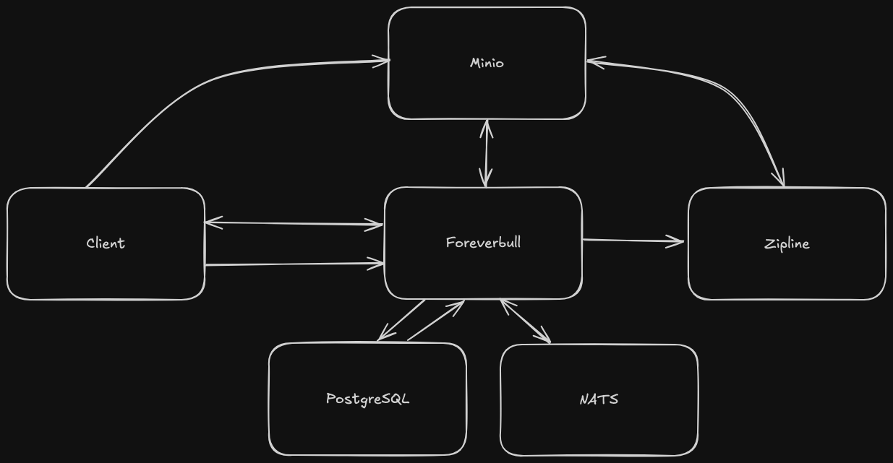
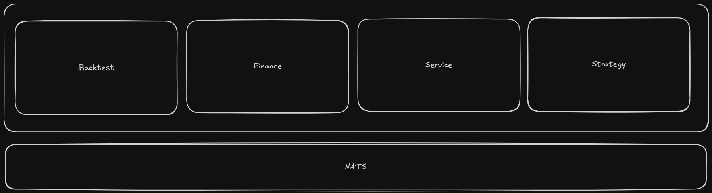

# Foreverbull 🚀

Foreverbull is an trading platform designed for seamless, continuous delivery of algorithmic trading strategies. Our mission? To empower you with rapid development, effortless deployment, and rock-solid confidence in your trading results! 💪

Right now, we're sourcing market data from Yahoo Finance, and fetching ETF holdings straight from the iShares API. For trading, we integrate with Alpaca, supporting both live and paper trading modes. 📈

Dive deeper into our architecture in the Architecture section. In a nutshell, the platform runs on a suite of containerized services:

- `Foreverbull`: The core app that orchestrates everything smoothly.
- `Minio`: Handles storage for backtesting ingestions and raw results. 🗄️
- `PostgreSQL`: Your reliable persistent storage for all app data. 
- `NATS`: The speedy message queue for seamless service communication. ⚡
- `Grafana` (with Loki): Monitors the platform and visualizes backtest outcomes beautifully. 📊

Ready to jump in? Here's a quickstart guide to get you up and running! 🌟

## Getting Started 🛠️
### Requirements 📋
- Docker
- [Kind](https://kind.sigs.k8s.io/docs/user/quick-start/)
- [Helm](https://helm.sh/docs/intro/install/)
- [kubectl](https://kubernetes.io/docs/tasks/tools/)
- Python 3.12+
- [uv](https://docs.astral.sh/uv/)

The local stack is a Kind cluster plus one Helm chart, not a raw Docker network.

### Quickstart 🚀

From a clone of this repository:

```bash
cd client
uv sync
VERSION=local uv run fbenv create   # Kind cluster `foreverbull` + Helm into namespace `foreverbull`
uv run fbenv status
```

`fbenv create` (cluster `local`, the default) creates a Kind cluster named `foreverbull` if needed, loads images, and `helm upgrade --install`s `deploy/helm/foreverbull` into namespace `foreverbull`. Workloads: Postgres, NATS JetStream, Minio, Zipline, the Foreverbull broker, and Grafana.

To build `:local` images first (broker, Zipline, Grafana) and then create the environment, from the repository root:

```bash
task env
```

Host ports (Kind `extraPortMappings`): Postgres `5432`, NATS `4222`, Minio `9000`, broker gRPC `50055`, backtest NNG `27000`–`27015`, Grafana `3000`. Python `fbull` talks to `localhost:50055` locally. Override with `FOREVERBULL_BROKER_ADDRESS`.

Remote cluster (writes `.foreverbull/config.yaml`, then installs the same chart):

```bash
uv run fbenv use remote \
  --kubeconfig /path/to/kubeconfig \
  --context my-context \
  --namespace my-namespace \
  --broker-address host:50055
uv run fbenv create
```

You can also `helm upgrade --install` against a kubeconfig directly — see [deploy/README.md](deploy/README.md).

### Strategy projects

Once the platform is running, generate a starter algorithm:

```bash
cookiecutter https://github.com/lhjnilsson/foreverbull.git
```

Cookiecutter walks you through setup. Choose from two starter templates depending on whether you have TA-Lib installed. 

## Architecture 📐



Client communicates with the broker through gRPC. The broker will internally orchestrate tasks between services through NATS.

When running backtest simulations the client workers connects to the broker using NNG(NanoMSG) for lower latency and higher throughput.

### Domains 🧩



- `Backtest`: Powers strategy backtesting with Zipline for reliable simulations. 🔄
- `Finance`: Manages market data ingestion and live trading operations. 
- `Service`: Orchestrates algorithmic strategies within containers efficiently. 🤖
- `Strategy`: Handles scheduling for backtests and live trading sessions. ⏰

## Development and Contributing 🤝

The project is mainly built in Go, with domains organized under pkg and internal components in internal. CLI entry points live in cmd. Our Python client libraries are in client and include four key parts:

- `foreverbull`: The primary client that connects to the Foreverbull broker. 🔗
- `foreverbul-zipline`: A handy Zipline wrapper with gRPC for smooth communication. 📡
- `foreverbull-cli`: Your go-to CLI for managing backtests, trading, and environments. 🖥️
- `foreverbull-testing`: Custom Pytest fixtures to make testing a breeze. 🧪

For Go-specific details, check out the Go README in the pkg folder.
For Python insights, see the Python README in the client folder.

Both Go and Python utilizes TestContainers for dependencies when running unit tests.
Integration tests require Zipline to be built.

taskfile.yaml contains collection of commands to assist with integration testing among other things.
In order to run them you need to have go-task installed.

