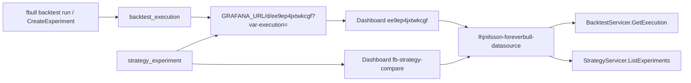

# 📝 Grafana analysis — implementation contract

This document is the implementation contract for how users **analyze** backtests and strategies in Grafana. It is not code. Read it before changing the datasource plugin (`grafana/lhjnilsson-foreverbull-datasource`), the provisioned dashboards, `GetExperiment.grafana_path`, or CLI `execution_link` / `GRAFANA_URL`. **Status** at the end records what landed.

Grafana is the visual analysis surface. One execution time series is not enough. Users need readable execution labels, overlay/compare, strategy/experiment variables, authored dashboards, and links that actually open a working panel.

CLI compare of strategy experiments (`fbull strategy experiments`) must keep working **without** Grafana. Grafana is the overlay of the same executions, not a replacement for that table. Live trading UI is out.

**Hard facts this contract must not contradict:**

- Dashboard UID `ee9ep4jxtwkcgf` must keep working. CLI and `GetExperiment` deep-link it as `?var-execution=`. If the dashboard is rewritten, keep this UID. If it ever moves, document a redirect; do not silently break those URLs.
- Query type `GetExecutionMetric` is the mux key (`pkg/main.go`, `src/types.ts`). Do not rename it.
- Grafana OSS in `grafana/Dockerfile` stays `grafana/grafana-oss:11.3.2` unless that Dockerfile already pins a different tag. Do not vendor a new Grafana version here.
- Plugin ID stays `lhjnilsson-foreverbull-datasource`. Unsigned loading is already allowed in the image.
- In-cluster Grafana talks to the broker via `BROKER_URL` (`foreverbull:50055` from Helm). Host links for local Kind are `http://localhost:3000`.

## 1. Problem

Users finish a backtest or a strategy experiment and need to **see** the run. The original path was a single leftover Grafana export of one execution id, plus a printed URL. Three loops were missing or broken:

1. **Inspect one backtest run.** The link is printed, the dashboard UID is stable, but the panel did not bind the variable the URL sets.
2. **Compare two executions.** The plugin could only load one `GetExecutionMetric` series with no overlay labels.
3. **Compare one strategy version across backtests.** Strategy experiments already join many backtests onto one version. Grafana never called `StrategyServicer`. Dropdowns were raw execution UUIDs.

The provisioned dashboard was a UI Save (default panel title, session-local execution UUIDs, frozen 2023 range). Query JSON did not match what Go unmarshals. That export is not the dashboard anymore; see Status.



## 2. Design principles

1. **Compose the broker; do not copy metrics.** Period rows live in `backtest_execution_period`. The plugin reads them through existing RPCs. Do not duplicate Sharpe/drawdown into Grafana storage.
2. **Keep `GetExecutionMetric` for one series.** It loads one execution by id and selected metrics. Overlay is multiple queries (or a multi-value `execution` variable) on the same panel, not a second time-series store. The backtest overview is not a time series. It uses query type `ListExecutionOverview` (one table row per run). Do not rename `GetExecutionMetric` to feed that table, and do not pretend the leaderboard is one `GetExecutionMetric` series.
3. **Labels are for humans; values are UUIDs.** Variable values stay execution ids so `?var-execution=` keeps working. Labels must not be those raw UUIDs.
4. **Strategy is a dimension, not a second product.** Experiments (`strategy_name`, `version_rev`, `backtest_name`, `execution_id`) are how users pick runs to overlay. The datasource must grow a StrategyServicer client for that loop. CLI compare stays the non-Grafana path.
5. **Dashboards are authored, not exported.** Provisioned JSON is source. No Grafana default panel title, no session-local datasource UID, no frozen time range from whoever last clicked Save in the UI.
6. **Health means the broker answers.** `CheckHealth` must dial `BROKER_URL`, not only parse empty plugin settings.

## 3. Intended user loops

### 3.1 Inspect one backtest run

**Who:** someone who just ran `fbull backtest run` (or `fbull backtest executions`) and got a Grafana link.

**Loop:**

1. CLI prints `{GRAFANA_URL}/d/ee9ep4jxtwkcgf?var-execution={id}` (`client/cli/src/foreverbull_cli/output.py` `execution_link`). Default origin is `http://localhost:3000`.
2. Grafana opens dashboard UID `ee9ep4jxtwkcgf` with template variable `execution` set to that id. The link does not include `var-backtest`.
3. Two selectors: **Backtest** (value and label are the backtest name) and **Execution** (runs for that backtest). The execution label is the start date, the end date, and a short id — the same `{start}–{end} {short id}` shape as `{backtest} {start}–{end} {short id}`, without repeating the backtest. The value remains the UUID.
4. A deep link that only has `var-execution` still opens that run. The backtest selector is set from the execution’s backtest name, and the execution stays selected even when the backtest variable was empty on the first load. Changing the backtest refreshes the execution list to that backtest. Changing the execution still moves the time axis to that run’s exact minimum and maximum.
5. The panels run `GetExecutionMetric` for that id and plot the selected metrics over the execution’s own dates. The page reads as a backtest: latest portfolio value, return, max drawdown, and Sharpe are stats; portfolio value is the equity curve; drawdown is underwater on its own axis; period returns are bars. Dollar series are grouped. Ratio series are grouped. Benchmark return is not on the equity axis.
6. The same dashboard shows the stored configuration: function name, parameter key, value, and value type, plus backtest name, benchmark, session id, start, end, and execution id. No stored parameters is an empty table, not advanced-template defaults. Database URL, broker port, and namespace port are not shown.

**Must keep working:** the CLI link is still only `var-execution` (no `var-backtest`), one series, metrics present, and a time axis whose `from` is the selected execution’s minimum timestamp and whose `to` is its maximum. Minimum is the earliest period time. Maximum is the latest period time. No pad. `ListExecutions` `start_date` and `end_date` move the axis as soon as the execution is known, including a deep link that is only `?var-execution=` (no `from` or `to`). If `GetExecutionMetric` period timestamps differ from those dates, the axis becomes that series min and max. Selecting another execution replaces both ends, even when the previous zoom sits inside the new span. The same execution, after that min and max was applied, keeps a later zoom. The first entry applies even when the saved window is `now`/`now` and does not already contain the points. A frozen 2023 cursor, or a fixed window such as `now-30y`, is not the axis. Do not leave the user on `now`/`now` after the execution is known.

### 3.2 Compare two executions

**Who:** someone who ran the same backtest twice, or two sessions, and wants overlay.

**Loop:**

1. Open `ee9ep4jxtwkcgf` (or the compare dashboard `fb-strategy-compare`). A single-id deep link still lands on `ee9ep4jxtwkcgf`.
2. Pick two (or more) executions. Grafana already supports multiple queries per panel (`refId` A/B) and multi-value variables. Use that. Do not require a new query-type name unless overlay cannot be expressed as repeated `GetExecutionMetric`.
3. Series names are the human labels from §3.1, not `portfolio_value` twice with no way to tell which run is which.
4. Deep link for a single id stays `?var-execution=`. Multi-select may add extra `var-execution` values; a single-id link must still show that one run.

### 3.3 Compare one strategy version across backtests

**Who:** someone who ran `CreateExperiment` for the same version on two backtests (the `spy` vs `eu` case already in strategy tests and `fbull strategy experiments`).

**Loop:**

1. CLI table already lists strategy, rev, backtest, status, execution, Sharpe/drawdown/end value (`research-to-paper.md` §5). That table does **not** move into Grafana.
2. Each row with an `execution_id` still prints `Link: {execution_link}`. `GetExperiment` still returns `grafana_path` when `execution_id` is set (`pkg/strategy/internal/api/experiment.go`).
3. In Grafana, variables cascade: **strategy → version → experiment/backtest → execution**. Values for the last step are still execution UUIDs so `ee9ep4jxtwkcgf?var-execution=` works.
4. Overlay those executions with `GetExecutionMetric` (loop 3.2). The datasource lists experiments through `StrategyServicer.ListExperiments` (`strategy_name`, `version_id`, `backtest_name` filters already exist). `BacktestServicer` alone cannot express “this version on two universes.”

Do not invent a Grafana-only experiment id that is not the broker’s `strategy_experiment.id`. Do not copy `ExperimentStats` into the plugin; those numbers stay on the CLI/API JOIN.

## 4. What already exists (reuse)

| Capability | Where | This work |
| --- | --- | --- |
| Query type `GetExecutionMetric` | `pkg/main.go`, `src/types.ts` `QueryType.GetExecutionMetric`, mux in `pkg/datasource.go` | Keep the name. Read canonical `execution.id` JSON |
| Metrics list | `pkg/datasource.go` `QueryMetric`, `pkg/resources.go` `ListMetrics` | Names the period writer fills and the editor lists: `portfolio_value`, `returns`, `pnl`, `cash`, `max_drawdown`, `benchmark` (column `benchmark_period_return`), `alpha`, `beta`, `sharpe`, `sortino`, `capital_used`, `long_count`, `short_count`, `long_value`, `short_value`, `gross_leverage`, `net_leverage`, `max_leverage`, `long_exposure`, `short_exposure`, `ending_exposure`, `starting_exposure`. Do not plot `positions` |
| Execution periods | `BacktestServicer.GetExecution` → `Periods` | Keep as the only metric source for charts |
| Worker arguments | `SessionServicer.CreateExecution` writes `backtest_execution.function_arguments`. `GetExecutionResponse.functions` reads them | Function name, parameter key, value used (supplied value, otherwise the default), and value type. Null column (runs created before it existed) is an empty list. No broker port, namespace port, or database URL. Benchmark stays on the backtest row (`GetBacktest`) |
| Backtest names | `BacktestServicer.ListBacktests` | Names for the execution-dashboard selector. The plugin resource is `/backtests` (value and label are the name; benchmark is not on that list) |
| List executions | `BacktestServicer.ListExecutions` (`backtest` / `session_id` optional filters) | Use filters when variables supply them. **Labels** use `Execution.backtest`, `start_date`, `end_date`, not `Id` twice |
| Dashboard UID | `provisioning/dashboards/executions.json` `"uid": "ee9ep4jxtwkcgf"` | Keep. Rewrite the JSON; do not change the uid |
| Template variable name | `templating.list[].name` = `execution`; links use `var-execution` | Keep the name |
| CLI link | `execution_link` reads `GRAFANA_URL` (default `http://localhost:3000`) + `/d/ee9ep4jxtwkcgf?var-execution=` | Keep path, UID, and query key. Override the origin with `GRAFANA_URL`, not the UID |
| Experiment Grafana path | `GrafanaExecutionURL` in `experiment.go` via `environment.GetGrafanaURL()` | Keep. Same UID and `var-execution`. Helm `grafana.url` sets broker `GRAFANA_URL` |
| Strategy experiments | `ListExperiments` / `GetExperiment` / `Experiment.execution_id` / `ExperimentStats` | Grafana lists/filters; CLI keeps the compare table |
| Image | `grafana/Dockerfile` → `lhjnilsson/fb-grafana`, Helm `BROKER_URL=foreverbull:50055`, host port 3000 | Keep. Plugin tests use fakes/bufconn, not this image |

`ListExecutions` already returns `foreverbull.backtest.v1.Execution` (`id`, `backtest`, `session`, `start_date`, `end_date`). Human labels are derived from those. Value stays `execution.Id` so `var-execution` is still a UUID.

`CreateExecution` stores each worker function’s name and parameters on `backtest_execution.function_arguments` (jsonb). Each parameter is `key`, the value actually used (the supplied `value` when that field is set, otherwise `defaultValue`, including an explicit empty string), and `value_type`. `GetExecutionResponse.functions` is that list (`ExecutionFunction`: `name`, `parameters[]` of `key`, `value`, `value_type`). The field is additive; `GetExecution` is not a new RPC. Runs inserted before the column existed have SQL NULL and return an empty list. Do not fill those with algorithm defaults. Broker port, namespace port, and database URL stay on the worker `ExecutionConfiguration` returned once from `CreateExecution`. They are not stored and are not on `GetExecution`. Benchmark stays on the backtest row and is read with `GetBacktest`.

## 5. Query types and dashboard UIDs

### 5.1 Query types to keep

| Query type | Role | Keep? |
| --- | --- | --- |
| `GetExecutionMetric` | One execution id + metric names → time series | **Yes.** Mux key, TS enum, chart `queryType`. Do not rename |
| `ListExecutionOverview` | Executions overlapping the dashboard time range → one table row per run, figures from the last stored period | **Yes.** Leaderboard only (`fb-backtest-overview`). Not a time series and not a renamed `GetExecutionMetric` |
| anything else | — | Do not add a renamed alias (`executionMetric` appears only as a historical unit-test string and must not become a second type) |

Resource HTTP routes:

- `GET/POST /executions` — variable and query-editor picker
- `GET/POST /backtests` — backtest names from `ListBacktests`. Value and label are the name. Benchmark is not included on this picker
- `GET/POST /execution` — one execution. Query `id` or `execution`, or JSON `{"id":"<uuid>"}` / `{"execution":"<uuid>"}`. Not a `GetExecutionMetric` body and not the `executionId` key. Response: `id`, `session`, `backtest`, `benchmark` (from `GetBacktest`; empty when that lookup fails), `start`, `end` (`YYYY-MM-DD`), and `functions`: `[{ "name", "parameters": [{ "key", "value", "value_type" }] }]`. `functions` is `[]` when nothing was stored. No database URL, broker port, or namespace port. The execution dashboard reads this for the run table and the worker-arguments table (`configuration`: `metadata` or `arguments` on the panel target). Those targets are not sent to the `GetExecutionMetric` mux
- `GET/POST /metrics` — metric picker
- `GET/POST /strategies` — strategy picker
- `GET/POST /versions` — version picker (filtered by strategy)
- `GET/POST /experiments` — experiment picker; **values are execution UUIDs**

Do not replace `/executions`. Do not rename `GetExecutionMetric` to carry arguments; arguments are `GetExecution.functions` and `/execution`.

### 5.2 Dashboard UIDs to keep

| UID | File / consumers | Keep? |
| --- | --- | --- |
| `ee9ep4jxtwkcgf` | `provisioning/dashboards/executions.json`; CLI `execution_link`; `GrafanaExecutionURL`; plugin READMEs | **Yes.** Inspect-one-run and every printed `Link:` |
| `fb-strategy-compare` | `provisioning/dashboards/strategy-compare.json` | Overlay two executions. Must not steal `ee9ep4jxtwkcgf` |
| `fb-backtest-overview` | `provisioning/dashboards/backtest-overview.json`. `executions.json` links to `/d/fb-backtest-overview` | Leaderboard. Saved time `now-2y` to `now`. Must not steal `ee9ep4jxtwkcgf` or `fb-strategy-compare` |

A single-execution URL into `ee9ep4jxtwkcgf` remains the compatibility contract. It does not require `var-backtest`.

### 5.3 Backtest overview (`fb-backtest-overview`)

Provisioned as `provisioning/dashboards/backtest-overview.json`. UID `fb-backtest-overview`, title `Backtest overview`. It does not replace `ee9ep4jxtwkcgf` or `fb-strategy-compare`.

Saved time is `now-2y` to `now`. Opening the board hides runs that end before that window. Widening the time picker brings them back. Do not use `now-30y`. This board does not snap the time axis to one execution. `ee9ep4jxtwkcgf` and `fb-strategy-compare` still do.

An execution is included when its `start_date`..`end_date` overlaps the picker from/to. Dates are inclusive UTC calendar dates, so the time of day does not shrink a date. The execution overlaps when it starts on or before the picker's to date and ends on or after the picker's from date. An execution that ends before the from date is excluded. One that ends on the from date, or starts on the to date, is included.

Query type `ListExecutionOverview` returns one table row per included execution. It is not `GetExecutionMetric` and it is not a time series. Optional JSON `backtest` limits `ListExecutions` to that name. Empty, `*`, `$__all`, or an uninterpolated `$backtest` means every backtest in the window. The dashboard variable `backtest` defaults to All (`allValue` is `*`, because an empty allValue is ignored by Grafana).

Return, max drawdown, Sharpe, and Sortino are the last stored period from `GetExecution` (latest period date), not `Execution.Result` and not rescaled. A nil Sharpe or Sortino on that period stays empty; earlier periods are not borrowed and a missing ratio is not stored as 0.

Start value is the earliest stored period's `starting_cash + starting_value` (`currencyUSD`). Zipline's `starting_value` is positions value, not the account, and the last session's `starting_cash` is only that morning. End value is that last period's `portfolio_value`. Date columns stay Start and End.

Benchmark is `not set` when the backtest has no benchmark (a failed `GetBacktest` counts as unset), `not available` when the ticker is set and the last period left `benchmark_period_return` empty, and otherwise the signed percent (`+3.1%`). Active days counts stored sessions whose `longs_count` or `shorts_count` is non-zero, and the cell is `N of M`. A nil period is not a session.

| Column | Field | Unit |
| --- | --- | --- |
| Backtest | `backtest` | |
| Start | `start` | `YYYY-MM-DD` |
| End | `end` | `YYYY-MM-DD` |
| ID | `id` | short id, first 8 characters of the UUID |
| Start value | `starting_portfolio_value` | `currencyUSD` |
| End value | `portfolio_value` | `currencyUSD` |
| Return | `algorithm_period_return` | `percentunit` |
| Benchmark | `benchmark` | `not set`, `not available`, or a signed percent |
| Sharpe | `sharpe` | `none` |
| Sortino | `sortino` | `none` |
| Max drawdown | `max_drawdown` | `percentunit` |
| Active days | `active_days` | `N of M` |

The full UUID is field `execution` (hidden). No positions column. No database URL, broker port, or namespace port.

Stats above the table, from the same rows: how many runs overlap the window (`count` of Backtest), best Sharpe (`max`), and worst drawdown (`min`, the most negative stored `max_drawdown`). Same units. Not rescaled.

A row links to `/d/ee9ep4jxtwkcgf?var-execution={uuid}&var-backtest={name}` when the name is known. An empty name leaves `var-backtest` blank, which the execution dashboard treats as absent. The execution dashboard still works with only `var-execution`. `ee9ep4jxtwkcgf` links to `/d/fb-backtest-overview`.

If `ee9ep4jxtwkcgf` is ever replaced, ship a Grafana dashboard redirect (or a stub dashboard with that UID) and update this document, CLI, and `GrafanaExecutionURL` in the same change. Until then: no new host path, no new UID in those three callers.

Datasource plugin id `lhjnilsson-foreverbull-datasource` stays. Provisioned datasource name and uid are both `foreverbull` (`provisioning/datasources/datasources.yml`). Do not hard-code Grafana’s generated datasource UID from a UI export.

## 6. Query JSON (`execution` / `id`)

Go unmarshals (`pkg/datasource.go` `queryModel`) the canonical body:

```json
{
  "queryType": "GetExecutionMetric",
  "execution": { "id": "<uuid>" },
  "metrics": [{ "name": "portfolio_value" }]
}
```

```go
type Execution struct {
    ID string `json:"id"`
}
```

**Contract:**

- JSON key for the execution object is `execution` (matches Go `json:"execution"` and `types.ts`).
- JSON key for the id inside it is `id` (matches Go `json:"id"`). TypeScript serializes `id`, not `ID`.
- `executionId` as a string is **invalid to write**. QueryEditor, VariableQueryEditor, and dashboard targets must not emit it. Go still accepts it as a legacy read so old panels do not go blank.
- `metrics` is `[{ "name": "..." }, ...]`, not `["portfolio_value"]`. Go still accepts a JSON array of strings as a legacy read.
- `queryType` is `GetExecutionMetric`, not `executionMetric`.
- Dashboard targets include `metrics`. `applyTemplateVariables` interpolates `query.execution.id` so `$execution` from the URL reaches the backend.

Error string `"executionId is missing"` is Go log text, not the JSON key.

The original mismatch (capital `ID`, string `executionId` on the panel and variable editor, missing `metrics`) is what made deep links open an empty chart. Do not reintroduce it.

## 7. Authored dashboards (not a UI export)

`provisioning/dashboards/executions.json`, `strategy-compare.json`, and `backtest-overview.json` are source. Constraints the rewrite had to satisfy, and must keep:

| Constraint | Why |
| --- | --- |
| Real panel titles | Built-in Grafana 11.3.2 panels, not a stack of identical lines and not Grafana’s create-panel default. A stat row shows the latest portfolio value (`currencyUSD`), return (`percentunit`), max drawdown (`percentunit`), and Sharpe (`none`), each from `GetExecutionMetric` reduced with `lastNotNull`. Portfolio value is a full-width timeseries: thicker line, light fill, `currencyUSD`. Drawdown is its own underwater timeseries (filled to zero, red below zero, `percentunit`), not on the portfolio axis. Returns are a bar chart (`percentunit`, green when positive, red when negative), not a line. Benchmark return stays its own `percentunit` panel. Alpha stays its own `percentunit` panel. Cash, PnL, and capital used sit on a Dollars row with long/short value and exposure (`currencyUSD`); none of those is a full-width copy of the equity curve. Sharpe, Sortino, beta, and leverage sit on a Ratios row (unit `none`). No `positions` series. No candlestick. No panel plugin that needs Grafana 12 |
| Empty variable `current` | Do not pin a session-local execution UUID |
| Variable query lists from the datasource | `source: executions` (and strategy/version on the compare board). Do not pin a UUID in the query |
| Target JSON matches §6 | `execution: { "id": "$execution" }` plus `metrics` |
| Datasource uid `foreverbull` | Matches `datasources.yml`. A generated uid from a UI Save breaks a fresh Grafana |
| Time axis is the selected execution | `ListExecutions` options carry `start` and `end` (`YYYY-MM-DD`). As soon as `var-execution` (or compare `left`/`right`) is known, the datasource sets `from`/`to` to that exact min and max via `locationService` (Grafana 11.3) — including a deep link with no `from` or `to`, and including a saved window of `now`/`now`. No pad. When `GetExecutionMetric` frames include a time field, that series min and max replaces the range if they differ. The same id then keeps a zoom. A different id replaces both ends even if the previous zoom sits inside the new span. Saved dashboard `time` may be `now`/`now` only as the unset placeholder on `ee9ep4jxtwkcgf` and `fb-strategy-compare`; it is not the range the user keeps, and it is not `now-30y`, `now-5y`, or a hard-coded year. Strategy compare uses the union (earliest min through latest max). Do not freeze an export cursor. `fb-backtest-overview` does not use this rule: its saved time is `now-2y` to `now`, and `ListExecutionOverview` must not move that picker |
| Units match stored period numbers | Zipline writes returns, `max_drawdown`, `benchmark_period_return`, and annualized alpha as fractions (`percentunit`; 0.01 is 1%). Sharpe, Sortino, and beta are ratios (`none`). Gross, net, and max leverage are exposure divided by portfolio value (`none`; 1 is 1x). `portfolio_value`, `pnl`, `cash`, `capital_used`, `long_value`, `short_value`, and the exposure fields are currency (`currencyUSD`). Do not rescale in the plugin or on the panel. Do not put a return series on the `portfolio_value` axis. Benchmark return has its own panel. The return bar chart, the drawdown panel, and alpha stay off that axis. Strategy compare uses the same units: portfolio value `currencyUSD`, drawdown `percentunit`, Sharpe `none`, and the last-value table keeps one unit per field |
| Field names with underscores | Plugin fields are `portfolio_value`, `max_drawdown`. Overrides that use spaces never match |
| No unused Annotations & Alerts scaffold | Authored JSON, not a Save from the UI |
| Dashboard titles | `Backtest execution` (`ee9ep4jxtwkcgf`) and `Strategy compare` (`fb-strategy-compare`) |

Config editor Path + API Key (`ConfigEditor.tsx`, `datasources.yml` `jsonData.path` / `secureJsonData.apiKey`) is still Grafana create-plugin scaffold. Broker is gRPC `BROKER_URL`, not an HTTP path + API key. `CheckHealth` dials the broker; those form fields do not.

Playwright (`tests/configEditor.spec.ts`) still asserts Path / API Key. That is not a product test. Query-editor Playwright asserts Execution / Metrics. Jest covers query JSON and the variable editor.

`docker-compose.yaml` still defaults `grafana_image: grafana-enterprise`. Plugin-dev leftover. Product image is OSS 11.3.2. Compose is not Kind/`fbenv` and does **not** use a Kind Docker network named `foreverbull`. Kind’s cluster name is `foreverbull`; that is not a Docker network. Compose’s `networks.foreverbull.external: true` only works if you created that network yourself. Product Grafana is Helm `lhjnilsson/fb-grafana` on host port 3000.

## 8. Labels, variables, strategy experiments

### 8.1 Execution labels

`ListExecutions` labels are `{backtest} {start}–{end} {short id}` (`executionLabel` in `pkg/resources.go`). Value stays `execution.Id` so `var-execution` is still a UUID. Each execution option also carries `start` and `end` (`YYYY-MM-DD` from `start_date` / `end_date`) so the time axis can move before period frames return. Chart series use that full label (`DisplayNameFromDS`) so overlay is readable.

On `ee9ep4jxtwkcgf` the execution selector does not repeat the backtest name. Its label is `{start}–{end} {short id}` (`label: "dates"` on the variable query). The backtest selector’s value and label are the name.

### 8.2 Variables to keep / add

| Variable | Name | Values | Required for |
| --- | --- | --- | --- |
| Backtest | `backtest` | backtest name (label is the name) | Execution dashboard selector. Not part of the CLI link. On `fb-backtest-overview`, the same name with All (`*`) as the default |
| Execution | `execution` | execution UUID. On `ee9ep4jxtwkcgf`, options are that backtest’s runs and the label is `{start}–{end} {short id}` | Loop 3.1, deep links. **Keep this name** |
| Strategy | `strategy` | strategy name | Loop 3.3 |
| Version | `version` | version id (label may show rev) | Loop 3.3 |
| Left / right (compare) | `left`, `right` | execution UUID | Loop 3.2 on `fb-strategy-compare` |

Do not rename `execution`. Do not use `executionId` as a Grafana variable name. Do not require `var-backtest` on `execution_link`.

`DatasourceVariableSupport.execute` honors `source` (`backtests` / `executions` / `strategies` / `versions` / `experiments`) and interpolates strategy/version/backtest filters so cascade variables mean something. The execution variable on `ee9ep4jxtwkcgf` queries `executions` with `backtest: "$backtest"`. When the entry URL has `var-execution` and no `var-backtest`, the plugin reads that execution, sets `var-backtest` from its backtest name, and keeps the id in the options even if Grafana had already selected another backtest. After that pin is acknowledged, changing the backtest lists only that backtest’s executions.

### 8.3 Strategy experiments

The datasource backend is `BacktestServicer` **and** `StrategyServicer` (`NewDatasource`). Resource routes list strategies, versions, and experiments. Experiment picker **values** are `execution_id` so overlay still uses `GetExecutionMetric`. Unimplemented strategy module (broker without strategy) returns empty lists, not a hard failure.

`GetExperiment` already returns `grafana_path` when `execution_id` is set; `GetExperiment` with no execution leaves `GrafanaPath` unset (`strategy_test.go`). Grafana does not generate that URL. It honors `var-execution` when the user follows it, and lists those same executions by strategy/version when the user starts from Grafana.

Plugin Go module (`grafana/lhjnilsson-foreverbull-datasource/go.mod`) pins `github.com/lhjnilsson/foreverbull` with `replace github.com/lhjnilsson/foreverbull => ../..`. Generated clients live under `pkg/pb/backtest/service` and `pkg/pb/strategy/service`. Do not drop the replace in favor of a frozen module. Do not vendor Grafana itself.

## 9. Deep links

`GRAFANA_URL` is the Grafana origin. Default `http://localhost:3000` (Kind host port: `deploy/README.md`, Helm `grafana.port: 3000`, `expose.hostPort`). Path contract: `/d/ee9ep4jxtwkcgf?var-execution={execution_id}`.

Call sites:

- `client/cli/src/foreverbull_cli/output.py` `execution_link` reads `GRAFANA_URL`
- `pkg/strategy/internal/api/experiment.go` `GrafanaExecutionURL` via `environment.GetGrafanaURL()`
- Helm `grafana.url` → broker env `GRAFANA_URL` for `GetExperiment.grafana_path`
- Plugin READMEs and `AGENTS.md`

That URL is what users click after `fbull backtest run` and `fbull strategy experiments`. It must land on a panel that queries `execution.id = {execution_id}`.

CLI on the laptop still wants localhost for Kind. Remote clusters set `grafana.url` / `GRAFANA_URL` to the public Grafana origin. Do not change the dashboard UID or `var-execution`.

Plugin-dev compose publishes Grafana on **3001** and is not the product URL. Do not point CLI or `GrafanaExecutionURL` at 3001.

## 10. Tests

Plugin Go tests use fakes/bufconn, not a live broker. `datasource_test.go` / `resources_test.go` send the canonical body in §6 (`execution.id`, `GetExecutionMetric`, metrics as `{name}` objects). Jest covers query/variable editors (`npm run test:ci`). Playwright scaffold that expects Path/API Key is not a product test.

Do not add Kind e2e unless a tiny helm template check already exists.

Rebuild: `grafana/lhjnilsson-foreverbull-datasource` `npm run build` + `mage -v`, then from repo root `task grafana:build:docker` (`lhjnilsson/fb-grafana:local`). See `AGENTS.md` and the plugin README.

## 11. Out of scope

- Live trading UI
- Stooq (market data, not Grafana)
- Rewriting the plugin in a new framework
- Grafana Enterprise (compose’s default image is leftover; product is OSS)
- Signing for Grafana.com
- Committing `node_modules` or vendoring a new Grafana version
- Kind e2e in CI
- Replacing CLI experiment compare with Grafana

## 12. Status

Landed. Grafana is the analysis surface for backtests and strategy experiments. CLI compare stays the non-Grafana table.

- **Inspect one run.** Dashboard `ee9ep4jxtwkcgf` (`Backtest execution`) binds `?var-execution=` onto `GetExecutionMetric` with `execution: { "id": "$execution" }` and `metrics`. Selectors are backtest name, then that backtest’s executions (`{start}–{end} {short id}`; value stays the UUID). A link with only `var-execution` sets the backtest selector from the run and keeps that execution selected. Changing the backtest refreshes the execution list. Changing the execution still sets the time axis to that run’s exact min and max. A stat row shows the latest portfolio value (`currencyUSD`), return (`percentunit`), max drawdown (`percentunit`), and Sharpe (`none`). Portfolio value is a full-width equity curve (thicker line, light fill, `currencyUSD`). Drawdown is its own underwater panel (filled to zero, red below zero, `percentunit`), not on the portfolio axis. Returns are a bar chart (`percentunit`, green when positive, red when negative), not a line. Benchmark return and alpha each stay on their own `percentunit` panel. Cash, PnL, capital used, long/short value, and exposure are grouped as dollars (`currencyUSD`) and are not full-width copies of the equity curve. Sharpe, Sortino, beta, and leverage are grouped as ratios (unit `none`). `positions` is not plotted. There is no candlestick panel. The time axis is that execution’s exact minimum and maximum timestamps (no pad): `ListExecutions` start and end as soon as the run is known, then the period series min and max if they differ. A new execution replaces both ends. The same execution keeps a later zoom. Saved `time` of `now`/`now` is not kept once the execution is known, and it is not `now-30y`. Datasource uid is `foreverbull`. Variable current is empty. Panels are the Grafana 11.3.2 stat, timeseries, barchart, table, and row panels. Business Charts is not installed. The dashboard links to `/d/fb-backtest-overview` and to strategy compare.
- **Overview.** Dashboard `fb-backtest-overview` (`Backtest overview`, `provisioning/dashboards/backtest-overview.json`) is a leaderboard. It does not replace `ee9ep4jxtwkcgf` or `fb-strategy-compare`. Saved time is `now-2y` to `now` (not `now-30y`). An execution is included when `start_date`..`end_date` overlaps the picker as inclusive UTC calendar dates; a run that ends before the from date is excluded, and widening the picker brings it back. Optional backtest filter defaults to all backtests in the window (`allValue` `*`). Query type `ListExecutionOverview` returns one table row per run (not `GetExecutionMetric`). Date columns are Start and End. Portfolio columns are Start value and End value (`currencyUSD`): Start value is the earliest session's `starting_cash + starting_value`, End value is the last period's `portfolio_value`. Return and max drawdown are `percentunit`. Sharpe and Sortino are `none` and stay empty when unset. Benchmark is `not set`, `not available`, or a signed percent. Active days is `N of M`. Return, drawdown, ratios, and End value are the last stored `GetExecution` period and are not rescaled. Stats above the table: run count, best Sharpe, worst (most negative) drawdown. A row links to `/d/ee9ep4jxtwkcgf?var-execution={uuid}` and adds `var-backtest` when the name is known. The execution dashboard still works with only `var-execution`. This query does not move the execution time axis.
- **Overlay.** `fb-strategy-compare` overlays left/right `GetExecutionMetric` queries (refId A/B). Series names are `{backtest} {start}–{end} {short id}`, not a bare metric twice. The time axis is the union of the selected runs’ exact minimum and maximum timestamps (earliest through latest, no pad), with the same replace-on-new-id and keep-zoom rules as `ee9ep4jxtwkcgf`, not `now`/`now` and not `now-30y`. Portfolio value stays a `currencyUSD` timeseries (thicker line, light fill) and is not on one axis with a return series. Drawdown stays its own underwater panel (`percentunit`, filled to zero); the two runs keep distinct series colors. Sharpe stays a ratio (`none`). The last-value table keeps those units per field. Query editor can also add a second query on `ee9ep4jxtwkcgf`. UID stays `fb-strategy-compare` and does not replace `ee9ep4jxtwkcgf`.
- **Strategy dimension.** Datasource dials `StrategyServicer`. Variables cascade strategy → version → executions. Resource routes `/strategies`, `/versions`, `/experiments`. Experiment values are execution UUIDs.
- **Labels and health.** `ListExecutions` labels are human; values stay UUIDs. `CheckHealth` calls `ListBacktests` on `BROKER_URL`.
- **Stored worker arguments.** `CreateExecution` writes function name, parameter key, the value used (supplied value, otherwise the default), and value type to `backtest_execution.function_arguments`. `GetExecution.functions` returns them. Runs from before that column return an empty list. Plugin resources: `/backtests` (names only) and `/execution` (one id: start, end, session, backtest name, benchmark from `GetBacktest`, functions). `ee9ep4jxtwkcgf` shows that as a run table and a worker-arguments table. Empty stored parameters stay an empty table. No database URL, broker port, or namespace port.
- **Deep links.** CLI `execution_link` and `GrafanaExecutionURL` build `{GRAFANA_URL}/d/ee9ep4jxtwkcgf?var-execution=`. They do not set `var-backtest`. Default origin `http://localhost:3000`. Helm `grafana.url` sets broker `GRAFANA_URL`. Query editors write `execution.id`, never `executionId`.
- **Rebuild.** Plugin frontend `npm run build`, backend `mage -v`, image `task grafana:build:docker`. Product Grafana is Kind/Helm, not compose. Compose does not join a Kind Docker network named `foreverbull`.

Not in this work: live trading UI, signing for Grafana.com, replacing CLI experiment compare, rewriting ConfigEditor Path/API Key, Grafana Enterprise, Kind e2e.
