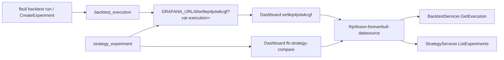

# Grafana analysis — implementation contract

This document is the implementation contract for how users **analyze** backtests and strategies in Grafana. It is not code. Read it before changing the datasource plugin (`grafana/lhjnilsson-foreverbull-datasource`), the provisioned dashboards, `GetExperiment.grafana_path`, or CLI `execution_link` / `GRAFANA_URL`. **Status** at the end records what landed.

Grafana is the visual analysis surface. One execution time series is not enough. Users need readable execution labels, overlay/compare, strategy/experiment variables, authored dashboards, and links that actually open a working panel.

CLI compare of strategy experiments (`fbull strategy experiments`) must keep working **without** Grafana. Grafana is the overlay of the same executions, not a replacement for that table. Live trading UI is out.

**Hard facts this contract must not contradict:**

- Dashboard UID `ee9ep4jxtwkcgf` must keep working. CLI and `GetExperiment` deep-link it as `?var-execution=`. If the dashboard is rewritten, keep this UID. If it ever moves, document a redirect; do not silently break those URLs.
- Query type `GetExecutionMetric` is the mux key (`pkg/main.go`, `src/types.ts`). Do not rename it.
- Grafana OSS in `grafana/Dockerfile` stays `grafana/grafana-oss:11.3.2` unless that Dockerfile already pins a different tag. Do not vendor a new Grafana version here.
- Plugin ID stays `lhjnilsson-foreverbull-datasource`. Unsigned loading is already allowed in the image.
- In-cluster Grafana talks to the broker via `BROKER_URL` (`foreverbull:50055` from Helm). Host links for local Kind are `http://localhost:3000`.

## 1. Problem

Users finish a backtest or a strategy experiment and need to **see** the run. The original path was a single leftover Grafana export of one execution id, plus a printed URL. Three loops were missing or broken:

1. **Inspect one backtest run.** The link is printed, the dashboard UID is stable, but the panel did not bind the variable the URL sets.
2. **Compare two executions.** The plugin could only load one `GetExecutionMetric` series with no overlay labels.
3. **Compare one strategy version across backtests.** Strategy experiments already join many backtests onto one version. Grafana never called `StrategyServicer`. Dropdowns were raw execution UUIDs.

The provisioned dashboard was a UI Save (default panel title, session-local execution UUIDs, frozen 2023 range). Query JSON did not match what Go unmarshals. That export is not the dashboard anymore; see Status.



## 2. Design principles

1. **Compose the broker; do not copy metrics.** Period rows live in `backtest_execution_period`. The plugin reads them through existing RPCs. Do not duplicate Sharpe/drawdown into Grafana storage.
2. **One query type already exists; keep it.** `GetExecutionMetric` loads one execution by id and selected metrics. Overlay is multiple queries (or a multi-value `execution` variable) on the same panel, not a second time-series store.
3. **Labels are for humans; values are UUIDs.** Variable values stay execution ids so `?var-execution=` keeps working. Labels must not be those raw UUIDs.
4. **Strategy is a dimension, not a second product.** Experiments (`strategy_name`, `version_rev`, `backtest_name`, `execution_id`) are how users pick runs to overlay. The datasource must grow a StrategyServicer client for that loop. CLI compare stays the non-Grafana path.
5. **Dashboards are authored, not exported.** Provisioned JSON is source. No Grafana default panel title, no session-local datasource UID, no frozen time range from whoever last clicked Save in the UI.
6. **Health means the broker answers.** `CheckHealth` must dial `BROKER_URL`, not only parse empty plugin settings.

## 3. Intended user loops

### 3.1 Inspect one backtest run

**Who:** someone who just ran `fbull backtest run` (or `fbull backtest executions`) and got a Grafana link.

**Loop:**

1. CLI prints `{GRAFANA_URL}/d/ee9ep4jxtwkcgf?var-execution={id}` (`client/cli/src/foreverbull_cli/output.py` `execution_link`). Default origin is `http://localhost:3000`.
2. Grafana opens dashboard UID `ee9ep4jxtwkcgf` with template variable `execution` set to that id.
3. The panel runs `GetExecutionMetric` for that id and plots the selected metrics over the execution’s own dates.
4. The execution picker shows a readable label (`{backtest} {start}–{end}`, short id if useful) while the value remains the UUID.

**Must keep working:** one variable, one series, metrics present, time range from the run (or browser `now` with the series still visible). A frozen 2023 cursor is not that.

### 3.2 Compare two executions

**Who:** someone who ran the same backtest twice, or two sessions, and wants overlay.

**Loop:**

1. Open `ee9ep4jxtwkcgf` (or the compare dashboard `fb-strategy-compare`). A single-id deep link still lands on `ee9ep4jxtwkcgf`.
2. Pick two (or more) executions. Grafana already supports multiple queries per panel (`refId` A/B) and multi-value variables. Use that. Do not require a new query-type name unless overlay cannot be expressed as repeated `GetExecutionMetric`.
3. Series names are the human labels from §3.1, not `portfolio_value` twice with no way to tell which run is which.
4. Deep link for a single id stays `?var-execution=`. Multi-select may add extra `var-execution` values; a single-id link must still show that one run.

### 3.3 Compare one strategy version across backtests

**Who:** someone who ran `CreateExperiment` for the same version on two backtests (the `spy` vs `eu` case already in strategy tests and `fbull strategy experiments`).

**Loop:**

1. CLI table already lists strategy, rev, backtest, status, execution, Sharpe/drawdown/end value (`research-to-paper.md` §5). That table does **not** move into Grafana.
2. Each row with an `execution_id` still prints `Link: {execution_link}`. `GetExperiment` still returns `grafana_path` when `execution_id` is set (`pkg/strategy/internal/api/experiment.go`).
3. In Grafana, variables cascade: **strategy → version → experiment/backtest → execution**. Values for the last step are still execution UUIDs so `ee9ep4jxtwkcgf?var-execution=` works.
4. Overlay those executions with `GetExecutionMetric` (loop 3.2). The datasource lists experiments through `StrategyServicer.ListExperiments` (`strategy_name`, `version_id`, `backtest_name` filters already exist). `BacktestServicer` alone cannot express “this version on two universes.”

Do not invent a Grafana-only experiment id that is not the broker’s `strategy_experiment.id`. Do not copy `ExperimentStats` into the plugin; those numbers stay on the CLI/API JOIN.

## 4. What already exists (reuse)

| Capability | Where | This work |
| --- | --- | --- |
| Query type `GetExecutionMetric` | `pkg/main.go`, `src/types.ts` `QueryType.GetExecutionMetric`, mux in `pkg/datasource.go` | Keep the name. Read canonical `execution.id` JSON |
| Metrics list | `pkg/datasource.go` `QueryMetric`, `pkg/resources.go` `ListMetrics` | Keep: `portfolio_value`, `alpha`, `beta`, `sharpe`, `sortino`, `capital_used`, `long_count`, `short_count`, `long_value`, `short_value` (plus period fields the editor already lists) |
| Execution periods | `BacktestServicer.GetExecution` → `Periods` | Keep as the only metric source for charts |
| List executions | `BacktestServicer.ListExecutions` (`backtest` / `session_id` optional filters) | Use filters when variables supply them. **Labels** use `Execution.backtest`, `start_date`, `end_date`, not `Id` twice |
| Dashboard UID | `provisioning/dashboards/executions.json` `"uid": "ee9ep4jxtwkcgf"` | Keep. Rewrite the JSON; do not change the uid |
| Template variable name | `templating.list[].name` = `execution`; links use `var-execution` | Keep the name |
| CLI link | `execution_link` reads `GRAFANA_URL` (default `http://localhost:3000`) + `/d/ee9ep4jxtwkcgf?var-execution=` | Keep path, UID, and query key. Override the origin with `GRAFANA_URL`, not the UID |
| Experiment Grafana path | `GrafanaExecutionURL` in `experiment.go` via `environment.GetGrafanaURL()` | Keep. Same UID and `var-execution`. Helm `grafana.url` sets broker `GRAFANA_URL` |
| Strategy experiments | `ListExperiments` / `GetExperiment` / `Experiment.execution_id` / `ExperimentStats` | Grafana lists/filters; CLI keeps the compare table |
| Image | `grafana/Dockerfile` → `lhjnilsson/fb-grafana`, Helm `BROKER_URL=foreverbull:50055`, host port 3000 | Keep. Plugin tests use fakes/bufconn, not this image |

`ListExecutions` already returns `foreverbull.backtest.v1.Execution` (`id`, `backtest`, `session`, `start_date`, `end_date`). Human labels are derived from those. Value stays `execution.Id` so `var-execution` is still a UUID.

## 5. Query types and dashboard UIDs

### 5.1 Query types to keep

| Query type | Role | Keep? |
| --- | --- | --- |
| `GetExecutionMetric` | One execution id + metric names → time series | **Yes.** Mux key, TS enum, dashboard `queryType` |
| anything else | — | Do not add a renamed alias (`executionMetric` appears only as a historical unit-test string and must not become a second type) |

Resource HTTP routes:

- `GET/POST /executions` — variable and query-editor picker
- `GET/POST /metrics` — metric picker
- `GET/POST /strategies` — strategy picker
- `GET/POST /versions` — version picker (filtered by strategy)
- `GET/POST /experiments` — experiment picker; **values are execution UUIDs**

Do not replace `/executions`.

### 5.2 Dashboard UIDs to keep

| UID | File / consumers | Keep? |
| --- | --- | --- |
| `ee9ep4jxtwkcgf` | `provisioning/dashboards/executions.json`; CLI `execution_link`; `GrafanaExecutionURL`; plugin READMEs | **Yes.** Inspect-one-run and every printed `Link:` |
| `fb-strategy-compare` | `provisioning/dashboards/strategy-compare.json` | Overlay two executions. Must not steal `ee9ep4jxtwkcgf` |

A single-execution URL into `ee9ep4jxtwkcgf` remains the compatibility contract.

If `ee9ep4jxtwkcgf` is ever replaced, ship a Grafana dashboard redirect (or a stub dashboard with that UID) and update this document, CLI, and `GrafanaExecutionURL` in the same change. Until then: no new host path, no new UID in those three callers.

Datasource plugin id `lhjnilsson-foreverbull-datasource` stays. Provisioned datasource name and uid are both `foreverbull` (`provisioning/datasources/datasources.yml`). Do not hard-code Grafana’s generated datasource UID from a UI export.

## 6. Query JSON (`execution` / `id`)

Go unmarshals (`pkg/datasource.go` `queryModel`) the canonical body:

```json
{
  "queryType": "GetExecutionMetric",
  "execution": { "id": "<uuid>" },
  "metrics": [{ "name": "portfolio_value" }]
}
```

```go
type Execution struct {
    ID string `json:"id"`
}
```

**Contract:**

- JSON key for the execution object is `execution` (matches Go `json:"execution"` and `types.ts`).
- JSON key for the id inside it is `id` (matches Go `json:"id"`). TypeScript serializes `id`, not `ID`.
- `executionId` as a string is **invalid to write**. QueryEditor, VariableQueryEditor, and dashboard targets must not emit it. Go still accepts it as a legacy read so old panels do not go blank.
- `metrics` is `[{ "name": "..." }, ...]`, not `["portfolio_value"]`. Go still accepts a JSON array of strings as a legacy read.
- `queryType` is `GetExecutionMetric`, not `executionMetric`.
- Dashboard targets include `metrics`. `applyTemplateVariables` interpolates `query.execution.id` so `$execution` from the URL reaches the backend.

Error string `"executionId is missing"` is Go log text, not the JSON key.

The original mismatch (capital `ID`, string `executionId` on the panel and variable editor, missing `metrics`) is what made deep links open an empty chart. Do not reintroduce it.

## 7. Authored dashboards (not a UI export)

`provisioning/dashboards/executions.json` and `strategy-compare.json` are source. Constraints the rewrite had to satisfy, and must keep:

| Constraint | Why |
| --- | --- |
| Real panel titles | Timeseries of portfolio value / drawdown / Sharpe / exposure, not Grafana’s create-panel default |
| Empty variable `current` | Do not pin a session-local execution UUID |
| Variable query lists from the datasource | `source: executions` (and strategy/version on the compare board). Do not pin a UUID in the query |
| Target JSON matches §6 | `execution: { "id": "$execution" }` plus `metrics` |
| Datasource uid `foreverbull` | Matches `datasources.yml`. A generated uid from a UI Save breaks a fresh Grafana |
| Time range `now-30y` / `now` | Period series stay on screen; zoom to the run. Do not freeze an export cursor |
| Field names with underscores | Plugin fields are `portfolio_value`, `max_drawdown`. Overrides that use spaces never match |
| No unused Annotations & Alerts scaffold | Authored JSON, not a Save from the UI |
| Dashboard titles | `Backtest execution` (`ee9ep4jxtwkcgf`) and `Strategy compare` (`fb-strategy-compare`) |

Config editor Path + API Key (`ConfigEditor.tsx`, `datasources.yml` `jsonData.path` / `secureJsonData.apiKey`) is still Grafana create-plugin scaffold. Broker is gRPC `BROKER_URL`, not an HTTP path + API key. `CheckHealth` dials the broker; those form fields do not.

Playwright (`tests/configEditor.spec.ts`) still asserts Path / API Key. That is not a product test. Query-editor Playwright asserts Execution / Metrics. Jest covers query JSON and the variable editor.

`docker-compose.yaml` still defaults `grafana_image: grafana-enterprise`. Plugin-dev leftover. Product image is OSS 11.3.2. Compose is not Kind/`fbenv` and does **not** use a Kind Docker network named `foreverbull`. Kind’s cluster name is `foreverbull`; that is not a Docker network. Compose’s `networks.foreverbull.external: true` only works if you created that network yourself. Product Grafana is Helm `lhjnilsson/fb-grafana` on host port 3000.

## 8. Labels, variables, strategy experiments

### 8.1 Execution labels

`ListExecutions` labels are `{backtest} {start}–{end} {short id}` (`executionLabel` in `pkg/resources.go`). Value stays `execution.Id` so `var-execution` is still a UUID. Chart series use the same label (`DisplayNameFromDS`) so overlay is readable.

### 8.2 Variables to keep / add

| Variable | Name | Values | Required for |
| --- | --- | --- | --- |
| Execution | `execution` | execution UUID | Loop 3.1, deep links. **Keep this name** |
| Strategy | `strategy` | strategy name | Loop 3.3 |
| Version | `version` | version id (label may show rev) | Loop 3.3 |
| Left / right (compare) | `left`, `right` | execution UUID | Loop 3.2 on `fb-strategy-compare` |

Do not rename `execution`. Do not use `executionId` as a Grafana variable name.

`DatasourceVariableSupport.execute` honors `source` (`executions` / `strategies` / `versions` / `experiments`) and interpolates strategy/version/backtest filters so cascade variables mean something.

### 8.3 Strategy experiments

The datasource backend is `BacktestServicer` **and** `StrategyServicer` (`NewDatasource`). Resource routes list strategies, versions, and experiments. Experiment picker **values** are `execution_id` so overlay still uses `GetExecutionMetric`. Unimplemented strategy module (broker without strategy) returns empty lists, not a hard failure.

`GetExperiment` already returns `grafana_path` when `execution_id` is set; `GetExperiment` with no execution leaves `GrafanaPath` unset (`strategy_test.go`). Grafana does not generate that URL. It honors `var-execution` when the user follows it, and lists those same executions by strategy/version when the user starts from Grafana.

Plugin Go module (`grafana/lhjnilsson-foreverbull-datasource/go.mod`) pins `github.com/lhjnilsson/foreverbull` with `replace github.com/lhjnilsson/foreverbull => ../..`. Generated clients live under `pkg/pb/backtest/service` and `pkg/pb/strategy/service`. Do not drop the replace in favor of a frozen module. Do not vendor Grafana itself.

## 9. Deep links

`GRAFANA_URL` is the Grafana origin. Default `http://localhost:3000` (Kind host port: `deploy/README.md`, Helm `grafana.port: 3000`, `expose.hostPort`). Path contract: `/d/ee9ep4jxtwkcgf?var-execution={execution_id}`.

Call sites:

- `client/cli/src/foreverbull_cli/output.py` `execution_link` reads `GRAFANA_URL`
- `pkg/strategy/internal/api/experiment.go` `GrafanaExecutionURL` via `environment.GetGrafanaURL()`
- Helm `grafana.url` → broker env `GRAFANA_URL` for `GetExperiment.grafana_path`
- Plugin READMEs and `AGENTS.md`

That URL is what users click after `fbull backtest run` and `fbull strategy experiments`. It must land on a panel that queries `execution.id = {execution_id}`.

CLI on the laptop still wants localhost for Kind. Remote clusters set `grafana.url` / `GRAFANA_URL` to the public Grafana origin. Do not change the dashboard UID or `var-execution`.

Plugin-dev compose publishes Grafana on **3001** and is not the product URL. Do not point CLI or `GrafanaExecutionURL` at 3001.

## 10. Tests

Plugin Go tests use fakes/bufconn, not a live broker. `datasource_test.go` / `resources_test.go` send the canonical body in §6 (`execution.id`, `GetExecutionMetric`, metrics as `{name}` objects). Jest covers query/variable editors (`npm run test:ci`). Playwright scaffold that expects Path/API Key is not a product test.

Do not add Kind e2e unless a tiny helm template check already exists.

Rebuild: `grafana/lhjnilsson-foreverbull-datasource` `npm run build` + `mage -v`, then from repo root `task grafana:build:docker` (`lhjnilsson/fb-grafana:local`). See `AGENTS.md` and the plugin README.

## 11. Out of scope

- Live trading UI
- Stooq (market data, not Grafana)
- Rewriting the plugin in a new framework
- Grafana Enterprise (compose’s default image is leftover; product is OSS)
- Signing for Grafana.com
- Committing `node_modules` or vendoring a new Grafana version
- Kind e2e in CI
- Replacing CLI experiment compare with Grafana

## 12. Status

Landed. Grafana is the analysis surface for backtests and strategy experiments. CLI compare stays the non-Grafana table.

- **Inspect one run.** Dashboard `ee9ep4jxtwkcgf` (`Backtest execution`) binds `?var-execution=` onto `GetExecutionMetric` with `execution: { "id": "$execution" }` and `metrics`. Panels are Portfolio value, Drawdown, Sharpe, Long / short exposure. Time range is `now-30y`/`now`. Datasource uid is `foreverbull`. Variable current is empty; the picker lists executions from `/executions`.
- **Overlay.** `fb-strategy-compare` overlays left/right `GetExecutionMetric` queries (refId A/B). Series names are `{backtest} {start}–{end} {short id}`, not a bare metric twice. Query editor can also add a second query on `ee9ep4jxtwkcgf`.
- **Strategy dimension.** Datasource dials `StrategyServicer`. Variables cascade strategy → version → executions. Resource routes `/strategies`, `/versions`, `/experiments`. Experiment values are execution UUIDs.
- **Labels and health.** `ListExecutions` labels are human; values stay UUIDs. `CheckHealth` calls `ListBacktests` on `BROKER_URL`.
- **Deep links.** CLI `execution_link` and `GrafanaExecutionURL` build `{GRAFANA_URL}/d/ee9ep4jxtwkcgf?var-execution=`. Default origin `http://localhost:3000`. Helm `grafana.url` sets broker `GRAFANA_URL`. Query editors write `execution.id`, never `executionId`.
- **Rebuild.** Plugin frontend `npm run build`, backend `mage -v`, image `task grafana:build:docker`. Product Grafana is Kind/Helm, not compose. Compose does not join a Kind Docker network named `foreverbull`.

Not in this work: live trading UI, signing for Grafana.com, replacing CLI experiment compare, rewriting ConfigEditor Path/API Key, Grafana Enterprise, Kind e2e.
