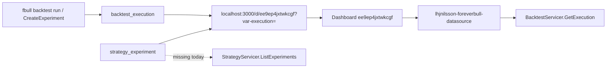

# Grafana analysis — implementation contract

This document is the implementation contract for how users **analyze** backtests and strategies in Grafana. It is not code. Read it before changing the datasource plugin (`grafana/lhjnilsson-foreverbull-datasource`), the provisioned dashboard, `GetExperiment.grafana_path`, or CLI `execution_link` / `GRAFANA_URL`.

Grafana is the visual analysis surface. One execution time series is not enough. Users need readable execution labels, overlay/compare, strategy/experiment variables, dashboards that are not leftover Grafana exports, and links that actually open a working panel.

CLI compare of strategy experiments (`fbull strategy experiments`) must keep working **without** Grafana. Grafana is the overlay of the same executions, not a replacement for that table. Live trading UI is out.

**Hard facts this contract must not contradict:**

- Dashboard UID `ee9ep4jxtwkcgf` must keep working. CLI and `GetExperiment` deep-link it as `?var-execution=`. If the dashboard is rewritten, keep this UID. If it ever moves, document a redirect; do not silently break those URLs.
- Query type `GetExecutionMetric` is the mux key (`pkg/main.go`, `src/types.ts`). Do not rename it.
- Grafana OSS in `grafana/Dockerfile` stays `grafana/grafana-oss:11.3.2` unless that Dockerfile already pins a different tag. Do not vendor a new Grafana version here.
- Plugin ID stays `lhjnilsson-foreverbull-datasource`. Unsigned loading is already allowed in the image.
- In-cluster Grafana talks to the broker via `BROKER_URL` (`foreverbull:50055` from Helm). Host links for local Kind are `http://localhost:3000`.

## 1. Problem

Users finish a backtest or a strategy experiment and need to **see** the run. Today that path is a single provisioned timeseries of one execution id, plus a printed URL. Three loops are missing or broken:

1. **Inspect one backtest run.** The link is printed, the dashboard UID is stable, but the panel does not bind the variable the URL sets.
2. **Compare two executions.** The plugin can only load one `GetExecutionMetric` series with no overlay labels.
3. **Compare one strategy version across backtests.** Strategy experiments already join many backtests onto one version. Grafana never calls `StrategyServicer`. Dropdowns are raw execution UUIDs.

The provisioned dashboard is a leftover Grafana export (`Panel Title`, hardcoded UUIDs, frozen 2023 range). Query JSON does not match what Go unmarshals.



## 2. Design principles

1. **Compose the broker; do not copy metrics.** Period rows live in `backtest_execution_period`. The plugin reads them through existing RPCs. Do not duplicate Sharpe/drawdown into Grafana storage.
2. **One query type already exists; keep it.** `GetExecutionMetric` loads one execution by id and selected metrics. Overlay is multiple queries (or a multi-value `execution` variable) on the same panel, not a second time-series store.
3. **Labels are for humans; values are UUIDs.** Variable values stay execution ids so `?var-execution=` keeps working. Labels must not be those raw UUIDs.
4. **Strategy is a dimension, not a second product.** Experiments (`strategy_name`, `version_rev`, `backtest_name`, `execution_id`) are how users pick runs to overlay. The datasource must grow a StrategyServicer client for that loop. CLI compare stays the non-Grafana path.
5. **Dashboards are authored, not exported.** Provisioned JSON is source. No `Panel Title`, no session-local datasource UID, no frozen time range from whoever last clicked Save in the UI.
6. **Health means the broker answers.** `CheckHealth` must dial `BROKER_URL`, not only parse empty plugin settings.

## 3. Intended user loops

### 3.1 Inspect one backtest run

**Who:** someone who just ran `fbull backtest run` (or `fbull backtest executions`) and got a Grafana link.

**Loop:**

1. CLI prints `{GRAFANA_URL}/d/ee9ep4jxtwkcgf?var-execution={id}` (`client/cli/src/foreverbull_cli/output.py` `execution_link`). Default origin is `http://localhost:3000`.
2. Grafana opens dashboard UID `ee9ep4jxtwkcgf` with template variable `execution` set to that id.
3. The panel runs `GetExecutionMetric` for that id and plots the selected metrics over the execution’s own dates.
4. The execution picker shows a readable label (`{backtest} {start}–{end}`, session if useful) while the value remains the UUID.

**Must work today after the query-JSON fix:** one variable, one series, metrics present, time range from the run (or browser `now` with the series still visible). Frozen `2023-10-30`/`2023-12-25` is not that.

### 3.2 Compare two executions

**Who:** someone who ran the same backtest twice, or two sessions, and wants overlay.

**Loop:**

1. Open `ee9ep4jxtwkcgf` (or a second dashboard that still deep-links this UID for a single id).
2. Pick two (or more) executions. Grafana already supports multiple queries per panel (`refId` A/B) and multi-value variables. Use that. Do not require a new query-type name unless overlay cannot be expressed as repeated `GetExecutionMetric`.
3. Series names are the human labels from §3.1, not `portfolio_value` twice with no way to tell which run is which.
4. Deep link for a single id stays `?var-execution=`. Multi-select may add extra `var-execution` values; a single-id link must still show that one run.

### 3.3 Compare one strategy version across backtests

**Who:** someone who ran `CreateExperiment` for the same version on two backtests (the `spy` vs `eu` case already in strategy tests and `fbull strategy experiments`).

**Loop:**

1. CLI table already lists strategy, rev, backtest, status, execution, Sharpe/drawdown/end value (`research-to-paper.md` §5). That table does **not** move into Grafana.
2. Each row with an `execution_id` still prints `Link: {execution_link}`. `GetExperiment` still returns `grafana_path` when `execution_id` is set (`pkg/strategy/internal/api/experiment.go`).
3. In Grafana, variables cascade: **strategy → version → experiment/backtest → execution**. Values for the last step are still execution UUIDs so `ee9ep4jxtwkcgf?var-execution=` works.
4. Overlay those executions with `GetExecutionMetric` (loop 3.2). The datasource must list experiments through `StrategyServicer.ListExperiments` (`strategy_name`, `version_id`, `backtest_name` filters already exist). `BacktestServicer` alone cannot express “this version on two universes.”

Do not invent a Grafana-only experiment id that is not the broker’s `strategy_experiment.id`. Do not copy `ExperimentStats` into the plugin; those numbers stay on the CLI/API JOIN.

## 4. What already exists (reuse)

| Capability | Where | This work should |
| --- | --- | --- |
| Query type `GetExecutionMetric` | `pkg/main.go`, `src/types.ts` `QueryType.GetExecutionMetric`, mux in `pkg/datasource.go` | Keep the name. Fix the JSON body it reads |
| Metrics list | `pkg/datasource.go` `QueryMetric`, `pkg/resources.go` `ListMetrics` | Keep: `portfolio_value`, `alpha`, `beta`, `sharpe`, `sortino`, `capital_used`, `long_count`, `short_count`, `long_value`, `short_value` |
| Execution periods | `BacktestServicer.GetExecution` → `Periods` | Keep as the only metric source for charts |
| List executions | `BacktestServicer.ListExecutions` (`backtest` / `session_id` optional filters) | Use filters when variables supply them. **Labels** must use `Execution.backtest`, `start_date`, `end_date`, not `Id` twice |
| Dashboard UID | `provisioning/dashboards/executions.json` `"uid": "ee9ep4jxtwkcgf"` | Keep. Rewrite the JSON; do not change the uid |
| Template variable name | `templating.list[].name` = `execution`; links use `var-execution` | Keep the name |
| CLI link | `execution_link` reads `GRAFANA_URL` (default `http://localhost:3000`) + `/d/ee9ep4jxtwkcgf?var-execution=` | Keep path, UID, and query key. Override the origin with `GRAFANA_URL`, not the UID |
| Experiment Grafana path | `GrafanaExecutionURL` in `experiment.go` via `environment.GetGrafanaURL()` | Keep. Same UID and `var-execution`. Helm `grafana.url` sets broker `GRAFANA_URL` |
| Strategy experiments | `ListExperiments` / `GetExperiment` / `Experiment.execution_id` / `ExperimentStats` | Grafana lists/filters; CLI keeps the compare table |
| Image | `grafana/Dockerfile` → `lhjnilsson/fb-grafana`, Helm `BROKER_URL=foreverbull:50055`, host port 3000 | Keep. Plugin tests use fakes/bufconn, not this image |

`ListExecutions` already returns `foreverbull.backtest.v1.Execution` (`id`, `backtest`, `session`, `start_date`, `end_date`). `ListExecutions` in the plugin currently sets `Label: execution.Id` and `Value: execution.Id` (`pkg/resources.go`). That is the label bug, not a missing RPC.

## 5. Query types and dashboard UIDs

### 5.1 Query types to keep

| Query type | Role | Keep? |
| --- | --- | --- |
| `GetExecutionMetric` | One execution id + metric names → time series | **Yes.** Mux key, TS enum, dashboard `queryType` |
| anything else | — | Do not add a renamed alias (`executionMetric` appears only in Go unit-test JSON and must not become a second type) |

Resource HTTP routes to keep:

- `GET/POST /executions` — variable and query-editor picker
- `GET/POST /metrics` — metric picker

New resource routes are allowed for strategy/version/experiment pickers. They must not replace `/executions`.

### 5.2 Dashboard UIDs to keep

| UID | File / consumers | Keep? |
| --- | --- | --- |
| `ee9ep4jxtwkcgf` | `provisioning/dashboards/executions.json`; CLI `execution_link`; `GrafanaExecutionURL`; plugin READMEs | **Yes.** Inspect-one-run and every printed `Link:` |

Additional dashboards (dedicated compare, strategy-version overlay) may get **new** UIDs. They must not steal `ee9ep4jxtwkcgf`. A single-execution URL into `ee9ep4jxtwkcgf` remains the compatibility contract.

If `ee9ep4jxtwkcgf` is ever replaced, ship a Grafana dashboard redirect (or a stub dashboard with that UID) and update this document, CLI, and `GrafanaExecutionURL` in the same change. Until then: no new host path, no new UID in those three callers.

Datasource plugin id `lhjnilsson-foreverbull-datasource` stays. Provisioned datasource name is `foreverbull`. Do not hard-code Grafana’s generated datasource UID (`P7866CEC33224B4CB` in the export) — `datasources.yml` does not set a uid.

## 6. JSON field mismatch (`executionId` vs `execution`)

This is the binding bug. Three writers and one reader disagree.

**Go unmarshals** (`pkg/datasource.go` `queryModel`):

```go
type Execution struct {
    ID string `json:"id"`
}
type queryModel struct {
    ExecutionId *Execution `json:"execution"`
    Metrics     []Metric   `json:"metrics"`
}
```

Canonical body:

```json
{
  "queryType": "GetExecutionMetric",
  "execution": { "id": "<uuid>" },
  "metrics": [{ "name": "portfolio_value" }]
}
```

**What the tree actually writes:**

| Writer | Field it emits | Shape | Go reads it? |
| --- | --- | --- | --- |
| `QueryEditor.tsx` | `execution: { ID: value }` | object, **capital `ID`** | No. Go tag is `id` |
| `types.ts` | `execution?: Execution` with `ID: string` | same | No, once serialized |
| `VariableQueryEditor.tsx` | `executionId: event.label` | **string**, wrong name | No. Go wants `execution` object |
| `executions.json` panel target | `"executionId": "$execution"` | string | No |
| `executions.json` variable query | `"executionId": "84753648-1bba-4a76-8c5f-c0631204633e"` | leftover UUID | No |
| `datasource_test.go` | `"executionId": "%s"` plus `"queryType": "executionMetric"` | string; metrics a JSON array of strings | No. Tests do not match production JSON |

`applyTemplateVariables` in `src/datasource.ts` interpolates `query.execution?.ID`. The provisioned panel never sets `execution`, so `$execution` from the URL never reaches the backend even if Go were fixed.

Error string `"executionId is missing"` is Go log text, not the JSON key. Do not “fix” the dashboard by only renaming the panel title.

**Contract for the query model (later code, not this file):**

- JSON key for the execution object is `execution` (matches Go `json:"execution"` and `types.ts`).
- JSON key for the id inside it is `id` (matches Go `json:"id"`). TypeScript should serialize `id`, not `ID`.
- `executionId` as a string is **invalid**. VariableQueryEditor and `executions.json` must stop writing it.
- `metrics` is `[{ "name": "..." }, ...]`, not `["portfolio_value"]`.
- `queryType` is `GetExecutionMetric`, not `executionMetric`.
- Dashboard target must include `metrics`. Today the panel target has only `executionId` and `queryType`; Go would reject even a correctly named execution with `"metrics is missing"`.

## 7. Leftover Grafana export issues

`provisioning/dashboards/executions.json` is a UI Save, not an authored dashboard.

| Symptom | Where | Why it is wrong |
| --- | --- | --- |
| `"title": "Panel Title"` | panel id 1 | Scaffold/export default. The panel is the execution timeseries; name it that |
| Hardcoded variable current | `a5f5dde9-e45c-462b-9c83-68cbe29b9bd7` | Session-local execution from whoever exported |
| Hardcoded variable query | `84753648-1bba-4a76-8c5f-c0631204633e` | Same. Variable query should list executions from the datasource, not pin a UUID |
| `executionId` on target and variable | §6 | Does not match Go `execution` |
| No `metrics` on the target | panel `targets[0]` | Backend requires metrics |
| Datasource uid `P7866CEC33224B4CB` | panel + templating | Not in `provisioning/datasources/datasources.yml`. Breaks on a fresh Grafana |
| Frozen time range | `"from": "2023-10-30T05:33:35.444Z"` / `"to": "2023-12-25T19:45:02.482Z"` | Export cursor. New runs are invisible |
| `hideSeriesFrom` names `["portfolio value"]` | field override | Plugin field is `portfolio_value` (underscore). Override never matches |
| `"id": 1`, `"version": 6`, `"pluginVersion": "11.3.2"` | dashboard root / panel | Grafana-assigned export metadata |
| Built-in “Annotations & Alerts” | `annotations.list` | Unused scaffold |
| Dashboard title `"Foreverbull"` | root | Acceptable product name; panel title is the defect |
| Config editor Path + API Key | `ConfigEditor.tsx`, `datasources.yml` `jsonData.path` / `secureJsonData.apiKey` | Grafana create-plugin scaffold. Broker is gRPC `BROKER_URL`, not an HTTP path + API key |
| Playwright tests | `tests/queryEditor.spec.ts`, `tests/configEditor.spec.ts` | Still assert “Query Text”, “Constant”, values `10`/`20`, “Path”, “API key is missing” |
| `docker-compose.yaml` | `grafana_image: grafana-enterprise` | Plugin-dev leftover. Product image is OSS 11.3.2. Compose is not Kind/`fbenv` |

`CheckHealth` (`pkg/datasource.go`) loads empty `PluginSettings` and always returns `"Data source is working"`. It never dials the broker. Save & test in the scaffolded Playwright file is therefore meaningless for Foreverbull.

## 8. Labels, variables, strategy experiments

### 8.1 Execution labels

`ListExecutions` labels are raw UUIDs (`Label: execution.Id`). Proto already has `backtest`, `session`, `start_date`, `end_date`. Human label is derived from those. Value stays `execution.Id` so `var-execution` is still a UUID.

### 8.2 Variables to keep / add

| Variable | Name | Values | Required for |
| --- | --- | --- | --- |
| Execution | `execution` | execution UUID | Loop 3.1, deep links. **Keep this name** |
| Strategy | `strategy` (new) | strategy name | Loop 3.3 |
| Version | `version` (new) | version id (label may show rev) | Loop 3.3 |
| Backtest / experiment | new, names TBD | backtest name or experiment id | Loop 3.3 filter; execution list then narrows |

Do not rename `execution`. Do not use `executionId` as a Grafana variable name.

`DatasourceVariableSupport.execute` currently ignores the variable query and always calls `getExecutions()`. Cascade filters (strategy → version → executions) need that query to mean something.

### 8.3 Strategy experiments

The datasource backend is `BacktestServicer` only (`NewDatasource` → `pb.NewBacktestServicerClient`). There is no strategy/experiment dimension:

- No `ListStrategies` / `ListExperiments` resource.
- No query editor field for strategy or version.
- Overlay of one version across backtests is impossible in the UI except by hunting UUIDs.

`GetExperiment` already returns `grafana_path` when `execution_id` is set; `GetExperiment` with no execution leaves `GrafanaPath` unset (`strategy_test.go`). Grafana does not need to generate that URL. It needs to **honor** `var-execution` when the user follows it, and to list those same executions by strategy/version when the user starts from Grafana.

Plugin Go module (`grafana/lhjnilsson-foreverbull-datasource/go.mod`) pins `github.com/lhjnilsson/foreverbull v0.0.0-20250127210530-23a1a972f2a9` with **no** `replace`. Current generated clients live under `pkg/pb/backtest/service` and `pkg/pb/strategy/service`. Any strategy client work must follow the packages in this checkout, not the frozen January module, without vendoring Grafana itself.

## 9. Deep links

`GRAFANA_URL` is the Grafana origin. Default `http://localhost:3000` (Kind host port: `deploy/README.md`, Helm `grafana.port: 3000`, `expose.hostPort`). Path contract: `/d/ee9ep4jxtwkcgf?var-execution={execution_id}`.

Call sites:

- `client/cli/src/foreverbull_cli/output.py` `execution_link` reads `GRAFANA_URL`
- `pkg/strategy/internal/api/experiment.go` `GrafanaExecutionURL` via `environment.GetGrafanaURL()`
- Helm `grafana.url` → broker env `GRAFANA_URL` for `GetExperiment.grafana_path`
- Plugin READMEs

That URL is what users click after `fbull backtest run` and `fbull strategy experiments`. It must land on a panel that queries `execution.id = {execution_id}`.

CLI on the laptop still wants localhost for Kind. Remote clusters set `grafana.url` / `GRAFANA_URL` to the public Grafana origin. Do not change the dashboard UID or `var-execution`.

Plugin-dev compose publishes Grafana on **3001** and is not the product URL. Do not point CLI or `GrafanaExecutionURL` at 3001.

## 10. Tests (later code, not this file)

No application tests run for this document. When the plugin is fixed:

- Go tests with fakes/bufconn, not a live broker. Today `datasource_test.go` / `resources_test.go` construct a `bufconn.Listener` and then mock `BacktestServicerClient` without serving on it; the JSON they send (`executionId`, `executionMetric`, metrics as strings) does not match `queryModel`. Tests must use the canonical body in §6.
- Jest for query/variable editors if `npm test` / `npm run test:ci` works. Playwright scaffold that expects Path/API Key/Query Text is not a product test.
- Do not add Kind e2e unless a tiny helm template check already exists.

## 11. Out of scope

- Live trading UI
- Stooq (market data, not Grafana)
- Rewriting the plugin in a new framework
- Grafana Enterprise (compose’s default image is leftover; product is OSS)
- Signing for Grafana.com
- Committing `node_modules` or vendoring a new Grafana version
- Kind e2e in CI
- Replacing CLI experiment compare with Grafana
