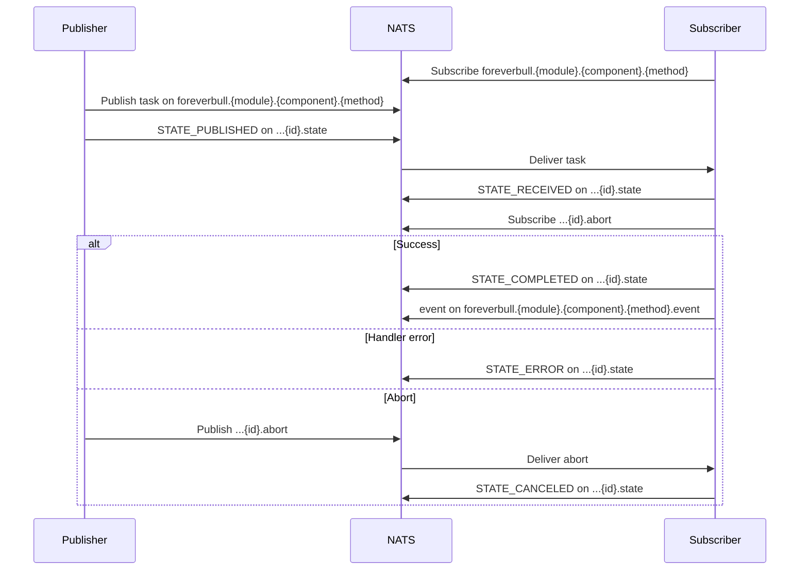

# NATS JetStream tasks

Broker domains publish and subscribe on the `foreverbull` JetStream (`subjects: foreverbull.>`).

Topic templates (`internal/stream/stream.go`):

| Kind | Subject |
| --- | --- |
| Task | `foreverbull.{module}.{component}.{method}` |
| State | `foreverbull.{module}.{component}.{method}.{id}.state` |
| Abort | `foreverbull.{module}.{component}.{method}.{id}.abort` |
| Event | `foreverbull.{module}.{component}.{method}.event` |
| Unrecorded state (core NATS, not on the stream) | `foreverbull-unrecorded.{module}.{component}.{method}.{id}` |
| Unconfirmed outcome (core NATS, waiter only) | `foreverbull-unconfirmed.{module}.{component}.{method}.{id}` |

Example (backtest create): `foreverbull.backtest.backtest.create`, then `foreverbull.backtest.backtest.create.{id}.state`.

States (`proto/foreverbull/internal/stream/message.proto`): `CREATED`, `PUBLISHED`, `RECEIVED`, `COMPLETED`, `ERROR`, `CANCELED`.

`Publish` writes the task payload and `STATE_PUBLISHED`. The subscriber writes `STATE_RECEIVED`, runs the handler, then `STATE_COMPLETED` (and an `.event`) or `STATE_ERROR`. `WaitForCompletion` watches the state subject. On cancel it publishes `.abort`; the subscriber then writes `STATE_CANCELED`.

## A state the stream refuses

`Publish` sends `STATE_PUBLISHED` before the task, so when the `PUBLISHED` publish fails with any error, the task was never sent and nothing runs; `Publish` then sends an `ERROR` for the task over core NATS (below). When the stream refuses the task after `PUBLISHED` was stored, `Publish` does the same, so `message_states` doesn't keep a lone `PUBLISHED`. A full stream returns `ErrStateNotRecorded`, whose text is `usercopy.TaskStateNotRecorded`; so does a refused `.abort`. The NATS error goes to the log only.

When the stream refuses a worker's state, the worker sends that state over core NATS on `foreverbull-unrecorded.…` instead. `WaitForCompletion` and the state listener both subscribe to it (the listener in a queue group, so one broker records each), so the waiter returns and `message_states` records how the task ended. An `ERROR` or `CANCELED` keeps its own cause. Any other state becomes `ERROR` with a plain cause: `ErrStateNotRecorded` for a full stream, or `ErrServicesUnreachable` for any other refusal. A task whose `RECEIVED` was refused doesn't run. If the stream refuses the event, the task fails: with `ErrStateNotRecorded` when it is full, otherwise with `ErrServicesUnreachable`.

Only a definite refusal is reported without reading the subject back: an error the stream answered with (`*nats.APIError`, such as code 10077 for a full stream with `Discard` new) or no stream answering at all (`nats.ErrNoStreamResponse`). A lost ack (`nats.ErrTimeout`), a deadline, or a dropped connection can come back after the server stored the message. After such an error on `RECEIVED` the worker still runs the task and sends nothing, as the waiter doesn't need `RECEIVED`. After one on the event, the command still completes, as nothing in the broker subscribes to events. After one on the task itself, `Publish` returns the error and records nothing, as the task may still run.

Every `*nats.APIError` counts as a refusal only because the stream has a single replica (`Replicas` unset). With replicas, an error such as a leader change can answer a publish the stream still stores.

On a final state (`COMPLETED`, `ERROR`, or `CANCELED`) the worker reads that subject once and does not publish the state again. When the stored message is the one just sent, the worker reports nothing and logs the NATS error, so a stored state is not contradicted. When the read shows it was not stored, the worker reports that state over core NATS on `foreverbull-unrecorded.…`: an `ERROR` or `CANCELED` keeps its cause, and a `COMPLETED` becomes `ERROR` with `ErrTaskFinishedNotSaved`, whose text is `usercopy.TaskFinishedNotSaved`. The waiter ends with that cause, and `message_states` records it. When the read itself fails, including a connection that is already closed, the worker tells only the waiter, on `foreverbull-unconfirmed.…`, with `ErrTaskEndNotConfirmed` (`usercopy.TaskEndNotConfirmed`). The state listener does not subscribe there, so `message_states` gets no error row that could contradict a success the read could not see. The waiter ends with that cause.

If core NATS fails as well, the worker logs both errors. In that case the broker's own connection is down, and the waiter's subscription ends with the connection's error once the client stops reconnecting. A waiter that falls behind on its core NATS subscriptions has new messages dropped by NATS; the broker's connections log that as a slow consumer.

The API names a full queue in its own sentence (`internal/usercopy/stream.go`):
- Backtest create rewrites the failed step's message. It first removes a backtest that this create stored, but never one that existed before the create.
- Session start and strategy experiments return their own sentence.

## Retention

The broker creates the `foreverbull` stream on start, or updates an existing one to the current settings (`StreamConfig` in `stream.go`), so a deployment made by an older broker gets them too. If the server refuses the update, the broker doesn't start and logs the server's reason.

| Setting | Value | Why |
| --- | --- | --- |
| `MaxAge` | 24h | `WaitForCompletion` and the state listener read a task's states from the stream, so they must outlive the longest task. That is a price download or ingest, capped by `FINANCE_TASK_TIME_LIMIT`: 2h by default, at most 6h. 24h is twelve times the default and four times the maximum, and also covers a task queued behind others or a broker down for most of a day. |
| `MaxBytes` | 512 MiB | Half of the chart's 1 GiB NATS volume (`persistence.nats.size`), leaving room for consumer state. Tasks and states are small protobufs. |
| `Discard` | `new` | A full stream refuses the publish and the caller gets the error. The server never drops the oldest messages, which can be a running task's states. When the stream refuses a worker's state, the worker reports it over core NATS instead (above), so the task still ends. |
| `MaxMsgsPerSubject` | unset | `WaitForCompletion` reads a task's whole state history, not just its latest state. |

`message_states` rows follow the stream. A row copies a state message and carries its time, so the broker deletes rows older than `MaxAge` (`StateRetention`): at start, then every hour, oldest first, 10,000 rows per statement and at most a million per prune. A prune that hits that cap logs a warning, and the rest goes in the next prunes. Rows go one by one by their own age, not per task: a task that runs longer than 24h loses its early rows (`PUBLISHED`, `RECEIVED`) while it runs, which is harmless as nothing reads them once a later state is in. A prune that fails stops the broker with exit code 1 and the cause in the log.

The prune scans `message_states_occurred_at_idx`. The broker builds it at start with `CREATE INDEX CONCURRENTLY`, which doesn't block writes, and rebuilds an invalid one left by an interrupted build. Brokers that start together take turns under a Postgres advisory lock, so one never drops another's build in progress. The lock is tried every 100ms rather than waited on, because a session blocked in `pg_advisory_lock` holds a snapshot that `CREATE INDEX CONCURRENTLY` waits for, which deadlocks. A broker that finds the lock held logs a warning with the holder's pid and waits at most 90s, below the 120s `startupProbe`, then fails to start with `another broker holds it`. The index build itself has no deadline. On the first start after the upgrade, a large `message_states` makes that build slow, and the broker starts serving only after it. The chart's broker `startupProbe` allows 120s (60 × 2s); on a table of many millions of rows, build the index before the upgrade with `CREATE INDEX CONCURRENTLY IF NOT EXISTS message_states_occurred_at_idx ON message_states (occurred_at);`. The probe isn't a chart value.

💥 Rolling back to a broker released before these limits fails at start with `nats: stream name already in use`: it creates the stream with `AddStream` and no limits, which the server refuses for a stream that has them. Before such a rollback, remove the limits with `nats stream edit foreverbull --max-age=0 --max-bytes=-1 --discard=old`, or delete the stream when no task is running.

Orchestrations run steps in order. Messages in a step are published in parallel with `WaitForCompletion`.

