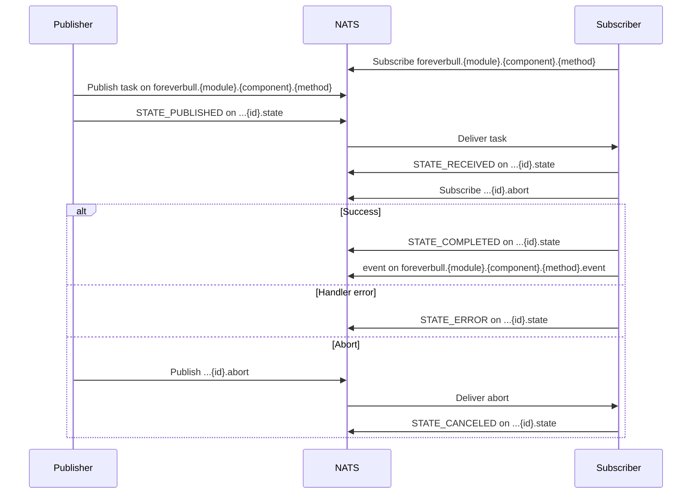

# NATS JetStream tasks

Broker domains publish and subscribe on the `foreverbull` JetStream (`subjects: foreverbull.>`).

Topic templates (`internal/stream/stream.go`):

| Kind | Subject |
| --- | --- |
| Task | `foreverbull.{module}.{component}.{method}` |
| State | `foreverbull.{module}.{component}.{method}.{id}.state` |
| Abort | `foreverbull.{module}.{component}.{method}.{id}.abort` |
| Event | `foreverbull.{module}.{component}.{method}.event` |

Example (backtest create): `foreverbull.backtest.backtest.create`, then `foreverbull.backtest.backtest.create.{id}.state`.

States (`proto/foreverbull/internal/stream/message.proto`): `CREATED`, `PUBLISHED`, `RECEIVED`, `COMPLETED`, `ERROR`, `CANCELED`.

`Publish` writes the task payload and `STATE_PUBLISHED`. The subscriber writes `STATE_RECEIVED`, runs the handler, then `STATE_COMPLETED` (and an `.event`) or `STATE_ERROR`. `WaitForCompletion` watches the state subject. On cancel it publishes `.abort`; the subscriber then writes `STATE_CANCELED`.

Orchestrations run steps in order. Messages in a step are published in parallel with `WaitForCompletion`.

