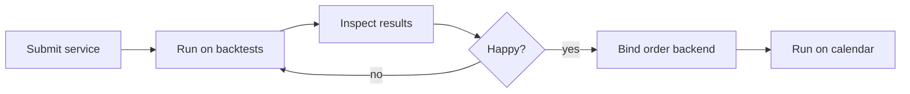
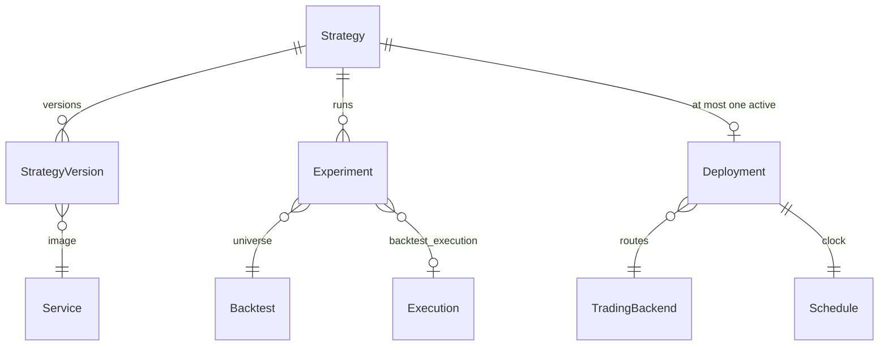
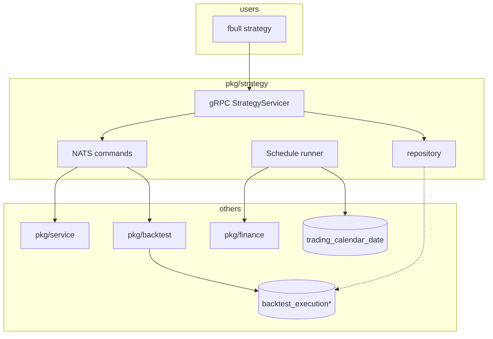
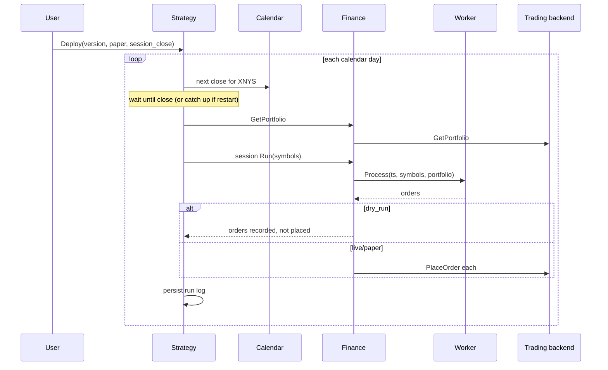

# Strategy domain — design proposal

This document is the implementation contract for `pkg/strategy`. It is not code. The domain is currently quarantined (`strategy.Module` is empty; `RunStrategy` returns `Unimplemented`). The goal is to turn that stub into the **lifecycle** users actually want: submit an algorithm, try it on backtests, inspect results, then promote it onto a paper or live order backend on a schedule.

Read this before changing protos, tables, or CLI under strategy.

## 1. Problem

Today those steps are disconnected:

- **Service** (`pkg/service`) already knows how to start a containerized algorithm (image + interviewed `Algorithm`).
- **Backtest** (`pkg/backtest`) already knows universes, sessions, executions, and Zipline.
- **Finance** (`pkg/finance`) already ingests market data, stores a trading calendar, and talks to a `supplier.Trading` (Alpaca today).
- **CLI** can create a backtest and run a local algorithm file against it. There is no first-class object that means “this is *my* strategy, here are its experiments, here is what it is allowed to trade live.”

The old `RunStrategy` RPC was a one-shot live loop (symbols + dates + algorithm → stream of statuses). That is the wrong grain. Users do not “run strategy” once. They **register**, **experiment**, **promote**, and **schedule**.



## 2. Design principles

1. **Strategy orchestrates; it does not reimplement.** No second Zipline, no second Alpaca client, no second worker pool. Strategy calls Backtest, Service, and Finance through their existing APIs / NATS commands / `supplier` interfaces.
2. **Promotion is explicit.** A backtest going well must never start live orders. Paper and live require a user action plus a backend that is actually configured.
3. **Same algorithm binary in every mode.** The worker (`Algorithm` + NNG `Process(timestamp, symbols, portfolio) → orders`) is identical for backtest, paper, and live. Only the *session* around it changes (Zipline vs trading supplier vs clock).
4. **Backends are plugins.** Order routing, clocks, and schedulers are interfaces with one production impl each for the PoC. Adding IBKR, a k8s CronJob, or a custom report must not rewrite the core tables.
5. **Durable intent, ephemeral runners.** Postgres stores *what* the user wants (strategy, version, schedule, which execution ids). NATS / in-process loops *do* the work. Restarting the broker must recover schedules from the database, not from RAM.
6. **One cluster, one namespace for PoC.** Multi-tenant auth is out of scope. Identity is “this Foreverbull install.”

## 3. What already exists (reuse)

| Capability | Where | Strategy should |
| --- | --- | --- |
| Algorithm image + interview | `pkg/service` (`service.image` text PK, statuses CREATED → INTERVIEW → READY, plus ERROR) | Reference by image; refuse to run if not READY |
| Worker pool | `pkg/service/worker.Pool` | Not own a pool; Backtest/Finance sessions already create one |
| Universe + periods | `pkg/backtest` Backtest | Reference by name |
| Simulated fill + metrics | `backtest_execution` (`id text DEFAULT uuid_generate_v4()`) / `backtest_execution_period` (PnL, Sharpe, drawdown, …) | Link to those rows; do not duplicate metrics |
| Grafana of an execution | existing datasource | Return execution id so CLI/UI can open the link |
| Market data ingest | Finance `ingest` + Backtest ingest orchestration | Kick existing orchestration if a backtest is not ingested yet |
| Trading calendar | `trading_calendar_date` (PK `(code, date)`) | Drive the schedule; do not invent a second calendar |
| Place orders | `pkg/finance/supplier.Trading` (`GetPortfolio`, `PlaceOrder`, `GetOrders`) | Call through Finance; never import Alpaca from strategy |
| Live-ish session RPC | Finance `SessionServicer` (Configure / Run / PlaceOrders) | This is the *session adapter* for paper/live, not the public strategy API |

The current Finance session already does “one bar”: get portfolio → `Pool.Process(now, symbols, portfolio)` → optionally `PlaceOrder`. Strategy’s job is to **repeat that on a calendar** and to remember *which* algorithm and *which* symbols/backend the user approved.

## 4. Domain model

Strategy owns four concepts. Everything else is a foreign key into another domain.



### 4.1 Strategy

A named product the user cares about (`mean-reversion`, `crossover-sp100`).

| Field | Notes |
| --- | --- |
| `id` | `text PRIMARY KEY DEFAULT uuid_generate_v4()` — same as `session.id` / `backtest_execution.id`, not native `uuid` |
| `name` | Unique in this install |
| `description` | Optional |
| `created_at` | |

A strategy without versions cannot run.

### 4.2 StrategyVersion

Immutable snapshot: “this Docker image / algorithm file, these default parameters.”

| Field | Notes |
| --- | --- |
| `id` | `text PRIMARY KEY DEFAULT uuid_generate_v4()` |
| `strategy_id` | text FK |
| `rev` | Monotonic integer per strategy |
| `service_image` | text FK to `service.image` (`image text PRIMARY KEY`). Later: also support in-process file path for local CLI |
| `parameters` | JSONB of function parameter overrides |
| `created_at` | |

Never mutate a version after an experiment or deployment has referenced it. New knobs → new rev.

### 4.3 Experiment

One attempt to run a version on a backtest.

| Field | Notes |
| --- | --- |
| `id` | `text PRIMARY KEY DEFAULT uuid_generate_v4()` |
| `strategy_id` / `version_id` | text FKs |
| `backtest_name` | Existing backtest (`backtest.name` is `text PRIMARY KEY`) |
| `execution_id` | text; same type as `backtest_execution.id`; filled by `CreateExecution`; Grafana key |
| `status` | `queued`, `running`, `completed`, `failed` (store as `int` like `service.status`) |
| `error` | |
| `created_at` / `completed_at` | |

Strategy does **not** copy Sharpe into its own table. Analysis reads `backtest_execution_period` (and Minio artifacts) *through* the execution id. If we later want saved “notes” or a user rating, add `experiment.notes` / `experiment.rating` — not a parallel metrics schema.

### 4.4 Deployment

The promotion record: this version is allowed to talk to an order backend on a schedule.

| Field | Notes |
| --- | --- |
| `id` | `text PRIMARY KEY DEFAULT uuid_generate_v4()` |
| `strategy_id` / `version_id` | Must point at a version that has ≥1 completed experiment (PoC rule; can be relaxed later) |
| `mode` | `paper` or `live` |
| `backend_id` | Which `Trading` impl / account |
| `calendar_code` | e.g. `XNYS` — already used by ingest |
| `symbols` | Snapshot of what it may trade (copy from a backtest period or explicit list) |
| `schedule` | See below |
| `status` | `stopped`, `running`, `error` |
| `dry_run` | If true, `Process` runs but `PlaceOrder` is skipped (orders stored as would-be) |
| `started_at` / `stopped_at` | |

**Invariant:** `live` requires `dry_run=false` *and* an explicit confirm. Default new deployments to `paper` + `dry_run=true`.

Only one *running* deployment per strategy in the PoC (keeps the runner trivial). History of stopped deployments is kept.

### 4.5 Schedule

Stored on the deployment, not a separate product yet.

PoC shape:

```text
kind: session_close    # fire once per calendar day at that day's close
calendar: XNYS
```

Later extensions (do not implement now, do not block the schema):

- `session_open`
- `interval` (every N minutes while the session is open)
- `cron` (wall clock, for research jobs)
- k8s `CronJob` runner instead of in-process

The **clock** is an interface (see §7). The row only stores *intent*.

### 4.6 Trading backend

Not a Strategy table of API keys. Finance already constructs `supplier.Trading` from env (`TRADING_ENABLED`, `TRADING_PROVIDER`, Alpaca URL/key). Strategy stores a **backend name** (`default`, later `alpaca-paper`, `alpaca-live`).

PoC: a single backend, selected by `mode`:

- `paper` → Alpaca paper base URL (already the default `ALPACA_MARKETS_BASE_URL`)
- `live` → same client with a live URL, only if env allows it

Extension: a `trading_backend` table (name, provider, config JSON / secret ref). Strategy only stores `backend_id`. Keys stay out of strategy rows.

## 5. Runtime architecture



### 5.1 Experiment path (backtest)

1. User: `CreateExperiment(strategy, version, backtest_name)`.
2. Strategy checks version’s service is READY (`service.status` CREATED → INTERVIEW → READY, plus ERROR). Or, for local-file PoC, that the algorithm loads.
3. Use the existing Backtest session path (do not fork a new ingest pipeline). If the backtest is not ingested, fail with a clear error pointing at `fbull backtest create` / ingest — PoC does not silently ingest the world.
4. Persist experiment `queued` → `running`.
5. Store `execution.id` from `CreateExecution` (text uuid). Mark `completed` / `failed` after `RunExecution` + `StoreResult`.
6. `GetExperiment` returns status + execution id + Grafana path if the install has one.

How a backtest execution is created today (do not invent a second path):

1. `BacktestServicer.CreateSession` inserts `session` (`id text DEFAULT uuid_generate_v4()`) and publishes NATS `backtest.session.run`.
2. `command.SessionRun` starts `pkg/backtest/internal/api` gRPC `SessionServicer` on a port (requires an existing ingestion object).
3. Caller hits `CreateExecution` → INSERT `backtest_execution` (`id text DEFAULT uuid_generate_v4()`) + `worker.NewPool`.
4. Python client still starts a **local** worker process using the returned `ExecutionConfiguration` (NNG / mangos). The broker pool is the other end.
5. `RunExecution` runs Zipline `EngineSession.RunBacktest` and streams periods.
6. `StoreResult` writes `backtest_execution_period`.

Finance paper/live session RPCs are different: `SessionServicer` in `proto/foreverbull/finance/service/v1/trading.proto` is Configure / Run / PlaceOrders / StopServer. Do not mix those names with the backtest session. Experiments should go **through the broker** so the execution row is always created. Do not add a second “strategy runs zipline itself” path.

### 5.2 Deployment path (paper / live)



On broker restart: load deployments with `status=running` and continue from the last persisted calendar date (do not double-fire the same session).

**Catch-up policy (PoC):** if the process was down across a close, skip missed sessions and log them (`skipped_missed_close`). Do not replay three days of orders on Monday morning. A later “replay” flag can exist on the runner interface.

### 5.3 Why not put the loop in Finance?

Finance already has `command.SessionRun` on NATS `finance.trading.run` and a gRPC `SessionServicer` (Configure / Run / PlaceOrders). That is the **single bar**. Strategy owns **which** algorithm, **when**, and **whether** placing is allowed. If Finance grew a scheduler, every new product (research batch, rebalance-only, options) would clog trading. Keep Finance a supplier + session; keep Strategy the lifecycle.

## 6. Public API (proposed)

Replace today’s `RunStrategy(symbols, start_date, algorithm)` stream (`proto/foreverbull/strategy/service/v1/strategy_service.proto`, generated to `pkg/pb/strategy/service`). New surface, still gRPC, still under `foreverbull.strategy`.

Suggested RPCs (names can move; the verbs should not):

| RPC | Purpose |
| --- | --- |
| `CreateStrategy` / `Get` / `List` / `Delete` | Registry |
| `CreateVersion` | Pin a READY service image + parameters |
| `CreateExperiment` | Stream status (queued/running/completed) like other orchestrations |
| `GetExperiment` / `ListExperiments` | Includes execution id |
| `Deploy` | Create+start a deployment (`paper` default, `dry_run` default true) |
| `StopDeployment` | Idempotent |
| `ListDeploymentRuns` | Per-session log: timestamp, order count, errors, skipped |

CLI (later, not all in PoC):

```text
fbull strategy create mean-rev
fbull strategy version add mean-rev --image lhjnilsson/my-algo:local
fbull strategy experiment mean-rev --backtest sp100-2018
fbull strategy experiments mean-rev
fbull strategy deploy mean-rev --mode paper --dry-run
fbull strategy status mean-rev
fbull strategy stop mean-rev
```

Python cookiecutter users keep writing `Algorithm` + `Function` as today. They do not import a new strategy SDK for the PoC; they submit a **service image** (or, stretch, a file path understood by Service).

## 7. Extension points (interfaces)

Define these in `pkg/strategy` (or reuse Finance’s where they already exist). One impl each for PoC.

| Interface | PoC impl | Later |
| --- | --- | --- |
| `Trading` | existing `pkg/finance/supplier.Trading` (Alpaca) | IBKR, in-platform paper ledger |
| `Clock` | `CalendarClock` using `trading_calendar_date` + `time.Now` | backtest-replay clock, injected frozen clock in tests |
| `Runner` | in-process goroutine per running deployment, started from `fx` lifecycle | k8s CronJob / NATS delayed messages |
| `ExperimentLauncher` | calls existing `CreateSession` + session `CreateExecution` / `RunExecution` / `StoreResult` (not Finance Configure/Run) | remote job queue |
| `Analyzer` | pass-through: return execution id + period aggregates already in SQL | notebooks, custom score functions, walk-forward |

Do **not** add a plugin ABI or WASM. A Go interface + fx constructor is enough. New backends register in `pkg/finance` (trading) or `pkg/strategy` (clock/runner) the same way Yahoo vs Alpaca market data already switches on env.

### Analyzer

PoC analysis is:

- List experiments with execution ids
- Existing Grafana dashboards
- Optional: `GetExperiment` includes last period’s `sharpe`, `max_drawdown`, `portfolio_value` via a **read** of `backtest_execution_period` (JOIN, not a copy)

A future `Analyzer` can compute “did this beat the benchmark by X” without changing Deploy.

## 8. Persistence (strategy schema)

New tables, created from `pkg/strategy/internal/repository` like other domains (`CreateTables` on fx start). Do not alter `backtest_execution` except perhaps a nullable `strategy_experiment_id` later if we want a reverse index. Prefer strategy holding the FK to execution, not the other way around (Backtest stays unaware of Strategy).

Sketch (Postgres, same style as existing repos: `text` PKs with `DEFAULT uuid_generate_v4()`, `CREATE EXTENSION "uuid-ossp"`, `status int` like `service`, status history optional). Do not use native `uuid` columns.

- `strategy(id text PK DEFAULT uuid_generate_v4(), name unique, description, created_at)`
- `strategy_version(id text PK DEFAULT uuid_generate_v4(), strategy_id text, rev, service_image text REFERENCES service(image), parameters jsonb, created_at, unique(strategy_id, rev))`
- `strategy_experiment(id text PK DEFAULT uuid_generate_v4(), strategy_id text, version_id text, backtest_name text, execution_id text REFERENCES backtest_execution(id), status int, error, created_at, completed_at)`
- `strategy_deployment(id text PK DEFAULT uuid_generate_v4(), strategy_id text, version_id text, mode, backend, calendar_code, symbols text[], schedule_kind, dry_run, status int, last_session_date, error, …)`
- `strategy_deployment_run(id text PK DEFAULT uuid_generate_v4(), deployment_id text, session_date, started_at, orders jsonb, skipped, error)`

Use the same `notify_*` / status-history pattern as `service` **only if** CLI needs live tail. PoC can poll `Get` / stream NATS orchestration status for experiments.

## 9. Failure and safety

| Case | PoC behavior |
| --- | --- |
| Service not READY | Reject CreateVersion / Experiment |
| Backtest missing / not ingested | Reject Experiment with a pointed error |
| Trading disabled / no keys | Allow Experiment; reject `Deploy` unless `dry_run=true` and mode=paper with an explicit “log only” backend |
| `PlaceOrder` fails mid-batch | Stop the session, record error, leave remaining orders unsent; do not retry automatically |
| Duplicate schedule tick | `last_session_date` unique per deployment; second tick no-ops |
| Live mode | Require confirm flag on RPC/CLI; refuse if `TRADING_ENABLED` is false |
| Broker crash mid-session | Next start sees `last_session_date` unset for that day → skip or mark error; never silently re-place |

Paper vs live is a **mode on the deployment**, not a different algorithm. The same version id is what you promoted.

## 10. What this domain is not

- Not a parameter optimizer or walk-forward engine (can be an Analyzer later).
- Not a replacement for `fbull backtest run` during early algorithm hacking (local file + session stays).
- Not multi-user RBAC.
- Not a generic workflow engine.
- Not responsible for building/pushing the user’s Docker image (docs + cookiecutter).

## 11. Mapping to current files

| Path | Fate |
| --- | --- |
| `pkg/strategy/module.go` | Register gRPC + NATS + table create + runner lifecycle again |
| `pkg/strategy/internal/api/strategy.go` | Replace unimplemented `RunStrategy` with the RPCs in §6 (or a new proto service; do not keep the old request shape) |
| `proto/foreverbull/strategy/` | Today: `service/v1/strategy_service.proto`. New messages; deprecate `RunStrategyRequest`. Generate with `task proto` (`buf generate proto --exclude-path proto/buf` + client). Do not hand-edit `pkg/pb` or `client/src/foreverbull/pb` |
| `pkg/strategy/internal/repository/` | New (does not exist today) |
| `pkg/strategy/internal/stream/` | New: experiment orchestration commands |
| `pkg/strategy/internal/runner/` | New: Clock + in-process loop |
| CLI `fbull strategy` | New group; do not revive `fbull env` Docker paths |

Keep `pkg/strategy` from importing Alpaca, Docker, or Zipline clients. Allowed imports: `internal/stream`, `internal/postgres`, `pkg/pb`, **interfaces** owned by finance/service/backtest (or narrow facades). If a facade does not exist, add it in the *other* domain rather than reaching into `internal/` packages — except where this repo already does so; do not start a purity crusade in the PoC.

## 12. First PoC — deliberately small

Ship a loop a user can feel, not the full registry UI.

**In:**

1. Tables + gRPC for Strategy, Version, Experiment, Deployment.
2. `CreateExperiment` that launches an existing backtest execution path and stores `execution_id`.
3. `ListExperiments` returning execution ids (Grafana link if present).
4. `Deploy` in `paper` + `dry_run=true` using `CalendarClock` + Finance `GetPortfolio` / `Process` / record orders **without** `PlaceOrder`.
5. Restart-safe `last_session_date`.
6. CLI: create / version / experiment / experiments / deploy --dry-run / stop.
7. Tests: repository against Postgres testcontainers; runner with a fake Clock + fake Trading (no mocked SQL); gRPC bufconn.

**Out of PoC:**

- Live orders
- Multiple backends
- Catch-up replay
- Auto-ingest
- Parameter search
- k8s CronJob runner
- In-process algorithm file without a service image (nice-to-have if Service already allows it; do not block)

**Success metric:** a cookiecutter algorithm, built as the usual service/worker, can be registered, run against an existing backtest, show up as an execution in Grafana, then be “deployed” so that on the next fake calendar tick the worker is called and orders are logged, with zero broker API calls.

## 13. Proposed workflow to implement the PoC

Saved as the Grok workflow `strategy-poc` (`.grok/workflows/strategy-poc.rhai`). Sequential agents, one commit per step, same rules as `k8s-runtime` (`commit` default true, pause on block). Do **not** parallelize; tables and protos are shared. Launch with `/strategy-poc`.

| Step | Agent | Scope | Tests |
| --- | --- | --- | --- |
| 1. Contract freeze | Confirm this file vs tree (service READY, backtest execution schema, Trading interface, calendar table). Amend *this* markdown only if the tree disagrees. No code. | `pkg/strategy/implementation.md` | none |
| 2. Proto | Replace `RunStrategy*` with Strategy/Version/Experiment/Deployment messages + RPCs in `proto/foreverbull/strategy/` (current file: `service/v1/strategy_service.proto`). Generate with `task proto` (`buf generate proto --exclude-path proto/buf` plus `client:proto:generate`). Do not hand-edit `pkg/pb` or `client/src/foreverbull/pb`. | `proto/foreverbull/strategy/**`, generated pb | `task proto` / compile |
| 3. Repository | `CreateTables` + CRUD for the five tables. Status enums as `int` like `service`. PKs `text DEFAULT uuid_generate_v4()` like `backtest_execution` / `session`. FK `service_image` → `service.image` (text) and `execution_id` → `backtest_execution.id` (text). Tests use `internal/test_helper` Postgres testcontainers. | `pkg/strategy/internal/repository/` | `go test ./pkg/strategy/internal/repository/...` (Postgres testcontainers, same helper as other repos) |
| 4. Experiment launcher | NATS command + API `CreateExperiment` that calls **existing** backtest run/session entrypoints. Map completion → experiment row. No new Zipline code. | `pkg/strategy/internal/stream/`, `internal/api` | bufconn + mocked stream; one integration test only if backtest helpers already exist |
| 5. Runner | `Clock` + in-process loop + `Deploy`/`Stop`. `dry_run=true` only. Fake Trading in unit tests. Wire `fx` in `module.go` (gRPC register, table create, runner start/stop). | `pkg/strategy/internal/runner/`, `module.go` | `go test ./pkg/strategy/...` without `integration` tag |
| 6. CLI | `fbull strategy` subcommands listed in §12. Broker address from existing cluster config. | `client/cli/.../bull/` | `cd client && uv run pytest cli/tests -q` for new tests with patched broker |
| 7. Docs | Short section in root README + `AGENTS.md`: strategy is lifecycle, live is off, how to run an experiment. Do not write a CHANGELOG. | `README.md`, `AGENTS.md`, this file’s “Status” | none |

Optional later workflow (not PoC): `strategy-live` (confirm flags, real `PlaceOrder`, missed-session policy) and `strategy-runner-k8s` (CronJob). Do not fold them into the first run.

### Workflow args (when authored)

- `commit` (default true)
- `stop_on_block` (default true)
- Do not add live-trading as an arg. Live is a different workflow.

### Agent policy to copy into that workflow

- Do not mock Postgres for repository tests; do not use SQLite.
- Do not import Alpaca from `pkg/strategy`.
- Do not enable `TRADING_ENABLED` in tests.
- Do not implement live `PlaceOrder` in the PoC runner.
- Do not convert testcontainers to Kind.
- Stay on the current branch; no push.

## 14. Status

PoC implemented through CLI. Registry, experiments on any number of backtests, and paper dry-run are in. Live is still a later workflow. User API: `fbull strategy` (create, version add, experiment `--backtest`, experiments, deploy `--dry-run`, stop, status). Same version, different universes via separate experiments. `deploy` is paper + dry-run only; `PlaceOrder` is not called.
