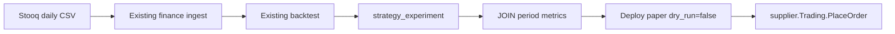

# Research-to-paper — implementation contract

This document is the implementation contract for closing the loop after `strategy-poc` and `etf-universe`. It is not code. The three chapters are one pipeline: **daily prices that survive delisting**, **compare a version across backtests**, **paper `PlaceOrder`**. Live trading is out.

Read this before changing market-data providers, experiment RPCs, `Deploy`, or the in-process runner. Compose what is already in the tree. Do not reimplement strategy lifecycle or ETF ISIN membership.

**Hard facts this contract must not contradict:**

- **Yahoo is kept.** It remains the metadata implementation (`GetAsset` / `SearchAsset` / `GetIndex`). An omitted backtest `provider` stores `yahoo`; pass `stooq` explicitly for Stooq bars.
- **Stooq is GetOHLC-only.** It must not scrape search or index membership. It must not replace Yahoo.
- **Live is out.** No live Alpaca URL, no `mode=live` orders, no k8s CronJob, no catch-up replay of missed sessions.

## 1. Problem

Three gaps sit between “I registered a strategy” and “it sent a paper order”:

1. **Prices.** Ingest calls `supplier.Marketdata.GetOHLC`. Yahoo (`pkg/finance/internal/suppliers/marketdata/yahoo.go`) is flaky for names that left an index or delisted. Stooq publishes daily CSV that still has those series. It is opt-in via `provider: stooq`; Yahoo is the default when `provider` is omitted. Users need Stooq **bars**, not a second Yahoo.
2. **Compare.** `ListExperiments` already returns many experiments for one version (one row per `backtest_name`). It does not surface Sharpe, drawdown, or ending value. Users have to open Grafana per `execution_id`.
3. **Paper.** `Deploy` and `runner.InProcess` are paper **dry-run only**. `dry_run=false` is rejected. `PlaceOrder` is never called. Promoting a version onto Alpaca paper still requires a later workflow if we do not open that path here.



## 2. Design principles

1. **Compose, do not fork.** Strategy-poc already has registry, experiments, paper dry-run, CLI. ETF-universe already has ISIN membership. This work adds a market-data impl, a read-only JOIN, and a `PlaceOrder` branch.
2. **Yahoo is kept.** Metadata stays on Yahoo. An omitted backtest `provider` stores `yahoo`; set `stooq` or `alpaca` when needed. Deleting or bypassing Yahoo metadata is out of scope. `MARKET_DATA_PROVIDER` is not read.
3. **Stooq is GetOHLC-only.** Metadata (`GetAsset`, `SearchAsset`, `GetIndex`) stays on Yahoo for every backtest provider, including `alpaca`. A composite `Marketdata` is how `stooq` is wired.
4. **Metrics are a JOIN, not a copy.** Strategy does not duplicate `backtest_execution_period`. Analysis reads through `strategy_experiment.execution_id`.
5. **Paper is not live.** `mode=paper` + `dry_run=false` + explicit confirm + a trading profile name (`--backend`) + `TRADING_ENABLED=true`. Live mode stays refused. Paper and demo base URLs are adapter constants. There is no live URL switch.
6. **No Alpaca import in `pkg/strategy`.** Orders go through `pkg/finance/supplier.Trading`.

## 3. What already exists (reuse)

| Capability | Where | This work should |
| --- | --- | --- |
| `Marketdata` interface | `pkg/finance/supplier/marketdata.go` — `GetAsset`, `SearchAsset`, `GetIndex`, `GetOHLC` | Add a Stooq type that implements **GetOHLC only**; composite delegates the rest |
| Yahoo `GetOHLC` | `yahoo.go`: `GET query2.finance.yahoo.com/v8/finance/chart/{SYMBOL}` with `period1`/`period2` unix, `interval=1d`, symbol uppercased | Keep. Yahoo is the default **daily** bar source when omitted; Stooq remains available, same `[]*pb.OHLC` |
| Yahoo metadata | `GetAsset` (quoteSummary), `SearchAsset`, `GetIndex` (components) | Keep. Composite uses this when provider is `stooq` |
| Alpaca market data | `alpaca.go` — full interface; `SearchAsset`/`GetIndex` already return empty | Unchanged. Not the Stooq composite |
| Provider selection | `Backtest.provider` (`yahoo`, `stooq`, or `alpaca`). Empty at create stores `yahoo` | Not a process-wide env var. Do not reintroduce `MARKET_DATA_PROVIDER` |
| Trading profile | `Deployment.backend` names a profile in `TRADING_PROFILES_FILE` | Credentials stay in that file, mounted from Secret `foreverbull-trading`. `TRADING_PROVIDER` is not read |
| Ingest | `pkg/finance/internal/api/marketdata.go` `downloadSymbol`: `GetAsset` then `GetOHLC(asset.Symbol, start, end)` into `ohlc` | No second ingest pipeline. Composite makes that `GetOHLC` hit Stooq while `GetAsset` stays Yahoo |
| Live Yahoo tests | `yahoo_test.go` skips unless `FOREVERBULL_LIVE_HTTP` is set | Stooq tests use `httptest`/fixtures. Do not add live Stooq to unit tests |
| Strategy lifecycle | `pkg/strategy/implementation.md`, tables, gRPC, CLI | Do not rebuild. Extend List/Get experiments and Deploy/runner |
| Experiments | `CreateExperiment` binds one version to one `backtest_name`; `ListExperiments` filters by strategy / version / backtest; `execution_id` FK to `backtest_execution(id)` | Same version, many backtests already. Add summary via JOIN |
| `GetExperiment.last_period` | Proto field on `GetExperimentResponse` (`foreverbull.backtest.v1.Period`) | **Unused today** (`GetExperiment` only fills experiment + grafana path). Populate from the last period row |
| Period metrics | `backtest_execution_period`: `portfolio_value`, `max_drawdown`, `sharpe`, `algorithm_period_return`, `benchmark_period_return`, … unique `(backtest_execution, date)` | Read last row by `date DESC`. Do not copy into `strategy_experiment` |
| Grafana | `GetExperiment` grafana path `http://localhost:3000/d/ee9ep4jxtwkcgf?var-execution=` | Keep. Compare CLI must work **without** opening Grafana |
| `Deploy` | `pkg/strategy/internal/api/deploy.go`: rejects `mode=LIVE`; rejects `dry_run=false`; always inserts paper + `dry_run=true` | Open paper + `dry_run=false` under the rules in §6. Live stays rejected |
| `DeployRequest.confirm` | Proto: “Required when mode is LIVE” | Also required when paper `dry_run=false`. Live still refused even with confirm |
| Runner | `runner.InProcess`: calendar `session_close`, `GetPortfolio` + `Process`, **never** `PlaceOrder`; missed closes → `skipped_missed_close` | Call `Trading.PlaceOrder` only when `dry_run=false`. Do not add catch-up replay |
| `supplier.Trading` | `GetPortfolio`, `PlaceOrder`, `GetOrders`. Alpaca impl in `pkg/finance/internal/suppliers/trading`. Constructed only if `TRADING_ENABLED` | Strategy calls the interface. `TRADING_ENABLED` default `false`. Paper URL default `https://paper-api.alpaca.markets` |
| CLI | `fbull strategy experiments` prints id/rev/backtest/status/execution; `deploy` refuses live | Table gains metrics. Paper PlaceOrder requires `--yes`/`--confirm` and `--backend`. Dry-run may omit `--backend`. Live stays refused |
| Fake Trading | `runner.FakeTrading.PlaceOrder` errors if called | Paper tests need a recording fake. Dry-run tests keep asserting zero `PlaceOrder` |

## 4. Chapter 1 — Stooq daily GetOHLC

### 4.1 Client

New type in `pkg/finance/internal/suppliers/marketdata/stooq.go` (name can move; the split must not).

- **Implements GetOHLC** by fetching Stooq **daily** CSV (`https://stooq.com/q/d/l/` style: symbol + daily interval, date range). Parse `Date,Open,High,Low,Close,Volume` into `[]*pb.OHLC`.
- Timestamps are session dates (daily). Volume is uint64 like Yahoo.
- Store/return bars under the **canonical** Foreverbull symbol (`AAPL`), not `aapl.us`.
- Empty body, missing file, HTTP error, or unparsable CSV is a **real error**. Do not return `(nil, nil)` the way Yahoo currently does on request failure.
- Include a fixture that looks like a **delisted** / truncated series (history then no more rows) and still parses.

`GetAsset` / `SearchAsset` / `GetIndex` on this type must **not** scrape Stooq. Leave them unimplemented (return a clear error). The composite in §4.3 is what satisfies `supplier.Marketdata`.

### 4.2 Canonical ticker map

Foreverbull and Yahoo use `AAPL`. Stooq US equities/ETFs use `aapl.us`.

Bidirectional map, at least:

| Canonical | Stooq |
| --- | --- |
| `AAPL` | `aapl.us` |
| `SPY` | `spy.us` |

Rules:

- Lookup is case-insensitive. Canonical form used in Postgres/`ohlc.symbol` stays the Yahoo-style ticker (`AAPL`).
- If the caller already passes a Stooq code (`aapl.us`), map back to canonical for storage and still fetch that code.
- Small built-in US set in Go (table or file next to the client). Configurable extension (extra file / map) is allowed; do not scrape a universe from Stooq.
- Unknown symbol: try a documented fallback (e.g. `lower(symbol)+".us"`) **or** fail with an explicit “no Stooq code for X” — pick one and test it. Do not silently hit Yahoo from the Stooq type.
- This map is **not** ISIN identity (that is etf-universe). It is only a vendor ticker translation for daily bars.

### 4.3 Price source

Search, `GetAsset`, and `GetIndex` stay on Yahoo. `GetOHLC` follows `Backtest.provider`. Create stores `yahoo` when the caller omits it. `MARKET_DATA_PROVIDER` is not read.

| `Backtest.provider` | GetOHLC | GetAsset / SearchAsset / GetIndex |
| --- | --- | --- |
| omitted / `stooq` | Stooq daily CSV | Yahoo (constructor required; fail closed) |
| `yahoo` | Yahoo | Yahoo |
| `alpaca` | Alpaca bars for `profile`, or the only configured Alpaca profile | Yahoo |

`profile` on a `yahoo` or `stooq` backtest is ignored. Zero Alpaca profiles, or more than one with `profile` empty, fails ingest before any download. Unknown providers fail create before download.

For `stooq`:

```text
GetOHLC              → Stooq client
GetAsset             → Yahoo client
SearchAsset          → Yahoo client
GetIndex             → Yahoo client
```

Construct **both**. If the Yahoo constructor fails, **fail closed** with a clear error. Do not serve Stooq OHLC without metadata. Do not silently drop `GetAsset`.

**Default provider is yahoo.** Pass `stooq` or `alpaca` when those bars are needed. The backtest field is the switch.

`ohlc` is unique on `(provider, symbol, time)`. Existing rows stay and default to `yahoo`. Ingest still calls `GetOHLC`; there is no second download path and no rewrite off `symbol`. A run reads only its own provider.

### 4.4 Tests (Stooq)

- `httptest` + CSV fixtures. No live Stooq HTTP in default unit tests.
- Map `AAPL ↔ aapl.us` (and `SPY ↔ spy.us`).
- Delisted-looking series parses.
- Empty/missing CSV is an error.
- Composite unit test with mocks: OHLC goes to Stooq mock, metadata to Yahoo mock.
- `FOREVERBULL_LIVE_HTTP` continues to skip live Yahoo; do not use it to sneak live Stooq into the default suite.

## 5. Chapter 2 — Compare experiments

### 5.1 Current behavior

- One `strategy_version` can have many `strategy_experiment` rows (different `backtest_name`).
- Each completed experiment stores `execution_id` (text, same as `backtest_execution.id`).
- `ListExperiments` returns those rows with no period stats.
- `GetExperiment` proto already has `last_period` but the API does not fill it.
- Metrics live in `backtest_execution_period` (Zipline `StoreResult`). Relevant columns:

  - `portfolio_value` (numeric, not null) — last row is end value
  - `max_drawdown` (numeric, not null)
  - `sharpe` (numeric, nullable)
  - `algorithm_period_return` (numeric, not null)
  - `benchmark_period_return` (numeric, nullable) — include **if present**

### 5.2 Contract

Read-only stats via **JOIN on `execution_id`**. Do not add Sharpe columns to `strategy_experiment`. Do not invent an optimizer.

Per completed experiment, expose at least:

| Field | Source (last `backtest_execution_period` row by `date DESC`) |
| --- | --- |
| last `portfolio_value` | `portfolio_value` |
| `max_drawdown` | `max_drawdown` |
| last `sharpe` | `sharpe` (omit/empty if NULL) |
| last `algorithm_period_return` | if the column is used in the response |
| benchmark | `benchmark_period_return` when the column is non-NULL |

Missing `execution_id` or no period rows → **empty stats, not an error** (queued/running/failed without a result still list).

Same version, many backtests: `ListExperiments(strategy_name, version_id)` already returns them side by side. The summary must appear on that list so the CLI can print one table.

API shape (names can move; the join must not):

- **GetExperiment:** fill existing `last_period` from the last period row (full `Period` is fine). Also acceptable to add a compact summary message if that is cleaner for CLI.
- **ListExperiments:** each row includes the compact summary (do not require N extra RPCs). A dedicated `Compare` RPC is allowed only if it is a thin wrapper over the same JOIN.

Do not copy Grafana. Keep returning `execution_id` and the existing grafana path on Get.

### 5.3 CLI

`fbull strategy experiments` prints a table a human can compare without Grafana:

- strategy, version (rev/id), backtest, status, execution id
- sharpe, max drawdown, end value (`portfolio_value`)
- benchmark when present
- grafana link when `execution_id` is set (can stay as a follow-up line)

Users must compare one version on two backtest names (`--backtest` filter optional, not required for the side-by-side list).

### 5.4 Tests (compare)

- Repository/API tests against **real Postgres** (testcontainers / `internal/test_helper`). Do not mock SQL.
- Insert fake `backtest_execution_period` rows; assert JOIN fields.
- Two experiments, same `version_id`, different `backtest_name`, both summaries present.
- Experiment without `execution_id` → empty stats.

`task proto` if messages change. Do not hand-edit `pkg/pb` or `client/src/foreverbull/pb`.

## 6. Chapter 3 — Paper PlaceOrder

Paper `PlaceOrder` uses `supplier.Trading` ([pkg/finance/trading.md](../finance/trading.md)).

### 6.1 Current behavior (PoC)

- `Deploy` rejects `Deployment_LIVE` with FailedPrecondition.
- Unset `dry_run` defaults true; `dry_run=false` is rejected (“PlaceOrder is disabled”).
- Insert always uses `PAPER` + `dry_run=true`.
- `InProcess.ProcessSession` persists would-be orders and **never** calls `PlaceOrder`.
- `FakeTrading.PlaceOrder` fails if invoked.
- CLI `fbull strategy deploy` refuses live and `--no-dry-run`.
- Finance constructs `supplier.Trading` only when `TRADING_ENABLED` is true; otherwise it is nil. Default is false. Alpaca base URL default is **paper** (`https://paper-api.alpaca.markets`).

### 6.2 Allow paper, not live

`Deploy` may create a **running** deployment when all of the following hold:

| Check | Paper dry-run (default) | Paper PlaceOrder | Live |
| --- | --- | --- | --- |
| `mode` | paper (default) | paper | **refuse** |
| `dry_run` | true (default / unset) | false | n/a |
| `confirm` | not required | **required** (`DeployRequest.confirm` / CLI `--yes` or `--confirm`) | refuse even with confirm |
| `backend` | may be empty | **required** profile name (`--backend`) | refuse |
| `TRADING_ENABLED` | may be false (log-only) | **must be true** and the named profile must exist | refuse |
| completed experiment on the version | required (existing PoC rule) | required | n/a |

Refuse with FailedPrecondition (or CLI red error, no RPC) when:

- `mode=live` (any dry_run / confirm)
- `dry_run=false` and `confirm` is false
- `dry_run=false` and `TRADING_ENABLED` is false or the profile is missing or unknown
- `dry_run=false` and `backend` is empty
- live URL switches — **out of scope**; do not add a live URL switch

Default new deployments stay `paper` + `dry_run=true`.

CLI (illustrative):

```text
fbull strategy deploy mean-rev --mode paper --dry-run
fbull strategy deploy mean-rev --mode paper --no-dry-run --backend alpaca-paper --yes
```

`--mode live` stays rejected. Document `--yes` / `--confirm`; do not document live trading as supported.

### 6.3 Runner

When `deployment.dry_run` is true: today’s behavior (Process, persist `strategy_deployment_run`, no `PlaceOrder`).

When `dry_run` is false (paper only):

1. `GetPortfolio` via `supplier.Trading` (already).
2. `Processor.Process` → orders (same worker grain as Finance session). Production currently passes `processor=nil` in `pkg/strategy/module.go`; paper PlaceOrder is meaningless until a Processor is wired to the existing worker `Process`. Wire that in the paper step — do not add a second pool and do not import Alpaca.
3. For each order, `Trading.PlaceOrder`. Persist the run with the orders that were attempted.
4. If `PlaceOrder` fails mid-batch: **stop the session**, record the error on the run / deployment, leave remaining orders unsent. **No auto-retry.**
5. Duplicate tick (`last_session_date` / unique run) still no-ops.

Missed closes stay `skipped_missed_close` (no Process, no PlaceOrder). Catch-up replay stays out.

`pkg/strategy` must not import `github.com/alpacahq/...`. Tests use `FakeTrading` (or equivalent) that **records** `PlaceOrder` calls.

### 6.4 Tests (paper)

- Fake Trading records `PlaceOrder`; paper `dry_run=false` asserts calls equal to Process orders.
- `dry_run=true` never calls `PlaceOrder` (keep / extend existing runner test).
- API: live still rejected; `dry_run=false` without confirm rejected; `dry_run=false` when trading disabled rejected.
- Do **not** set `TRADING_ENABLED=true` in tests that are not explicitly paper-integration skips. Unit tests inject `supplier.Trading`; they do not need the env flag.
- No live Alpaca account, no live HTTP.

## 7. Failure and safety

| Case | Behavior |
| --- | --- |
| Yahoo constructor fails for a `stooq` backtest | Fail closed; do not ingest OHLC without metadata |
| Stooq CSV empty / 404 | `GetOHLC` error; ingest marks that symbol the way it already does on `GetOHLC` error |
| Unknown `Backtest.provider` | Create fails before download |
| Experiment with no execution / no periods | Empty summary |
| `PlaceOrder` fails | Stop session, record error, no retry |
| Live mode | Always refuse |
| `TRADING_ENABLED=false` + `dry_run=false` | Refuse Deploy |
| Broker crash mid-session | Existing `last_session_date` / skip-missed policy; never silently re-place |

## 8. What this work is not

- **Live trading.** No live Alpaca URL, no `mode=live`, no enabling live from docs.
- **Deleting Yahoo.** Yahoo stays the metadata provider and remains an explicit bar source (`provider: yahoo`).
- **Stooq SearchAsset / GetIndex.** GetOHLC-only.
- **A second ingest pipeline** or rewriting `ohlc` off `symbol`.
- **Commodities / Europe as a new product.** Existing backtest names can be experimented on; this workflow does not add markets.
- **ETF ISIN membership.** Already `pkg/backtest/universe.md`.
- **Optimizers, walk-forward, notebooks.**
- **k8s CronJob runner** and **catch-up replay** of missed sessions.
- **Parameter search.**

## 9. Mapping to current files

| Path | Fate |
| --- | --- |
| `pkg/finance/internal/suppliers/marketdata/stooq.go` | New: CSV GetOHLC + ticker map. Tests/fixtures beside it |
| Composite type next to Stooq | `composite.go`: Stooq OHLC + Yahoo metadata; fail closed if Yahoo ctor fails |
| `pkg/finance/module.go` | Yahoo client for search, `GetAsset`, and `GetIndex`. `GetOHLC` follows `Backtest.provider`. Trading clients come from the profiles registry |
| `internal/environment/env.go` | No `MARKET_DATA_PROVIDER`. `TRADING_ENABLED` and `TRADING_PROFILES_FILE` remain |
| Helm broker | Mounts Secret `foreverbull-trading` and sets `TRADING_PROFILES_FILE`. No trading credential `value:` fields |
| `pkg/strategy/internal/api/experiment.go` + repository | JOIN period stats; fill `last_period` / list summary |
| `proto/foreverbull/strategy/**` | Only if List/Get need a summary message. `task proto` |
| `pkg/strategy/internal/api/deploy.go` | Allow paper `dry_run=false` + confirm + a known profile; refuse live; refuse if trading is disabled or the profile is missing |
| `pkg/strategy/internal/runner/` | `PlaceOrder` when `!dry_run`; keep skip-missed; fake Trading records calls |
| `pkg/strategy/module.go` | Wire Processor for paper; Trading already optional |
| CLI `client/cli/.../bull/strategy.py` | Experiments table; deploy `--yes` / `--no-dry-run` / `--backend` for paper only. Live refused |
| CLI `client/cli/.../bull/backtest.py` | `create` sends `provider` (default `yahoo`) and optional `profile`. `--provider` overrides the file |
| `pkg/strategy/implementation.md` | PoC contract; this file is the follow-on. Do not rewrite PoC history |
| Yahoo / Alpaca marketdata files | Keep |

## 10. Workflow (research-to-paper)

Saved as `.grok/workflows/research-to-paper.rhai`. Sequential. One commit per step.

| Step | Scope | Tests |
| --- | --- | --- |
| 1. This contract | `pkg/strategy/research-to-paper.md` only | none (must say Yahoo is kept, Stooq is GetOHLC-only, live is out) |
| 2. Stooq client | `stooq.go` + tests/fixtures. Do not change finance Module yet | `go test ./pkg/finance/internal/suppliers/marketdata/...` |
| 3. Wire provider | `module.go`, composite, env only if needed | `go test ./pkg/finance/...` ; `go build ./cmd/server/` |
| 4. Compare API | strategy API/repository/proto + generated pb | `task proto` if needed; `go test ./pkg/strategy/...` |
| 5. Compare CLI | `fbull strategy experiments` table | `cd client && uv run pytest cli/tests` (no Kind) |
| 6. Paper PlaceOrder | deploy.go, runner, CLI deploy | `go test ./pkg/strategy/...` ; CLI pytest |
| 7. Docs | Status in this file; `AGENTS.md` env/CLI; README only if a sentence is now false | grep: must not claim live trading is supported |

Agent policy: do not mock Postgres for repository tests; no live HTTP in default unit tests; do not import Alpaca from `pkg/strategy`; do not enable `TRADING_ENABLED` except explicit paper-integration skips; do not hand-edit generated pb.

## 11. Status

All three chapters are in. Live is out.

- **Stooq (ch. 1).** A backtest with `provider=stooq` uses Stooq for daily GetOHLC and Yahoo for metadata (`GetAsset` / `SearchAsset` / `GetIndex`). Default provider is `yahoo`. Yahoo is kept for metadata and as an explicit bar source. Stooq does not scrape search or index membership. `MARKET_DATA_PROVIDER` is not read. Bars are stored per provider.
- **Compare (ch. 2).** `ListExperiments` JOIN-fills `Experiment.stats` from the last `backtest_execution_period` row (`portfolio_value`, `max_drawdown`, `sharpe`, `algorithm_period_return`, `benchmark_period_return`). `GetExperiment` fills `last_period` the same way. Missing `execution_id` or no period rows → empty stats. CLI `fbull strategy experiments` prints Sharpe, max drawdown, end value, and benchmark.
- **Paper (ch. 3).** `Deploy` accepts `mode=paper` + `dry_run=false` when `confirm` is set, `TRADING_ENABLED` is true, and `backend` is a known profile name. CLI: `fbull strategy deploy … --mode paper --no-dry-run --backend alpaca-paper --yes` (or `--confirm`). Dry-run may omit `--backend`. Default deploy stays paper + dry-run. Runner calls `Trading.PlaceOrder` on paper sessions, persists attempted orders, stops on first error without retry. Missed closes stay `skipped_missed_close`. `mode=live` is still refused even with confirm. Credentials stay in the profiles file. Paper PlaceOrder uses `supplier.Trading` ([pkg/finance/trading.md](../finance/trading.md), [pkg/finance/profiles.md](../finance/profiles.md)).
